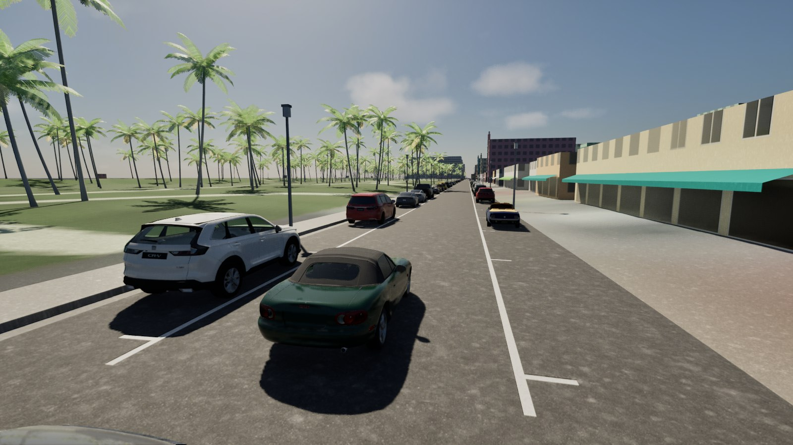
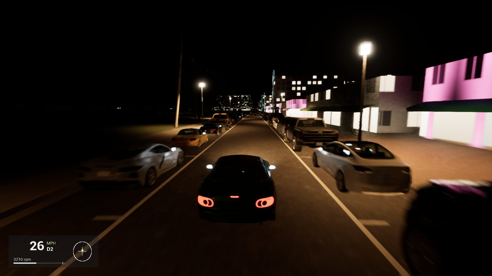
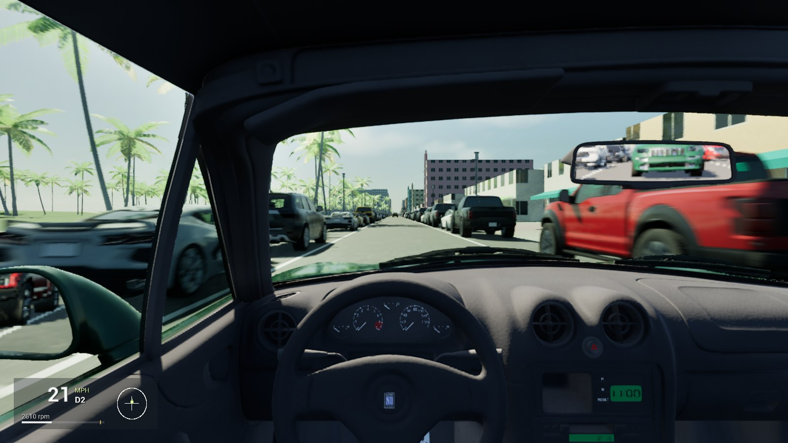
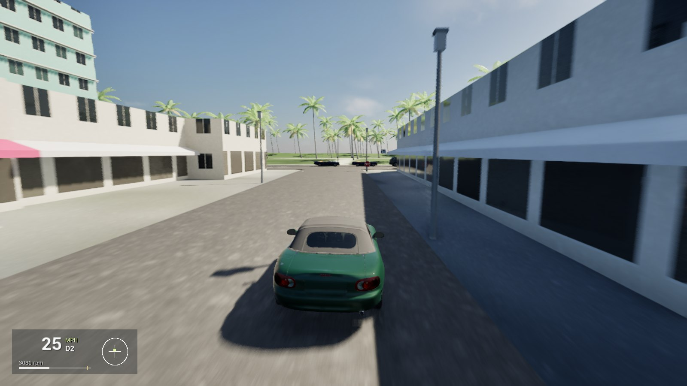
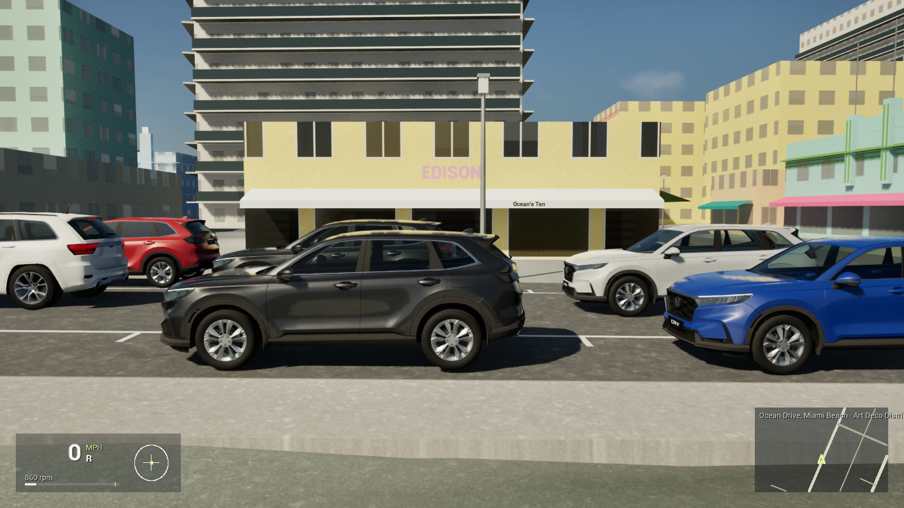
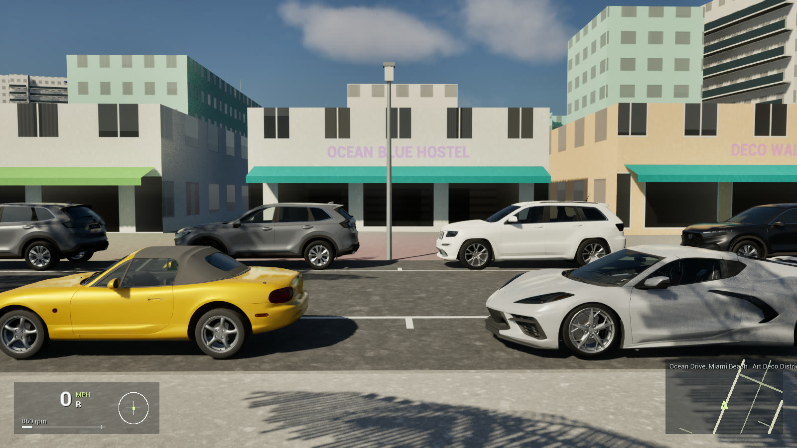

<p align="center">
  
</p>

<p align="center">
  <b>A free, open-source driving simulator for real places.</b><br>
  Type any US address and drive there, on roads built live from public map, elevation and aerial data.
</p>

<p align="center">
  <a href="https://github.com/simcruisegame/simcruise/releases"></a>
  <a href="LICENSE"></a>
  <a href="https://www.unrealengine.com/"></a>
</p>

---

## A message from the creator

> Hey! My buddy and I just had this random idea. We are not pros. Please be cool and if you have good ideas, send pr's. I don't know what this tech means, but yes it could probably be used for more stuff too? I do worry about the API calls to all these public places and I don't fully know the effect to them. I did have Claude aim to lower the calls it makes but I am still doing research on how this scales. Thanks! Please comment any ideas or concerns as well.

## About

SimCruise puts you behind the wheel anywhere in the United States. Roads, terrain, buildings and trees are generated on the fly from open public data (OpenStreetMap, USGS, USDA, NOAA, NASA, Overture and more), and every car is physically modelled and calibrated against published road-test numbers: the 1999 Mazda MX-5 Miata it started with, a 1965 Ford Mustang 289, a Corvette Stingray (C8) and four more.

No account, no API keys, no subscription, no telemetry. The game talks directly to open data services and caches what it fetches on your disk.

> **SimCruise moved to Unreal Engine 5.8 in November 2026.** The Godot client that made the 1.x releases is kept at the git tag [`godot-final`](https://github.com/simcruisegame/simcruise/tree/godot-final) (`git show godot-final:game/<file>`); everything below is about the Unreal client. The Unreal client drives the real car on a streamed Ocean Drive today; search, the atlas, traffic and installers are being ported (see [the migration ledger](docs/unreal-migration-ledger.md)).

## Screenshots

| | |
|---|---|
|  |  |
| *Ocean Drive, Miami Beach, mid-morning* | *Ocean Drive at night* |
|  |  |
| *Driver's seat, with traffic in the mirror* | *A side street: stop sign at Ocean Drive* |
|  |  |
| *Named places sign their own buildings* | *Signs along the row* |

*Captured with `-SimCruiseDriveCapture` (see [docs/unreal-building.md](docs/unreal-building.md#drive-captures)). Map data © OpenStreetMap contributors.*

## Features

- **Real places from public data.** Roads, terrain, buildings, land cover and water come from OpenStreetMap, USGS and Overture through the keyless map helper, streamed in tiles around the car with a floating origin.
- **Cars that drive like the real ones.** The physics runs on Chaos at a fixed 360 Hz with every wheel's contact, tyre slip, suspension, engine, clutch, gearbox and differential from published specifications, held to magazine 0–60 mph, 70–0 mph and skidpad figures by automated benches. The automatic changes gear with the pedal, as a real one does.
- **Roads built like real roads.** Fitted ribbons with crown and curbs, MUTCD markings, parking lanes with parked cars and crosswalks, street lights behind the curbs.
- **Traffic.** Cars drive their lanes at the posted speed, turn at junctions, stop at minor approaches and all-way stops and wait their turn, keep their distance and brake for the car ahead and for you.
- **An engine and a road you hear.** A procedural inline-four voice follows the simulated crank: firing pulses, load, intake, the limiter's stutter and overrun pops; tyre hiss, gravel crunch, scrub and squeal from each tyre's slip, and a little wind, all darker from the driver's seat. Live rear-view and door mirrors show the road behind.
- **The real sun and sky.** Sun and moon where they are at that place and time, physically based sky and exposure in real units, street lights and lit windows at night, low beams with a real cut-off. A drive starts in a morning sun; `-SimCruiseRealTime` follows your clock instead.
- **Keyboard or Xbox controller**, with steering and pedal shaping that never fakes the physics, rumble from tyre slip, cockpit and chase cameras and a true-to-screen lens.
- **Open data, open code.** Every data source is free and keyless, and its licence is recorded in [`licenses/`](licenses/).

## Running it

**Windows:** download the zip from [Releases](https://github.com/simcruisegame/simcruise/releases), extract it and start `SimCruise.exe` (64-bit Windows 10 or 11, DirectX 12). macOS follows when a Mac is available to build on. From source on Windows:

1. Install Unreal Engine 5.8, Visual Studio 2022 Build Tools with the C++ game workload, and [Bun](https://bun.com/) (for the map helper).
2. Clone the repository and build the editor target (PowerShell, editor closed):

   ```powershell
   & 'C:\Program Files\Epic Games\UE_5.8\Engine\Build\BatchFiles\Build.bat' SimCruiseEditor Win64 Development -Project="$PWD\SimCruise.uproject" -WaitMutex
   ```

3. Drive:

   ```powershell
   & 'C:\Program Files\Epic Games\UE_5.8\Engine\Binaries\Win64\UnrealEditor.exe' "$PWD\SimCruise.uproject" -game
   ```

The game builds the bundled Ocean Drive start (no network needed) and puts you in the 2001 roadster in Ocean Drive's lane. To make a standalone Windows build instead (no editor needed to play it), run `powershell -ExecutionPolicy Bypass -File scripts\package.ps1` and start `Saved\Package\Windows\SimCruise.exe`. Options (another car, a fixed time, graphics presets, captures) are in [docs/unreal-building.md](docs/unreal-building.md#drive-it).

| Action | Keyboard | Xbox controller |
|---|---|---|
| Accelerate / brake | W / S | Right / left trigger |
| Steer | A / D | Left stick |
| Camera | C | Y |
| Manual gearbox | T | B |
| Recover to the road | R | View |

Every control is in [docs/controls.md](docs/controls.md).

To build and run the automated tests (vehicle benches, world, traffic, audio, presentation, drive), with the editor closed:

```powershell
powershell -ExecutionPolicy Bypass -File scripts\check.ps1
sh scripts/check-helper.sh   # map helper tests
```

It prints each failure with its first errors and `CHECKS PASSED` or `CHECKS FAILED`, and exits 0 or 1; `-Filter SimCruise.Vehicle` runs a part, `-NoBuild` skips the build.

## Repository layout

| Folder | Contents |
|---|---|
| `Source/SimCruise/` | The Unreal client (C++): vehicle physics, world streaming, car presentation, lighting, driving shell, tests |
| `Config/`, `Content/` | Unreal project settings; car presentation profiles and calibration overlays |
| `data/` | Engine-neutral data the client reads: `cars/` (car physics JSON), `art/traffic/` (glTF car models and their manifest), `art/ground/` (detail photographs), `tiles/` (the bundled offline start and its aerial photographs), `observed/` (helper fixtures) |
| `helper/` | The map helper (Bun): fetches and converts public data into tiles |
| `docs/` | Architecture, building, cars, research, the migration ledger |

## Contributing

Contributions are welcome: code, data sources, bug reports from places that look wrong, and documentation. Please read [CONTRIBUTING.md](CONTRIBUTING.md) first. The short version: no keys or paid services, only freely licensed assets, and every change comes with a measurement.

- Report bugs and request features in [Issues](https://github.com/simcruisegame/simcruise/issues).
- See the [roadmap](docs/roadmap.md) for what is planned.
- Report security problems privately, as described in [SECURITY.md](SECURITY.md).
- Everyone taking part follows the [Code of Conduct](CODE_OF_CONDUCT.md).

## Documentation

| Document | Contents |
|---|---|
| [Technical overview](docs/technical-overview.md) | The Unreal client, the helper, tile streaming, the car model, rendering, privacy |
| [Unreal architecture](docs/unreal-architecture.md) | Every subsystem of the Unreal client in detail, with what it looks like and what is missing |
| [Building with Unreal](docs/unreal-building.md) | Build, run, options, captures, tests |
| [Migration ledger](docs/unreal-migration-ledger.md) | Every Godot file and check, where it went in Unreal, and its status |
| [Data sources and licences](docs/data-sources.md) | Every data layer, its source and licence |
| [Controls](docs/controls.md) | Full control reference, manual gearbox, road atlas |
| [Cars](docs/cars.md) | The garage, how cars are calibrated, adding a car |
| [Roadmap](docs/roadmap.md) | What comes next and why |
| [Changelog](CHANGELOG.md) | Changes by version |
| [Studies](docs/studies.md) | Research notes behind individual features |
| [Taste test](lab/taste/2026-11-10/README.md) | The game rendered at the pose of licensed photographs, with ranked differences for the car and the place |
| [Related projects](docs/related-projects.md) | Similar games and tools |

## License

The game code, shaders, map helper and tests are released under the [MIT License](LICENSE). Map data, imagery, models, textures and fonts keep their own licences, listed in [docs/data-sources.md](docs/data-sources.md), [`licenses/`](licenses/) and [Credits.txt](Credits.txt). Map data © OpenStreetMap contributors.

SimCruise was called *Sunday Driver* up to version 1.0.8; older notes still use that name.

## Credits

Built with [Unreal Engine](https://www.unrealengine.com/) and [Bun](https://bun.com/). The player car's model is "Mazda MX-5 (NB) convertible HQ interior" by [niev](https://sketchfab.com/niev), CC BY 4.0. Data from OpenStreetMap contributors, USGS, USDA, NOAA, NASA, the US Army Corps of Engineers, Overture Maps Foundation, Copernicus, WRI and Meta, and the state, county and city sources named in [Credits.txt](Credits.txt), together with the artists and photographers credited there.
