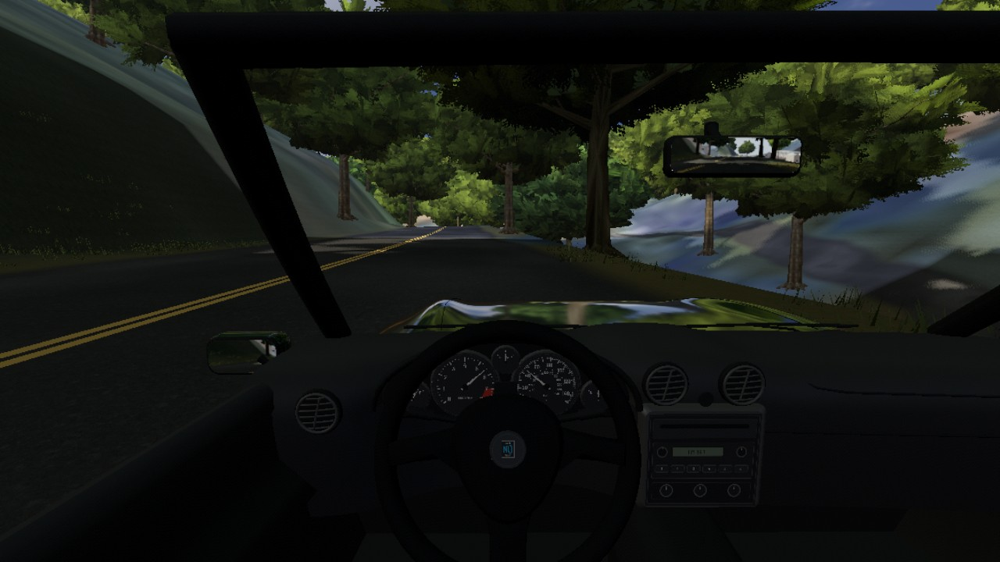
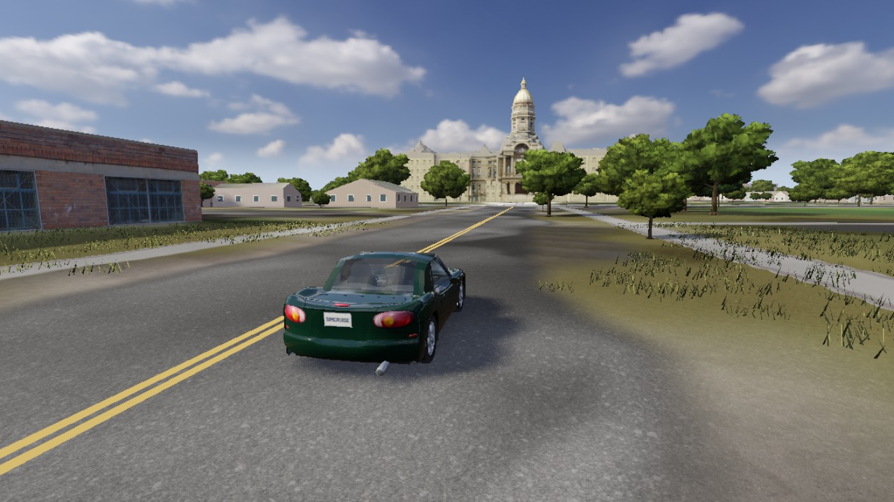
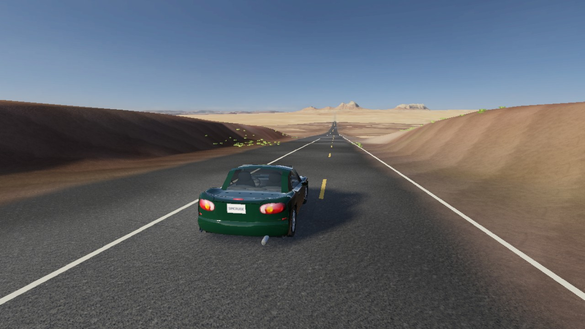
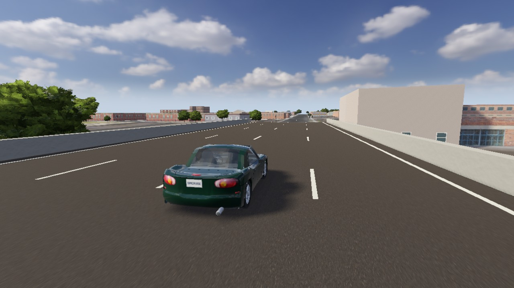
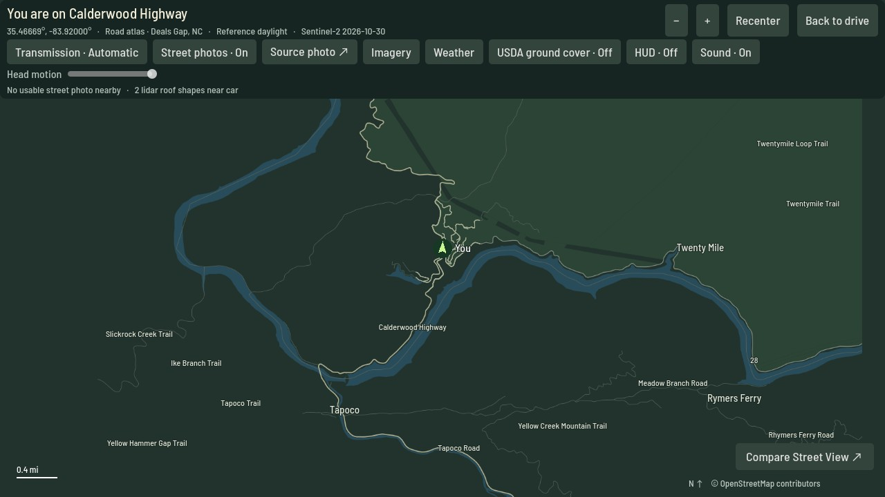

<p align="center">
  
</p>

<p align="center">
  <b>A free, open-source driving simulator for real places.</b><br>
  Type any US address and drive there, on roads built live from public map, elevation and aerial data.
</p>

<p align="center">
  <a href="https://github.com/simcruisegame/simcruise/releases"></a>
  <a href="LICENSE"></a>
  <a href="https://godotengine.org/"></a>
</p>

---

## A message from the creator

> Hey, it's Aaron. My buddy and I just had this random idea. We are not pros. Please be cool and if you have good ideas, send pr's. I don't know what this tech means, but yes it could probably be used for more stuff too? I do worry about the API calls to all these public places and I don't fully know the effect to them. I did have Claude aim to lower the calls it makes but I am still doing research on how this scales. Thanks! Please comment any ideas or concerns as well.

## About

SimCruise puts you behind the wheel anywhere in the United States. Roads, terrain, buildings and trees are generated on the fly from open public data (OpenStreetMap, USGS, USDA, NOAA, NASA, Overture and more), and the car is a physically modelled 1999 Mazda MX-5 Miata calibrated against published road-test numbers.

No account, no API keys, no subscription, no telemetry. The game talks directly to open data services and caches what it fetches on your disk.

<p align="center">
  <a href="docs/how-it-works/index.html"></a>
</p>

## Screenshots

| | |
|---|---|
|  |  |
| *Tail of the Dragon, US 129, Deals Gap NC* | *Capitol Avenue, Cheyenne WY* |
|  |  |
| *US 163 toward Monument Valley, UT* | *The I-180 viaduct, Cheyenne WY* |



*Captured in game with `--screenshots` (see [docs/images/README.md](docs/images/README.md)). Map data © OpenStreetMap contributors.*

## Features

- **Drive anywhere in the US.** Search a place, street or coordinates; the road network streams in around you as you drive.
- **Real-world data.** Lidar-measured roofs and road camber, USGS elevation and aerial imagery, building heights, tree canopy, traffic signals, live weather from the nearest METAR station.
- **A car that drives like the real one.** Suspension, tyres, engine, five-speed gearbox, clutch and limited-slip differential, held to Car and Driver's 0–60 mph, braking and skidpad figures by automated tests.
- **Manual or automatic**, keyboard or Xbox controller, cockpit, chase and scenic cameras, and a full-screen road atlas.
- **Open data, open code.** Every data source is free and keyless, and its licence is recorded in [`licenses/`](licenses/).

## Download

Get the latest release from the [Releases](https://github.com/simcruisegame/simcruise/releases) page:

- **macOS** (Apple Silicon, macOS 13 or newer): `SimCruise-<version>.dmg`, drag to Applications.
- **Windows** (64-bit Windows 10 or 11): `SimCruise-<version>-windows-x64-setup.exe`, or the portable `.zip`.

You need an internet connection for places outside the bundled starter area. The builds are not code-signed, so macOS and Windows warn on first launch; [docs/install.md](docs/install.md) shows how to open them and where the game stores its cache.

## How to play

The game starts on a rural road in Virginia. Press `/` to search for a place and drive there.

| Action | Keyboard | Xbox controller |
|---|---|---|
| Accelerate / brake | W / S | Right / left trigger |
| Steer | A / D | Left stick |
| Camera | C | Y |
| Road atlas | Tab | Menu |
| Find a place | / | — |
| Recover to the road | R | View |

Every control, the manual gearbox and the atlas are described in [docs/controls.md](docs/controls.md).

## Building from source

You need [Godot 4.7.2](https://godotengine.org/download/archive/4.7.2-stable/) and [Bun](https://bun.com/).

```sh
git clone https://github.com/simcruisegame/simcruise.git
cd simcruise
sh scripts/play.sh   # compile the map helper, import the project and play
```

To work on the game, open `game/project.godot` in Godot and press F5. A step-by-step setup from a fresh Mac, and packaging the app and disk image, are in [docs/building.md](docs/building.md).

To run the automated checks (physics calibration, rendering, data parsing):

```sh
sh scripts/check.sh          # headless Godot checks
sh scripts/check-helper.sh   # map helper tests
```

## Contributing

Contributions are welcome: code, data sources, bug reports from places that look wrong, and documentation. Please read [CONTRIBUTING.md](CONTRIBUTING.md) first. The short version: no keys or paid services, only freely licensed assets, and every change comes with a measurement.

- Report bugs and request features in [Issues](https://github.com/simcruisegame/simcruise/issues).
- See the [roadmap](docs/roadmap.md) for what is planned.
- Report security problems privately, as described in [SECURITY.md](SECURITY.md).
- Everyone taking part follows the [Code of Conduct](CODE_OF_CONDUCT.md).

## Documentation

| Document | Contents |
|---|---|
| [Technical overview](docs/technical-overview.md) | Architecture, tile streaming, the car model, rendering, privacy |
| [Data sources and licences](docs/data-sources.md) | Every data layer, its source and licence |
| [Controls](docs/controls.md) | Full control reference, manual gearbox, road atlas |
| [Building](docs/building.md) | Building the app and disk image |
| [Roadmap](docs/roadmap.md) | What comes next and why |
| [Changelog](CHANGELOG.md) | Changes by version |
| [Studies](docs/studies.md) | Research notes behind individual features |
| [Related projects](docs/related-projects.md) | Similar games and tools |

## License

The game code, shaders, map helper and tests are released under the [MIT License](LICENSE). Map data, imagery, models, textures and fonts keep their own licences, listed in [docs/data-sources.md](docs/data-sources.md), [`licenses/`](licenses/) and [Credits.txt](Credits.txt). Map data © OpenStreetMap contributors.

SimCruise was called *Sunday Driver* up to version 1.0.8; older notes still use that name.

## Credits

Built with [Godot Engine](https://godotengine.org/), [Jolt Physics](https://github.com/jrouwe/JoltPhysics) and [Bun](https://bun.com/). Data from OpenStreetMap contributors, USGS, USDA, NOAA, NASA, the US Army Corps of Engineers, Overture Maps Foundation, Copernicus, WRI and Meta, and the state, county and city sources named in [Credits.txt](Credits.txt), together with the artists and photographers credited there.
