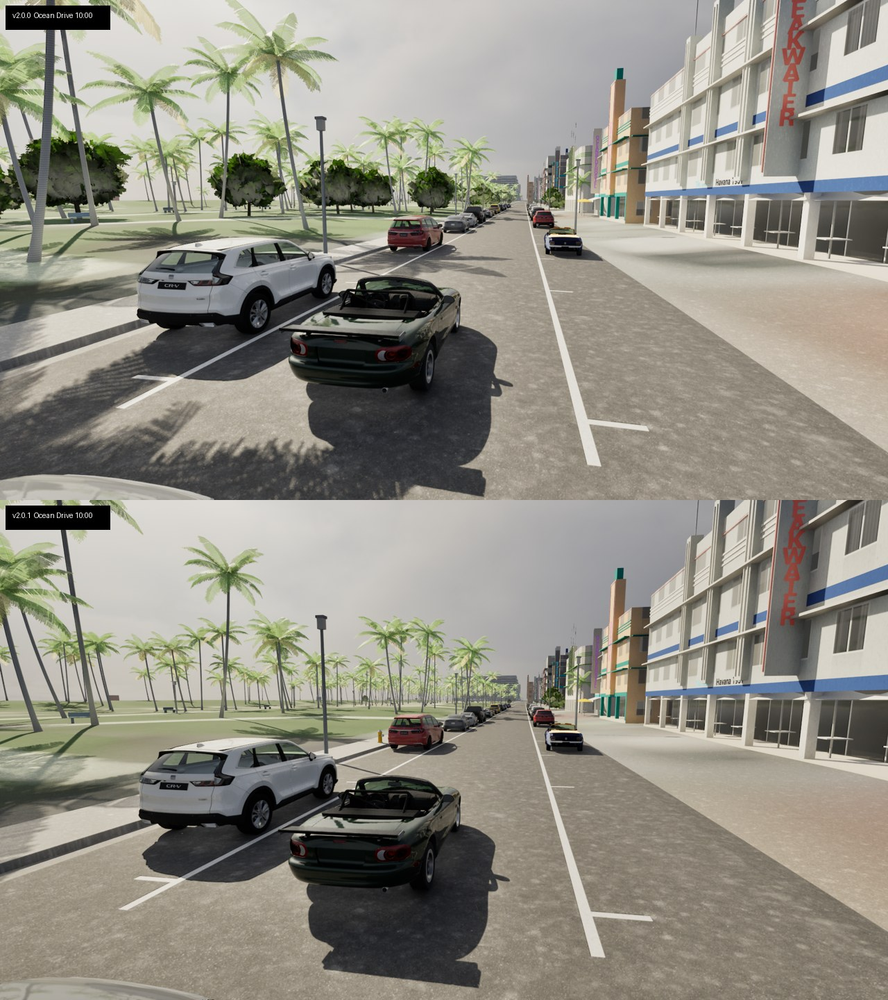
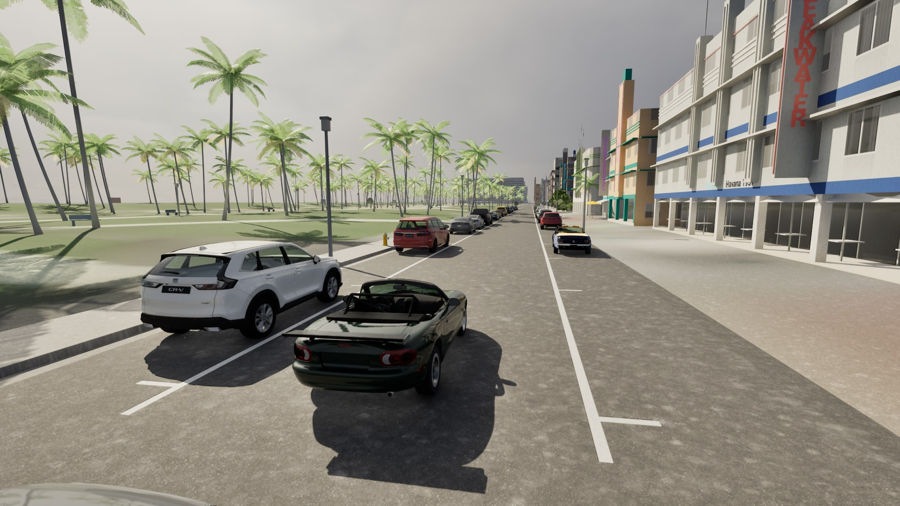
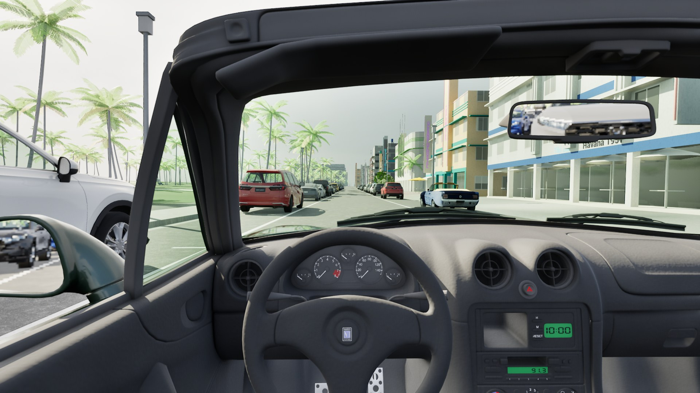
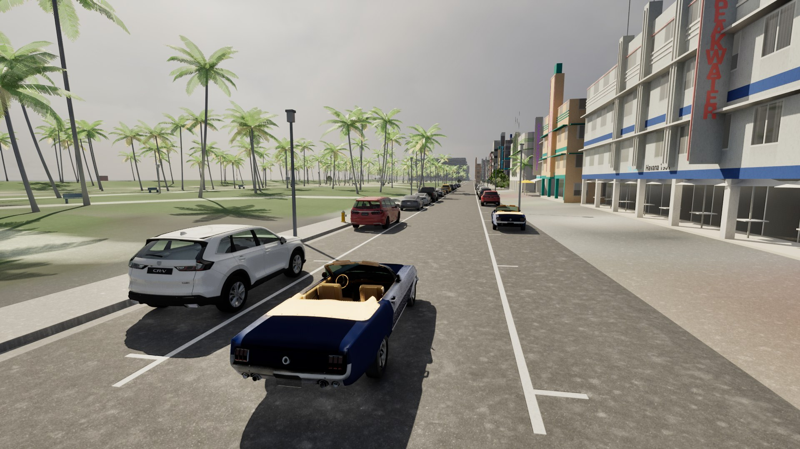
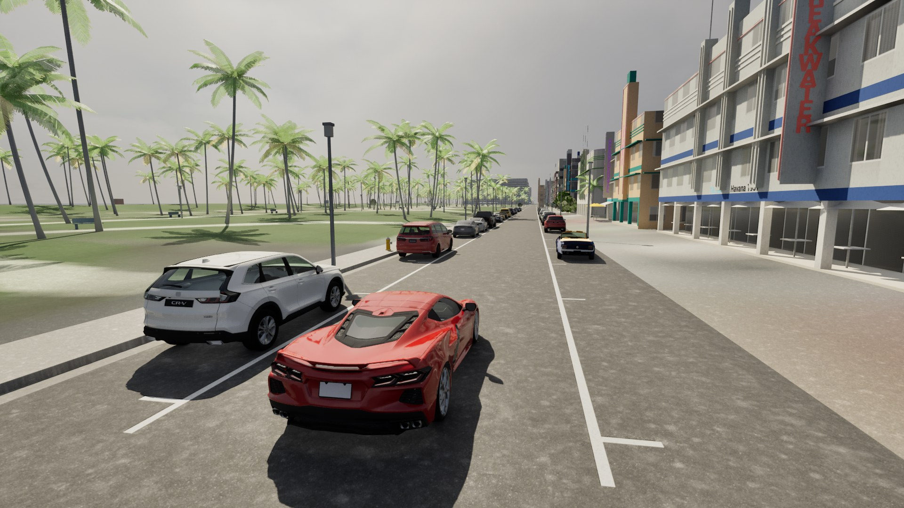
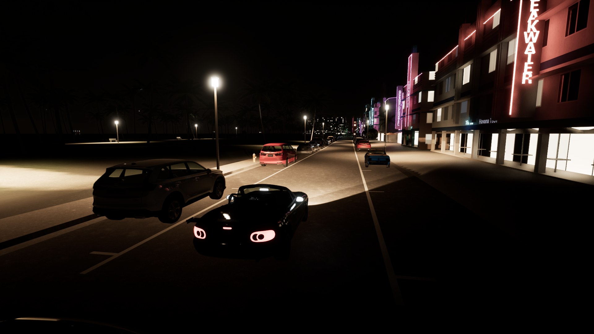
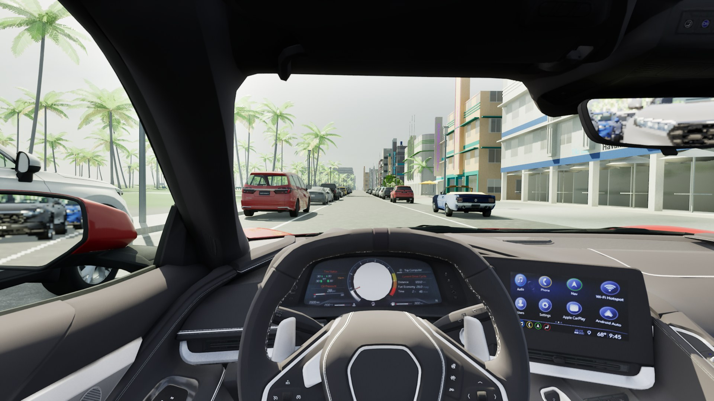
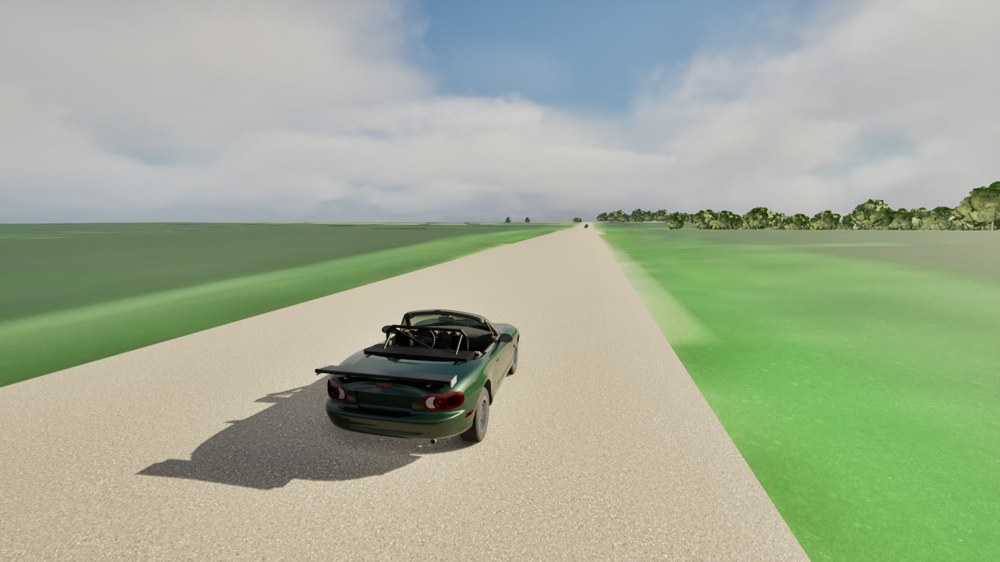
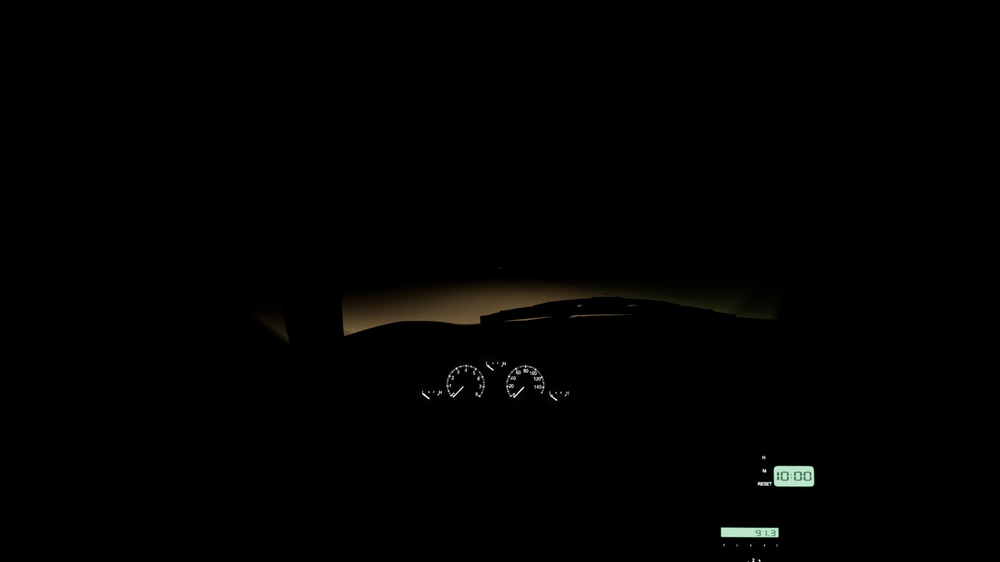
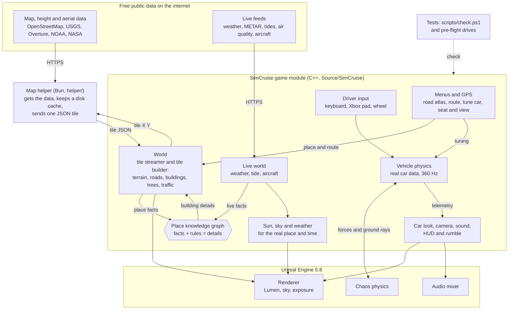

<p align="center">
  
</p>

<p align="center">
  <b>A free, open-source driving simulator for real places.</b><br>
  Type any US address and drive there, on roads built live from public map, elevation and aerial data.
</p>

<p align="center">
  <a href="https://github.com/simcruisegame/simcruise/releases"></a>
  <a href="LICENSE"></a>
  <a href="https://www.unrealengine.com/"></a>
</p>

---

## A message from the creator

> Hey! My buddy and I just had this random idea. We are not pros. Please be cool and if you have good ideas, send pr's. I don't know what this tech means, but yes it could probably be used for more stuff too? I do worry about the API calls to all these public places and I don't fully know the effect to them. I did have Claude aim to lower the calls it makes but I am still doing research on how this scales. Thanks! Please comment any ideas or concerns as well.

## About

SimCruise puts you behind the wheel anywhere in the United States. Roads, terrain, buildings and trees are generated on the fly from open public data (OpenStreetMap, USGS, USDA, NOAA, NASA, Overture and more), and every car is physically modelled and calibrated against published road-test numbers: the 1999 Mazda MX-5 Miata it started with, a 1965 Ford Mustang 289, a Corvette Stingray (C8) and four more.

No account, no API keys, no subscription, no telemetry. The game talks directly to open data services and caches what it fetches on your disk.

> **SimCruise moved to Unreal Engine 5.8 in November 2026.** The Godot client that made the 1.x releases is kept at the git tag [`godot-final`](https://github.com/simcruisegame/simcruise/tree/godot-final) (`git show godot-final:game/<file>`); everything below is about the Unreal client. The Unreal client goes anywhere in the US again: a normal start is a random road from the start pool, `/` searches for a place, and Tab (Menu on the pad) opens the road atlas to drive anywhere on the map. Trees, rangeland scrub, the land to the horizon, guard rails, bridges, gravel roads and traffic signals are built for wherever you are. What is still being ported is in [the migration ledger](docs/unreal-migration-ledger.md).

## Download

**SimCruise 2.0.1 for Windows** (64-bit Windows 10 or 11, DirectX 12): get `SimCruise-2.0.1-windows-x64-setup.exe` from the [latest release](https://github.com/simcruisegame/simcruise/releases/latest), run it, and start SimCruise from the Start menu. A portable zip and SHA-256 checksums are on the same page. Install steps and system requirements: [docs/install.md](docs/install.md). Controls (keyboard, Xbox controller, USB wheel): [docs/controls.md](docs/controls.md).

Tested on a laptop with an RTX 2070 Super Max-Q: 78 fps on Ocean Drive and 112 fps on a rural road from the driver's seat at 1080p on the Medium preset (the default for that GPU), capped at 60 fps in play, and about 50 ms from the stick to the picture. The release gates are in [docs/release/v2.0.1-report.md](docs/release/v2.0.1-report.md) and [v2.0.0-report.md](docs/release/v2.0.0-report.md).

## Screenshots

From the 2.0.1 Shipping build, Ultra preset, 1920x1080 (the gravel road in daylight from 2.0.0).



*2.0.0 (top) and 2.0.1 (bottom) at the same spot and time: a third of a stop darker by day, walls like weathered paint, the park's palms from the land-cover map, street furniture.*

| | |
|---|---|
|  |  |
| *2001 Miata, Ocean Drive* | *The driver's seat (natural lens, the default)* |
|  |  |
| *1965 Mustang 289* | *Corvette Stingray (C8)* |
|  |  |
| *Ocean Drive at night* | *Corvette cockpit* |
|  |  |
| *A gravel road in Nebraska* | *The same road at night* |

*Captured with `-SimCruiseDriveCapture` (see [docs/unreal-building.md](docs/unreal-building.md#drive-captures)). Map data © OpenStreetMap contributors. Earlier screenshots are in [docs/images/unreal/](docs/images/unreal/).*

## Features

- **Real places from public data.** Roads, terrain, buildings, land cover and water come from OpenStreetMap, USGS and Overture through the keyless map helper, streamed in tiles around the car with a floating origin.
- **Cars that drive like the real ones.** The physics runs on Chaos at a fixed 360 Hz with every wheel's contact, tyre slip, suspension, engine, clutch, gearbox and differential from published specifications, held to magazine 0–60 mph, 70–0 mph and skidpad figures by automated benches. The automatic changes gear with the pedal, as a real one does.
- **Roads built like real roads.** Fitted ribbons with crown and curbs, MUTCD markings, parking lanes with parked cars and crosswalks, street lights behind the curbs.
- **Traffic.** Cars drive their lanes at the posted speed, turn at junctions, stop at minor approaches and all-way stops and wait their turn, keep their distance and brake for the car ahead and for you.
- **An engine and a road you hear.** A procedural inline-four voice follows the simulated crank: firing pulses, load, intake, the limiter's stutter and overrun pops; tyre hiss, gravel crunch, scrub and squeal from each tyre's slip, and a little wind, all darker from the driver's seat. Live rear-view and door mirrors show the road behind.
- **The real sun and sky.** Sun and moon where they are at that place and time, physically based sky and exposure in real units, street lights and lit windows at night, low beams with a real cut-off. A drive starts in a morning sun; `-SimCruiseRealTime` follows your clock instead.
- **The real place, now.** While you drive, the game reads free public live feeds for the place you are: the weather (Open-Meteo and the nearest airport's METAR) sets the clouds, haze, mist and wet roads; the air quality (aerosol optical depth) sets the haze in clear air; the sea and the nearest NOAA tide gauge give the tide and waves; and the real aircraft within 25 nautical miles (adsb.lol) fly over you at their real positions, with their real lights at night. `-SimCruiseNoLive` turns it off.
- **A local AI detail engine.** A super-resolution network (Real-ESRGAN) runs on your own computer (CPU by default, or the GPU) through Unreal's Neural Network Engine and adds detail to the aerial photographs the ground is shaded with, once per place, then from a cache.
- **Keyboard, Xbox controller or USB wheel**, with steering and pedal shaping that never fakes the physics, rumble from tyre slip, a clutch on the right thumb and gears on the bumpers, a tuning menu (springs, dampers, ride height, anti-roll bars, gearing, steering ratio) and a seat & view menu, both in the road atlas and usable with the pad, seat, hood, near and far chase cameras with look-around on the right stick, traffic on, light or off, and a natural driver's lens or the true field of view of your screen (F6 or the atlas; screen size and eye distance on the road atlas).
- **Open data, open code.** Every data source is free and keyless, and its licence is recorded in [`licenses/`](licenses/).

## How the game works

SimCruise is a C++ game module on top of Unreal Engine 5.8. Unreal gives the renderer, the Chaos physics solver, the audio mixer and the input system. The SimCruise code makes the world, the cars and the menus. The diagram shows the main parts and how data moves between them.



How one frame of a drive works:

1. The tile streamer finds the map tiles near the car. For each tile that is not loaded, it asks the map helper.
2. The map helper gets the public data (or reads it from the disk cache) and sends back one JSON tile.
3. The tile builder makes the terrain, roads, buildings, trees and road furniture on worker threads. It adds one tile to the world in each frame.
4. The place knowledge graph uses facts about the place (for example "Art Deco", "hotel", "near water", "night", "rain") and its rules to choose the details of each building.
5. The live world reads the live feeds. The weather, the tide and the real aircraft go into the sky, the sea and the knowledge graph.
6. Your input goes to the vehicle physics. The physics runs 360 times each second on the Chaos physics thread. It calculates each tyre, spring, the engine, the gearbox and the differentials from the real car's data.
7. The telemetry from the physics moves the car model, the wheels, the camera, the engine sound, the HUD and the rumble.
8. Unreal renders the picture and mixes the sound.

The automated tests (`scripts/check.ps1`) and the pre-flight drives check the physics against real road-test numbers and check the world before each release. More detail is in [docs/technical-overview.md](docs/technical-overview.md) and [docs/unreal-architecture.md](docs/unreal-architecture.md).

## Running it

**Windows:** install with the setup from [Releases](https://github.com/simcruisegame/simcruise/releases) (see [Download](#download)). macOS follows when a Mac is available to build on. From source on Windows:

1. Install Unreal Engine 5.8, Visual Studio 2022 Build Tools with the C++ game workload, and [Bun](https://bun.com/) (for the map helper).
2. Clone the repository and build the editor target (PowerShell, editor closed):

   ```powershell
   & 'C:\Program Files\Epic Games\UE_5.8\Engine\Build\BatchFiles\Build.bat' SimCruiseEditor Win64 Development -Project="$PWD\SimCruise.uproject" -WaitMutex
   ```

3. Drive:

   ```powershell
   & 'C:\Program Files\Epic Games\UE_5.8\Engine\Binaries\Win64\UnrealEditor.exe' "$PWD\SimCruise.uproject" -game
   ```

The game starts on a random US road from the start pool (it needs the network; offline it falls back to the bundled Ocean Drive streets) and puts you in Aaron's 2001 roadster. Press / to search for a place, or Tab for the pause menu: plan a GPS route, pick a famous road, or open the road atlas. `-SimCruiseBundledStart` always starts on Ocean Drive. To make a standalone Windows build instead (no editor needed to play it), run `powershell -ExecutionPolicy Bypass -File scripts\package.ps1` and start `Saved\Package\Windows\SimCruise.exe`; `scripts\release.ps1` makes the installer too ([release checklist](docs/release/RELEASE-CHECKLIST.md)). Options (another car, a fixed time, graphics presets, captures) are in [docs/unreal-building.md](docs/unreal-building.md#drive-it).

| Action | Keyboard | Xbox controller |
|---|---|---|
| Accelerate / brake | W / S | Right / left trigger |
| Steer | A / D | Left stick |
| Camera | C | Y |
| Manual gearbox | T | B |
| Recover to the road | R | View |
| Pause menu (route, places, car, view, settings) | Tab | Menu |
| Menu pages | Q / E | LB / RB |
| Plan a route: move, add stop, remove, start, zoom | Arrows or drag, Enter or click, Delete, Y, - / + | Left stick, A, X, Y, LT / RT |

Every control is in [docs/controls.md](docs/controls.md).

To build and run the automated tests (vehicle benches, world, traffic, audio, presentation, drive), with the editor closed:

```powershell
powershell -ExecutionPolicy Bypass -File scripts\check.ps1
sh scripts/check-helper.sh   # map helper tests
```

It prints each failure with its first errors and `CHECKS PASSED` or `CHECKS FAILED`, and exits 0 or 1; `-Filter SimCruise.Vehicle` runs a part, `-NoBuild` skips the build.

## Repository layout

| Folder | Contents |
|---|---|
| `Source/SimCruise/` | The Unreal client (C++): vehicle physics, world streaming, car presentation, lighting, driving shell, tests |
| `Config/`, `Content/` | Unreal project settings; car presentation profiles and calibration overlays |
| `data/` | Engine-neutral data the client reads: `cars/` (car physics JSON), `art/traffic/` (glTF car models and their manifest), `art/ground/` (detail photographs), `tiles/` (the bundled offline start and its aerial photographs), `observed/` (helper fixtures) |
| `helper/` | The map helper (Bun): fetches and converts public data into tiles |
| `docs/` | Architecture, building, cars, research, the migration ledger |

## Contributing

Contributions are welcome: code, data sources, bug reports from places that look wrong, and documentation. Please read [CONTRIBUTING.md](CONTRIBUTING.md) first. The short version: no keys or paid services, only freely licensed assets, and every change comes with a measurement.

- Report bugs and request features in [Issues](https://github.com/simcruisegame/simcruise/issues).
- See the [roadmap](docs/roadmap.md) for what is planned.
- Report security problems privately, as described in [SECURITY.md](SECURITY.md).
- Everyone taking part follows the [Code of Conduct](CODE_OF_CONDUCT.md).

## Documentation

| Document | Contents |
|---|---|
| [Technical overview](docs/technical-overview.md) | The Unreal client, the helper, tile streaming, the car model, rendering, privacy |
| [Unreal architecture](docs/unreal-architecture.md) | Every subsystem of the Unreal client in detail, with what it looks like and what is missing |
| [Building with Unreal](docs/unreal-building.md) | Build, run, options, captures, tests |
| [Migration ledger](docs/unreal-migration-ledger.md) | Every Godot file and check, where it went in Unreal, and its status |
| [Data sources and licences](docs/data-sources.md) | Every data layer, its source and licence |
| [Controls](docs/controls.md) | Full control reference, manual gearbox, road atlas |
| [Place knowledge graph](docs/place-graph.md) | How facts and rules decide the details of each building, and the live-data hub |
| [Cars](docs/cars.md) | The garage, how cars are calibrated, adding a car |
| [Roadmap](docs/roadmap.md) | What comes next and why |
| [Changelog](CHANGELOG.md) | Changes by version |
| [Studies](docs/studies.md) | Research notes behind individual features |
| [Taste test](lab/taste/2026-11-10/README.md) | The game rendered at the pose of licensed photographs, with ranked differences for the car and the place |
| [Related projects](docs/related-projects.md) | Similar games and tools |

## License

The game code, shaders, map helper and tests are released under the [MIT License](LICENSE). Map data, imagery, models, textures and fonts keep their own licences, listed in [docs/data-sources.md](docs/data-sources.md), [`licenses/`](licenses/) and [Credits.txt](Credits.txt). Map data © OpenStreetMap contributors.

SimCruise was called *Sunday Driver* up to version 1.0.8; older notes still use that name.

## Credits

Built with [Unreal Engine](https://www.unrealengine.com/) and [Bun](https://bun.com/). The player car's model is "Mazda MX-5 (NB) convertible HQ interior" by [niev](https://sketchfab.com/niev), CC BY 4.0. Data from OpenStreetMap contributors, USGS, USDA, NOAA, NASA, the US Army Corps of Engineers, Overture Maps Foundation, Copernicus, WRI and Meta, and the state, county and city sources named in [Credits.txt](Credits.txt), together with the artists and photographers credited there.
