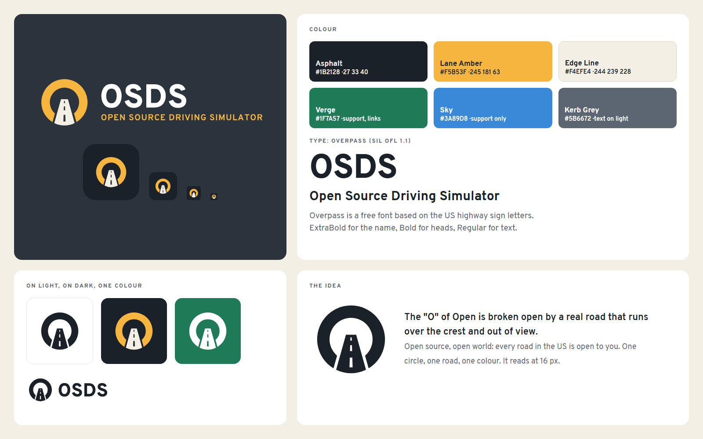
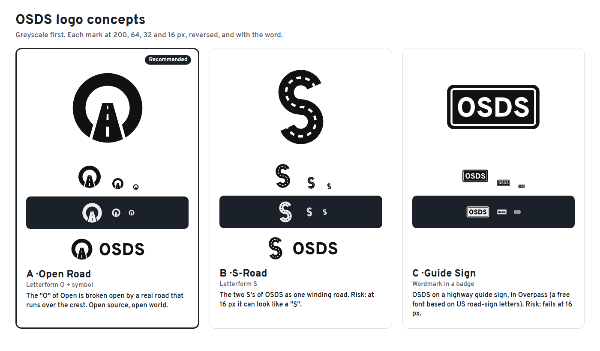

# OSDS brand kit

OSDS is the **Open Source Driving Simulator**. Until November 2026 its name was SimCruise.

## The name

- Write **OSDS** in capitals. The full name is **Open Source Driving Simulator** (each word with a capital letter).
- At the first mention on a page, write "OSDS (Open Source Driving Simulator)" or "OSDS, the Open Source Driving Simulator".
- Say "OSDS" letter by letter: "O-S-D-S".
- Where history matters, write "named SimCruise until November 2026". Do not write "OSDS (SimCruise)" in titles.
- The code keeps the old name inside: the `Source/SimCruise` module, `SimCruise.uproject`, `SimCruise.exe`, the `-SimCruise...` command-line options, the `simcruise.*` console variables and the `%LOCALAPPDATA%\SimCruise` folder. This keeps old saves, settings and scripts working. Do not rename these in a text change.

## The logo

The "O" of **Open** is broken open by a real road. The road runs up over a crest and out of view. Open source, open world: every road is open to you. One circle, one road, one colour.

| File | Use |
|---|---|
| [`svg/osds-lockup-full.svg`](svg/osds-lockup-full.svg) | Main logo: symbol, OSDS and the full name. Light backgrounds. |
| [`svg/osds-lockup-full-white.svg`](svg/osds-lockup-full-white.svg), [`-color.svg`](svg/osds-lockup-full-color.svg) | Main logo on dark backgrounds (white, or the colour version on Asphalt). |
| [`svg/osds-lockup-horizontal.svg`](svg/osds-lockup-horizontal.svg) (and `-white`, `-color`) | Symbol and OSDS only, for small headers. |
| [`svg/osds-lockup-stacked.svg`](svg/osds-lockup-stacked.svg) (and `-white`) | Square places: posters, title cards. |
| [`svg/osds-symbol.svg`](svg/osds-symbol.svg) (and `-white`, `-color`) | The symbol alone, 48 px and larger. |
| [`svg/osds-symbol-small.svg`](svg/osds-symbol-small.svg) (and `-white`) | The small-size cut for 16 to 40 px: no centre line, wider gaps. |
| [`svg/osds-icon.svg`](svg/osds-icon.svg), [`svg/osds-icon-small.svg`](svg/osds-icon-small.svg) | App icon: the colour symbol on an Asphalt tile; the small cut for 32 px and smaller. |
| [`svg/osds-wordmark.svg`](svg/osds-wordmark.svg) | OSDS letters only. |
| [`osds.ico`](osds.ico) | Windows icon, 16 to 256 px (16 to 32 px use the small cut). Copies: `packaging/windows/osds.ico` (installer) and `Build/Windows/Application.ico` (game window and `.exe`). |
| [`png/`](png/) | PNG copies: app icon 1024, 512, 256, 180, 64 and 32 px; lockups 1200 px wide; the brand sheet; the concept sheet. |
| [`../images/social-preview.png`](../images/social-preview.png) | GitHub and website preview, 1280 x 640. |

All marks are paths only: no live text, no filters, no images. The SVG files are the masters.

### Clear space and minimum size

- Keep clear space around the logo equal to the ring width (the thickness of the "O") on all sides.
- Symbol: 48 px minimum for `osds-symbol.svg`; under 48 px use `osds-symbol-small.svg` (it works down to 16 px). In print, 8 mm minimum.
- Horizontal lockup: 24 px high minimum. Full lockup: 40 px high minimum (the full-name line gets too small under that).

### Do not

- Do not put Lane Amber on white or Edge Line: the contrast is only 1.8 : 1. The colour logo goes on Asphalt only. On light backgrounds use the Asphalt logo.
- Do not change the colours, add shadows, gradients or outlines, or stretch, rotate or redraw the logo.
- Do not put the logo on a busy photo without a dark panel behind it.
- Do not set "OSDS" in another font, and do not use the old SimCruise map-pin icon with the new name.

## Colour

| Name | HEX | RGB | CMYK (approximate) | Use |
|---|---|---|---|---|
| Asphalt | `#1B2128` | 27 33 40 | 33 18 0 84 | Main dark: text on light, backgrounds of the colour logo and app icon |
| Lane Amber | `#F5B53F` | 245 181 63 | 0 26 74 4 | The brand highlight: the ring of the colour logo, accents on dark |
| Edge Line | `#F4EFE4` | 244 239 228 | 0 2 7 4 | Warm off-white: the road of the colour logo, light panels |
| Verge | `#1F7A57` | 31 122 87 | 75 0 29 52 | Support: links and buttons on light (5.3 : 1 on white) |
| Sky | `#3A89D8` | 58 137 216 | 73 37 0 15 | Support only (charts, maps); not for small text |
| Kerb Grey | `#5B6672` | 91 102 114 | 20 11 0 55 | Secondary text on light (5.9 : 1 on white) |

Contrast checks (WCAG): Lane Amber on Asphalt 8.9 : 1, Edge Line on Asphalt 14.1 : 1, Asphalt on white 16.2 : 1. The CMYK values are conversions, not proofs: proof them before a print job.

## Type

**[Overpass](https://github.com/RedHatOfficial/Overpass)** (SIL Open Font License 1.1, in `data/fonts/overpass`). It is a free font based on Highway Gothic, the letters of US road signs, and the game menus already use it.

- Name and big titles: Overpass ExtraBold.
- Heads and the full-name line: Overpass Bold (the full-name line in capitals, letter spacing 6 %).
- Text: Overpass Regular or SemiBold. On the web, the system font is also fine for long text.

## How we made it

We followed the process of the [logo-design Agent Skill](https://github.com/kaankiziltug/logo-design-skill) by kaankiziltug (MIT, about 6,900 stars on GitHub in November 2026, the highest-rated free logo and brand-kit tool we found that is open source, works offline and costs nothing). Its method: a brief, a list of the category's clichés, three different concepts in black first, tests at 16 px, one colour and reversed, a concept checkpoint, then the kit. Its reference library of real logos was not used or copied. Its Python scripts were not run on the build PC (the PC's safety rules do not let downloaded code run); our own scripts do the same steps:

- [`authoring/brand/make_brand.py`](../../authoring/brand/make_brand.py) draws every SVG from geometry (`python make_brand.py kit docs/brand/svg`). It needs `fonttools`.
- [`authoring/brand/render_brand.py`](../../authoring/brand/render_brand.py) makes the PNG and ICO files with a local Chrome or Edge and Pillow.
- [`authoring/brand/social-preview.html`](../../authoring/brand/social-preview.html) and [`brand-sheet.html`](../../authoring/brand/brand-sheet.html) are rendered to PNG by `render_brand.py html`.

### Concepts

- **A, Open Road** (chosen): it reads at 16 px, it works in one colour, and it ties the name (Open) to the game (real roads). A first version had a pointed road and looked like a circled "A" (the anarchy sign), so the road now stops flat at the crest.
- **B, S-Road**: the S of OSDS as a winding road. Winding-road icons are common, and at 16 px it can look like a "$".
- **C, Guide Sign**: OSDS on a highway sign. It fails at 16 px.

### Tests done

- 16, 20, 24, 32, 40, 48, 64, 128 and 256 px, on light and dark: the symbol reads as a ring and a road at every size (16 to 32 px use the small cut).
- One colour black, one colour white (reversed), on Asphalt, Verge and white.
- Unwanted readings: no letter A, no warning or traffic sign shape. We did not find a known logo like it; a reverse image search before wide use is still a good idea.
- Trademark: a USPTO search on 14 November 2026 found no live "OSDS" word mark. This is not legal clearance.
