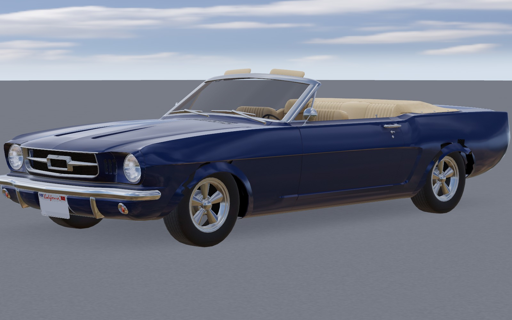
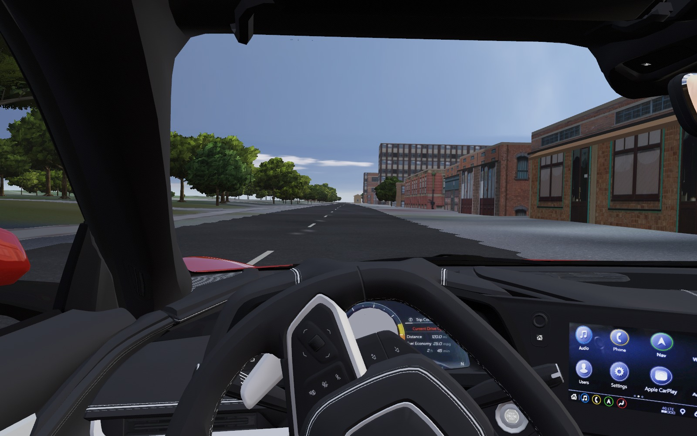

# Cars

Every car in SimCruise is a JSON file in [`game/cars/`](../game/cars/). Powertrain, suspension, tyres, brakes and aerodynamics read their numbers from it through `game/CarSpec.gd`, so adding a car means writing data, not code. The physics is shared by all cars: `game/Powertrain.gd` (contacts, tyres, engine or motor, gearbox, differentials) and `game/CarSuspension.gd` (springs, anti-roll bars, dampers, limited-slip split).

## The garage

Three cars:

| File | Name | Layout | Reference car | 0–60 mph | 70–0 mph | Skidpad |
|---|---|---|---|---|---|---|
| `nb1999.json` | 1999 Roadster Sport | front engine, rear drive, 5-speed manual | 1999 Mazda MX-5 Miata Sport | 7.99 s (7.97) | 172.9 ft (173) | 0.884 g (0.89) |
<<<<<<< HEAD
| `meridian_z.json` | Corvette Stingray Z51 (C8), formerly Meridian Z | mid-engine V8, rear drive, 8-speed dual clutch | 2020 Chevrolet Corvette Z51 | 3.55 s (2.8†) | 152.0 ft (148) | 1.025 g (1.03) |
=======
| `kestrel_s.json` | Kestrel S | front drive, turbo four, 6-speed manual | 2022 Honda Civic Si | 6.92 s (6.8) | 162.8 ft (160) | 0.953 g (0.94) |
| `tora_rs.json` | Tora RS | all-wheel drive, turbo flat four, 6-speed manual | 2022 Subaru WRX | 5.61 s (5.5) | 155.4 ft (153) | 0.953 g (0.95) |
| `volta.json` | Volta | electric, rear motor, single speed | Tesla Model 3 RWD | 5.35 s (5.4) | 167.0 ft (165*) | 0.897 g (0.88) |
| `meridian_z.json` | Corvette Stingray Z51 (C8), formerly Meridian Z | mid-engine V8, rear drive, 8-speed dual clutch | 2020 Chevrolet Corvette Z51 | 3.47 s (2.8†) | 151.7 ft (148) | 1.025 g (1.03) |
>>>>>>> cars/rig-infra
| `mustang65.json` | 1965 Mustang 289 | front engine, rear drive, 289 V8 four-barrel, 4-speed manual | 1965 Ford Mustang 289/210 | 9.00 s (8.9) | 259.3 ft (264‡) | 0.699 g (0.70*) |

<<<<<<< HEAD
Results are from `checks/CarTrack.gd`; published targets in brackets (mostly Car and Driver instrumented tests, cited in each file's `sources`). \* estimated target. ‡ derived from Car Life's measured 20 ft/s² from 80 mph (drum brakes). † open item, stated in the file: the magazine omits a 1 ft rollout worth about 0.3 s on a launch this hard while the bench times from rest, and from pedal-down at idle, where the car's launch control holds the engine at launch speed before the brake is released (not modelled). Before the slip-ratio tyre curve (main on 10 November 2026) the same bench read 7.95, 3.60 and 9.00 s; the roadster's 0.04 s comes from the driveline fix below, not from its tyres.
=======
Results are from `checks/CarTrack.gd`; published targets in brackets (mostly Car and Driver instrumented tests, cited in each file's `sources`). \* estimated target. ‡ derived from Car Life's measured 20 ft/s² from 80 mph (drum brakes). † open item, stated in the file: the magazine omits a 1 ft rollout worth about 0.3 s on a launch this hard while the bench times from rest, and from pedal-down at idle, where the car's launch control holds the engine at launch speed before the brake is released (not modelled). The standstill grip below (November 2026) moved only the Corvette, whose rear contacts' crawl-speed side damper had been unstable: 3.55 to 3.47 s and 152.0 to 151.7 ft (Tora RS 155.5 to 155.4 ft). Before the slip-ratio tyre curve (main on 10 November 2026) the same bench read 7.95, 6.83, 5.58, 5.30, 3.60, 9.00 and 5.68 s; the roadster's 0.04 s comes from the driveline fix below, not from its tyres.
>>>>>>> cars/rig-infra

The 1999 roadster is the original car of the game and keeps its own detailed model (`CarFinish.gd`); the Corvette and the Mustang wear real models downloaded from Sketchfab (see below). Four cars whose bodies were generated in Blender, the Kestrel S (2022 Civic Si), Tora RS (2022 WRX), Volta (Model 3 RWD) and Bison XL (F-150 2.7 EcoBoost), were removed in November 2026 because their generated models did not look like real cars; their calibrated car files remain in the git history for when real models are found. A saved choice of one of them, or `--car=` with an id that no longer exists, opens the 1999 roadster (`checks/CarRoster.gd` checks this).

## How a car is calibrated

`checks/CarTrack.gd` runs every car through three tests on a flat pad:

- **0–60 mph**: full throttle in automatic from rest (the same procedure as `checks/Track.gd`), timed from rest without the magazines' 1 ft rollout. Every car gets the same full pedal, with or without traction control: there is no bench driver feeding in the throttle, so the time is what a player on the keyboard (whose accelerator is all or nothing) gets. The speed at which the automatic clutch bites (`launch_rpm` + `launch_rpm_per_throttle` × pedal) is part of each car's file and explained in its `sources.launch` where it was chosen for this curve (Corvette 3000 rpm: its launch is tyre-limited, so a higher speed only revs the engine longer before the clutch bites).
- **70–0 mph**: full service brake, distance in feet. Cars with ABS (`abs_enabled`) hold each tyre at its peak slip, in either direction of travel; cars without lock their wheels and slide.
- **Skidpad**: a ramp steer at the speed a 300 ft circle needs for the target grip: steady speed, steering rising 0.6 % a second, and the peak one-second mean of lateral acceleration before the body slip angle passes 10°. It needs no path-following driver, so it does not depend on controller tuning; on the 1999 car it reads 0.884 g where `Track.gd`'s tuned circle driver demonstrates 0.885 g.

Bands: 0–60 ±0.15 s, 70–0 ±5 ft, skidpad ±0.02 g. A car outside them fails `sh scripts/check.sh` unless its file states the gap in `calibration_open`.

### Lift-off and trail braking

`checks/LiftOff.gd` (default suite) is every car's stability gate, after ISO 9816 (power-off reaction in a turn) and ISO 7975 (braking in a turn). A path and speed driver holds the car on a 40 m circle at 0.3, 0.5 and 0.7 g; then the wheel is frozen and the driver either closes the throttle over 0.1 s, or closes it and from 0.2 s squeezes the brake over 0.3 s to a pedal worth 0.15 g. It reports the yaw-rate ratio at 1 s (ISO 9816's measure: above 1 the car tucks in), the yaw overshoot, body sideslip at 1 s and its peak, the settling time and the deceleration. Gate: no car spins (sideslip past 8°) at 0.3 or 0.5 g, and no automatic ever selects reverse while rolling forward; 0.7 g is reported. `--radius=100` repeats it on ISO's larger circle, `--trace` prints each tyre's load, slip angle and slip ratio, and `--set=field=value` overrides a car-file field for experiments.

On the 1999 roadster a lift at 0.3–0.5 g gives a yaw-rate ratio of 1.01–1.07 with at most 1.2° of sideslip, settling at once; the trail brake 0.99–1.13 and 1.3° (40 m circle). That is the mild tuck-in owners describe ("with power off through a corner the miata tended to understeer slightly", [Grassroots Motorsports forum](https://grassrootsmotorsports.com/forum/grm/practice/12785/page3/); reviewers call the handling "balanced and forgiving", [Cars.com](https://cars.com/research/mazda-mx_5_miata-1999)); no instrumented lift-off test of the NB has been found, so the comparison is qualitative. At 0.7 g it tucks in more (ratio 1.19 lift, 1.43 brake, 4.8° peak) and still recovers.

The Miata's road spins in the November 2026 field test were not its chassis: the automatic selected reverse whenever the brake input was between 0 and the 0.01 brake threshold while rolling forward, and stayed in reverse while the brake was held, so the clutch drove the rear wheels backwards mid-corner. Every car did it (108–1,186 ticks per Tail of the Dragon run); the light rear-drive Miata, whose small brake pedal for a given deceleration spends longest in that band, spun. `Powertrain.gd` now changes direction only below 0.45 m/s, like a real selector's reverse inhibitor. Rear brake bias (50:50 or 75:25), an open differential, zero toe, no rear camber gain, load sensitivity 0–0.2, a 15 % larger yaw inertia and a 4.5 cm higher centre of gravity each moved the 0.7 g results by at most 0.11 in yaw-rate ratio and 0.6° in sideslip, so no chassis value was changed.

The NB's suspension travel is consistent with what owners measure: the car sits about 2 in (51 mm) above its bump stops (14 in to 12 in fender height, [Classic Motorsports forum](https://classicmotorsports.com/forum/grm/miata-bump-stop-question/172527/page1)); the file has 54 mm to the bump rubber and the hard stop 143 mm above ride height. The bump-stop ticks the field test counted on smooth roads came from `RoadDrive.gd` dropping the car from 0.35 m at the start and from the reverse-gear wheel hop; the drive now sets the car down at its ride height and prints where any bump stop is reached.

### Standstill and the parking brake

`checks/ParkBrakeHold.gd` (default suite) parks every car on its rear parking brake (H), in drive with the engine idling, on a flat pad, on a 10 % grade nose up and nose down, on a 10 % cross slope, and on the flat after a 0.3 m/s sideways push. From 3 s on the body must stay under 0.005 m/s and move under 5 mm in the next 3 s. Every car now reads under 0.0013 m/s and 0.1 mm.

Before, no car could hold a grade: on 10 % they rolled at 0.12 (1999 roadster) to 0.41 m/s (Bison XL), and across one at 1.5-9 cm/s, and the Corvette parked at the bundled Ocean Drive start never came to rest (0.07 m/s for 120 s, so `CarTurntable.gd` gave up). Two causes, both in `Powertrain.gd`'s handling of a tyre that is not rolling:

- Below walking pace the slip-angle law is regularised, `atan2(side velocity, max(1.8 m/s, speed))`, so the side force is a damper, and a held wheel's longitudinal force is the same damper (solved as if the wheel could still turn, which made it 13 times weaker on the Corvette). A damper cannot hold a car: on any slope it creeps at force / damping.
- The Corvette's grippy, heavily loaded rear contacts made that side damper 2.5 times stiffer than one 60 Hz tick can integrate once the body's roll is counted (the effective mass at a contact patch, `1/m + n·((I⁻¹(r×n))×r)`, is 60 % of a quarter of the car's mass). Disturbed, the car rocked side to side at 0.07 m/s, alternating each tick, without moving: the "creep" was that limit cycle.

A real tyre at rest is a spring: the tread sticks to the road and the carcass deflects. Each contact now carries a stick deflection (along and across the wheel) that follows the contact patch's slip; its spring (k·dt²/m = 0.1) and damper (c·dt/m = 0.5) are sized on the tick and the body's effective mass at that contact, so they are stable for every car (about 3 Hz, 0.8 of critical damping), and it slides once the spring reaches the friction limit or, along the wheel, the brake's holding torque. Across, it relaxes over the tyre's own length as the wheel rolls (cornering stiffness over spring rate), so its steady force is the slip-angle law's. It takes over fully below 0.2 m/s and hands back to the rolling law by 0.8 m/s; along the wheel it acts only while a brake holds the wheel still. Between 0.8 and 3.5 m/s, where the rolling law's relaxation length is still short, its 1.8 m/s regularising floor is raised for a contact whose damper would exceed 1.8 times its effective mass per tick (only the Corvette's rear). Calibration bands did not move: CarTrack and LaunchCheck are unchanged except the Corvette above; TurningCircle's 1.8 m/s diameter moved 3.7 cm (9.321 to 9.284 m) and 1.0 m/s stayed at 9.251 m.

What is published is used as published: mass, weight split where the maker gives it, engine power and torque, gear ratios, tyre sizes, wheelbase and track. What is not published is estimated and labelled in `sources.estimates`: centre-of-gravity height, inertia (scaled from the 1999 car by mass and size), spring and anti-roll rates (from ride frequencies typical of the class), dampers, brake torque and the tyre model's grip. The tyre grip is the main calibration handle: braking distance sets the longitudinal grip (`static_mu`), the skidpad sets the lateral factor (`lateral_grip_scale`), and launch settings are only tuned inside realistic limits. Published torque is never scaled to make a number.

## Models

Each car file names its model in `model_scene` and the driver's eye point in `driver_eye`; `game/CarBody.gd` mounts the model, spins and steers the wheels, turns the steering wheel, lights the brake lamps and puts the camera in the driver's seat. The 1999 roadster keeps its detailed `CarFinish.gd` model and cockpit; the Corvette and the Mustang use downloaded models (below). Pick a car with **Car** in the road atlas (Tab); the drive reopens at the same place. `--car=<id>` selects one on the command line.

### The 1999 roadster against photographs

`checks/CarTurntable.gd` (`--car-turntable DIR --quality=ultra [--lamps]`, windowed) photographs the car as the game builds it, alone on a neutral pad, from eight angles, the top, close-ups of a headlamp, tail lamp, wheel and the cabin, and the driver view; [lab/miata/appearance/turntable](../lab/miata/appearance/turntable/README.md) sets these beside Commons photographs of 1999 cars, including a green 1999 with the body-colour factory hardtop like the game's. From that comparison `CarFinish.gd` now smooths the faceted hardtop and glass, uses a lighter green-tinted glass, black trim, underbody and wheel liners, a slimmer body-colour windscreen frame, the black cowl grille, larger mirrors at the front corner of the doors, darker metallic wheels, a green (not chrome) hood from the seat and a hardtop lining in the driver view. **L** switches the head lamps: the lenses glow, two low-beam spot lights light the road, the amber markers glow and the stop lamps keep a dim tail glow. The headlamp opening, the rear bumper, the hardtop's rear glass and the coarse body shell still differ and need a new model; the physics, mounts and collision are unchanged. The [taste test of 10 November 2026](../lab/taste/2026-11-10/README.md) ranks what is left. First come the rippled panel reflections, then a windscreen about 15° too upright with a hardtop that sits too high, then a swept-spoke wheel where the 1999 15-inch alloy has straight, flat spokes. After those come the slit headlamp, the stand-in cabin seen through the glass, the black-silhouette paint at dusk and the egg-shaped mirrors on stalks.

The Blender tooling that generated the retired cars' bodies (`authoring/cars/build_car.py` and its modules; see [authoring/cars/README.md](../authoring/cars/README.md)) is kept for future cars, but only a model that looks like the real car ships. Better models are a welcome contribution: CC0 or CC BY, with four separable wheels or the node names that README lists.

## Real models from Sketchfab

The 1965 Mustang and the Corvette Stingray (C8, the physics formerly shipped as Meridian Z) use downloaded models. A car file with `"model_rig": {"fit": true}` is fitted by `game/ModelRig.gd` when the car loads. It finds the four wheels, by name when the author separated them (the C8) or by cutting every triangle within a tyre radius of each ground-contact patch out of the body (the Mustang, whose wheels were merged into the body). It scales the model to the spec's wheelbase, turns it to face −Z (a model without named wheels takes its front from the manifest's `flip`, the same flag that turns traffic around, unless the car file sets `flip`), sets the hubs at static ride height, maps brake-lamp and glass materials, hides badges and splits out the steering wheel. Fitted sizes match the real cars: Mustang 4.65 m long (4.61 m real), C8 4.64 m (4.63 m).

**Badges.** Surfaces whose material, texture, mesh or node name says badge, badging, logo, emblem or brand are left out (the C8's badges and steering-wheel emblem, the Raptor's and Grand Cherokee's badge decals, the Model 3's maker logo), in player cars and in traffic alike. Badges that share a material and texture with the body (the Mustang is four materials for the whole car) are listed per model in the manifest's `branded` array, next to the brand names: `{"note": …, "box": [[x,y,z],[x,y,z]]}` removes every connected part (vertices welded at 0.5 mm) that lies wholly inside the box, in the fitted car's frame, so a grille bar or bonnet panel that reaches outside it stays; `{"material": name}` removes a material. The Mustang's FORD bonnet letters and running-horse grille emblem go this way (978 and 98 triangles). Boxes apply to fitted cars; traffic hides only named badges.



**Steering wheel.** Every car's cabin steering wheel turns by the front wheels' mean angle times the car's `steering_ratio` (the maker's overall ratio, in each file with its source). `ModelRig.gd` finds a downloaded model's wheel by name (steer, wheel_s, volant, lenkrad, volante…; the C8's "Steering Wheel", the Raptor's "SteeringWheel") or else by geometry: it splits the left half of the cabin into connected parts and takes the one most like a rim, a flat closed ring 0.24-0.48 m across facing rearward (the edge is measured per sixteenth of the circle, so a squared-off wheel like the C8's counts). The rim's plane gives the column axis; every other part wholly inside the rim's cylinder (spokes, hub, airbag cover) turns with it, while the column shroud and dashboard stay. The node `steering_wheel` sits at the rim centre with +Z along the column toward the driver. When detection fails, `"model_rig": {"steering_wheel": {"node": "name"}}` or `{"centre": [x,y,z], "axis": [x,y,z], "radius": r}` (vehicle frame) sets it, and `{"none": true}` turns it off. `checks/SteeringWheelCheck.gd` (default suite) sweeps every car from centre to full left and right lock at a standstill and gates the wheel's accumulated rotation against ratio × road-wheel angle (within 0.5°), its place in front of the driver, its column lean, the direction (a left turn moves the top of the rim left) and that it turns only about its column:

| Car | Ratio (source) | Wheel at full lock | Turns lock to lock (published) |
|---|---|---|---|
| 1999 roadster | 15.0 (GoAuto) | 556° | 3.09 (2.6) |
| Kestrel S | 11.46 (Honda, Civic Si) | 417° | 2.32 (2.17) |
| Tora RS | 13.5 (Subaru, WRX) | 478° | 2.65 (2.5) |
| Volta | 10.3 (estimate from Tesla's 2.0 turns) | 364° | 2.02 (2.0) |
| Corvette (C8) | 15.7 (Chevrolet) | 540° | 3.00 (—) |
| 1965 Mustang | 21.7 (Ford, manual steering) | 722° | 4.01 (3.73) |
| Bison XL | 17.2 (estimate; Ford's Raptor figure) | 571° | 3.17 (—) |

The turns run 5-19 % above the published figures because each file's rack lock (`parking_rack_deg`) is an estimate; the ratio, which is published, is used as published. Generated models had a steering wheel that never turned: Godot's importer reads a node name ending in `_wheel` as a `VehicleWheel3D` and strips the suffix, so `steering_wheel` arrived as `steering`; the five `art/cars/*.glb` imports now set `nodes/use_node_type_suffixes=false`, and `CarBody.steering_wheel_entry` turns a wheel the right way whichever way its column axis was authored. `checks/CarTurntable.gd --steer-stills` saves the driver view at full left lock, a quarter left, centred, a quarter right and full right lock.



`checks/RigProbe.gd` (headless) fits every manifest model and prints what it found; `checks/RigView.gd` (windowed) draws orthographic sheets of each fitted model with the hubs, the cut tyre cylinders, the steering wheel and the driver's eye marked. A model without a car file is fitted from its manifest entry's `spec` block (published wheelbase and tyre size, with sources).

## Your own model for a car (private)

You can give any car an exterior you own, for example a model you bought, without it entering the repository. Put a binary glTF named after the car's id in the game's user folder:

- Windows: `%APPDATA%\Godot\app_userdata\SimCruise\cars\nb1999.glb`
- macOS: `~/Library/Application Support/Godot/app_userdata/SimCruise/cars/nb1999.glb`
- Linux: `~/.local/share/godot/app_userdata/SimCruise/cars/nb1999.glb`

At start the game reads it at run time (no import), and `ModelRig.gd` fits it like a Sketchfab model: it turns the model upright if needed (the shortest axis is up, tyres below the body), finds the four wheels by name or geometry, scales it to the car's wheelbase and sets it at ride height. The physics stay those of the car file. `--stock-model` ignores the file for one run. Only use a model whose licence lets you use it; the project ships only CC0 and CC BY models (see below), and a file here is never committed or redistributed.

## Traffic models from Sketchfab

<<<<<<< HEAD
Moving and parked traffic use only real models listed in `game/art/traffic/manifest.json`: 1965 Ford Mustang, Corvette Stingray C8, 2018 Honda Accord, 2025 Honda CR-V, 2018 Ford F-150 Raptor, 2013 Jeep Grand Cherokee, Chevrolet Tahoe, Honda Odyssey and Tesla Model 3 (all CC BY 4.0, credited in `licenses/Traffic models.txt`). The old low-poly sedan and pickup are no longer used for traffic, and the generated garage bodies have been removed from the game. Each merged model gets detail levels rebuilt at load, and `checks/TrafficLineup.gd` renders the fitted fleet in a row to check orientation (a model showing its tail from the front needs `"flip": true`). A model is accepted only if it looks at least as good as these; the Silverado (wheels missing) and Transit Connect (transparent materials) were rejected. `authoring/cars/sketchfab.mjs` fills that manifest:
=======
Moving and parked traffic use only real models listed in `game/art/traffic/manifest.json`: 1965 Ford Mustang, Corvette Stingray C8, 2018 Honda Accord, 2025 Honda CR-V, 2018 Ford F-150 Raptor (a SuperCab), 2013 Jeep Grand Cherokee, a 2015-2020 Chevrolet Suburban (listed on Sketchfab as a Tahoe), Honda Odyssey and Tesla Model 3 (all CC BY 4.0, credited in `licenses/Traffic models.txt`). The old low-poly sedan and pickup and the generated garage bodies are no longer used for traffic. Each merged model gets detail levels rebuilt at load, and `checks/TrafficLineup.gd` renders the fitted fleet in a row to check orientation (a model showing its tail from the front needs `"flip": true`). A model is accepted only if it looks at least as good as these; the Silverado (wheels missing) and Transit Connect (transparent materials) were rejected. `authoring/cars/sketchfab.mjs` fills that manifest:
>>>>>>> cars/rig-infra

```
bun authoring/cars/sketchfab.mjs search "generic sedan"
SKETCHFAB_API_TOKEN=… bun authoring/cars/sketchfab.mjs fetch <uid> --kind=sedan --length=4.7
```

Only CC0 and CC BY models are accepted. Models with a car maker in the title are refused unless you pass `--allow-brand` (then remove the badges). The token is your own, from sketchfab.com → Settings → Password & API; it is never written anywhere. Models are normalised at load (long axis along the road, scaled to `length_m`, wheels on the ground); set `"flip": true` in the manifest if one drives backwards. Credits go to `licenses/Traffic models.txt`.

### What each downloaded model needs before it can be driven

`RigProbe.gd` and `RigView.gd` on 10 November 2026, with each model's published wheelbase and tyres:

| Model | Wheels | Fitted length (real) | Steering wheel | Badges | Before it can be a player car |
|---|---|---|---|---|---|
| 2018 Accord | geometric, correct | 4.88 m (4.88) | none: the model has no interior (a single scanned mesh, black windows) | painted into its one scanned texture; the grille and boot emblems and the ACCORD script cannot be removed as geometry | a cabin, and a retouched texture |
| 2025 CR-V | geometric, correct | 4.64 m (4.70) | none: no interior | grille and tailgate emblems, tailgate scripts and the CR-V number plates removed by box and material | a cabin |
| F-150 Raptor | geometric, correct | 5.63 m (5.59) | by name, r 0.21 m, 22° | named badge material removed | the manifest said a 5.89 m SuperCrew; the model is a SuperCab (rear-hinged doors, wheelbase/length 0.60), so traffic drew it 5 % too long: now 5.59 m |
| 2013 Grand Cherokee SRT8 | geometric, correct | 4.86 m (4.82) | by geometry, r 0.20 m, 22° | named decal material removed | a car file |
| "Tahoe" | geometric, correct | 5.54 m (5.70) | by geometry, r 0.17 m, 20° | grille emblem and SUBURBAN door scripts removed by box | it is a 2015-2020 Suburban (SUBURBAN door script, long rear quarter windows, node `suburban_15`): traffic drew it at the Tahoe's 5.18 m, now 5.70 m |
| Odyssey | geometric, correct | 5.11 m (5.16 US 2018) | none: no interior | grille and tailgate emblems, ODYSSEY plates and script removed by box | a cabin |
| Model 3 | geometric, correct | 4.57 m (4.69) | by geometry, r 0.21 m, 15° | named maker-logo material removed | the body is 2.6 % short for its wheelbase |
| 1965 Mustang | geometric | 4.65 m (4.61) | by geometry, r 0.13 m, 29° | bonnet letters and grille emblem by box | the model's steering wheel is 10 in across, smaller than the real car's |
| Corvette C8 | named | 4.64 m (4.63) | by name, r 0.18 m, 18° | named | — |

## Adding a car

1. Copy the closest file in `game/cars/` and change `id` (the file name), `name`, `make` and `body`.
2. Fill in what is published, with a source for each in `sources`. Prefer manufacturer specification sheets and instrumented magazine tests.
3. Set the targets (`target_0_60_s`, `target_70_0_ft`, `target_skidpad_g`) from one instrumented test.
4. Run `godot --headless --path game --fixed-fps 60 --script res://checks/CarTrack.gd -- --car=<id>` and adjust only the estimated fields until the car is inside its bands. `CARTRACK_TRACE=1` prints the launch every quarter second.
5. Run `sh scripts/check.sh`; the other cars and `Track.gd` must not move.

Use made-up names for real cars, and no manufacturer logos or badges.

## Fields

`game/CarSpec.gd` lists every field with its unit and the 1999 car's value as the default; the main groups are mass and body, geometry, tyres, steering, brakes, aerodynamics, engine (`combustion` with a torque curve, or `electric` with peak torque, power and speed), gearbox and clutch, drivetrain (`rwd`, `fwd` or `awd` with a centre split and differential bias ratios; every car here is `rwd` and combustion, and the other layouts and the electric motor stay supported for future cars), suspension per axle, and the calibration targets. `axle_grip` gives staggered tyres their own grip per axle.

The tyre's longitudinal grip follows a slip-ratio curve: full grip (`static_mu`) up to `slip_ratio_peak` (0.10), falling by `slip_ratio_falloff` toward a locked or spinning wheel (reached at 3.5 × the peak). The Corvette, on radials and with ABS, sets 10 % (dry asphalt slides at 83–94 % of the peak: Wong, *Theory of Ground Vehicles*, table 1.3). The default is flat (0), and the 1999 roadster and the 1965 Mustang keep it: the roadster's only braking figure is a locked-wheel stop without ABS, which fixes the grip of a sliding tyre, and a fall-off would need an unmeasured peak above it (peak 1.07 sliding to 0.963 raised its trail-braking grip 5.3 %); for the Mustang an estimated bias-ply curve (peak 0.15, 25 % fall-off) made the full-throttle 0–60 10.7 s and 10 % made it 9.35 s against Car Life's 8.9 s.

`abs_enabled` and `traction_control` are on only for cars that had them (of the cars here, only the Corvette). ABS modulates each wheel's brake pressure about the tyre's peak slip. Traction control cuts engine or motor torque to hold the most-slipping driven wheel at the same peak slip (`tc_target_slip` overrides it): it reads the slip through a 20 ms filter and a slew limit, acts proportional (0.15) plus integral (`tc_gain`, 3/s) on the error, holds its state through a gear change, does not wind up while the clutch slips at its capacity, and moves the cut no faster than an engine can (off within 50 ms, back on over 0.15 s). Targets past the peak (1.15 or 1.3 ×) oscillated. Three checks in the default suite guard this: `checks/TractionControlCheck.gd` (torque factor and driveline torque during a full-throttle launch and a power-on corner exit; fails on a burst of 6 or more reversals of 5 % lasting 0.5 s or more), `checks/CombinedSlip.gd` (braking while cornering at 35 % and 70 % of the skidpad target, compared with main's numbers; fails when a car without ABS gains more than 3 %) and `checks/AbsReverse.gd` (ABS stops forwards and in reverse from 6 m/s).

A clutch, torque converter or dual clutch couples the engine to the driven wheels with a torque proportional to their speed difference. The coupling is now limited to the torque that closes the gap in one force substep: in low gears with the tyres at their limit the wheels reflect so little inertia that the explicit coupling overshot, and on main the clutch torque alternated sign for 2.2 s in the launch of the (since retired) front-drive Kestrel S and 1.75 s in the Corvette's (`TractionControlCheck -- --all-cars`). A dual clutch changes gear without interrupting the drive.
