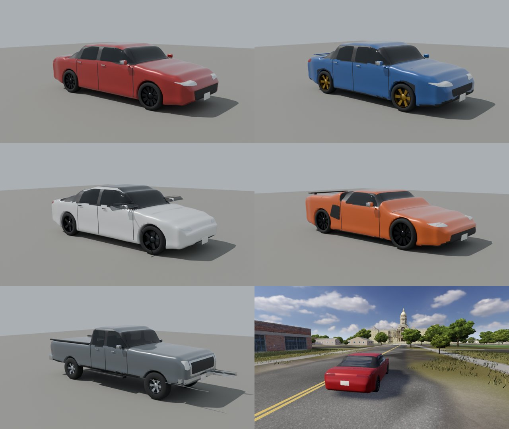

# Cars

Every car in SimCruise is a JSON file in [`game/cars/`](../game/cars/). Powertrain, suspension, tyres, brakes and aerodynamics read their numbers from it through `game/CarSpec.gd`, so adding a car means writing data, not code. The physics is shared by all cars: `game/Powertrain.gd` (contacts, tyres, engine or motor, gearbox, differentials) and `game/CarSuspension.gd` (springs, anti-roll bars, dampers, limited-slip split).

## The garage



*Kestrel S, Tora RS, Volta, Meridian Z and Bison XL as generated, and the Kestrel S in the game. The Meridian Z's physics now carry a real Corvette Stingray (C8) model; see below.*

| File | Name | Layout | Reference car | 0–60 mph | 70–0 mph | Skidpad |
|---|---|---|---|---|---|---|
| `nb1999.json` | 1999 Roadster Sport | front engine, rear drive, 5-speed manual | 1999 Mazda MX-5 Miata Sport | 7.99 s (7.97) | 172.9 ft (173) | 0.884 g (0.89) |
| `kestrel_s.json` | Kestrel S | front drive, turbo four, 6-speed manual | 2022 Honda Civic Si | 6.92 s (6.8) | 162.8 ft (160) | 0.953 g (0.94) |
| `tora_rs.json` | Tora RS | all-wheel drive, turbo flat four, 6-speed manual | 2022 Subaru WRX | 5.61 s (5.5) | 155.5 ft (153) | 0.953 g (0.95) |
| `volta.json` | Volta | electric, rear motor, single speed | Tesla Model 3 RWD | 5.35 s (5.4) | 167.0 ft (165*) | 0.897 g (0.88) |
| `meridian_z.json` | Corvette Stingray Z51 (C8), formerly Meridian Z | mid-engine V8, rear drive, 8-speed dual clutch | 2020 Chevrolet Corvette Z51 | 3.55 s (2.8†) | 152.0 ft (148) | 1.025 g (1.03) |
| `mustang65.json` | 1965 Mustang 289 | front engine, rear drive, 289 V8 four-barrel, 4-speed manual | 1965 Ford Mustang 289/210 | 9.00 s (8.9) | 259.3 ft (264‡) | 0.699 g (0.70*) |
| `bison_xl.json` | Bison XL | crew-cab pickup, twin-turbo V6, 10-speed automatic, 4WD | Ford F-150 2.7 EcoBoost 4x4 | 5.73 s (5.7) | 189.4 ft (190) | 0.736 g (0.74) |

Results are from `checks/CarTrack.gd`; published targets in brackets (mostly Car and Driver instrumented tests, cited in each file's `sources`). \* estimated target. ‡ derived from Car Life's measured 20 ft/s² from 80 mph (drum brakes). † open item, stated in the file: the magazine omits a 1 ft rollout worth about 0.3 s on a launch this hard while the bench times from rest, and from pedal-down at idle, where the car's launch control holds the engine at launch speed before the brake is released (not modelled). Before the slip-ratio tyre curve (main on 10 November 2026) the same bench read 7.95, 6.83, 5.58, 5.30, 3.60, 9.00 and 5.68 s; the roadster's 0.04 s comes from the driveline fix below, not from its tyres.

The new cars carry made-up names and makers on purpose: the specifications are real and sourced, the brands and body designs are not, which keeps the project clear of trademarks. The 1999 roadster is the original car of the game.

## How a car is calibrated

`checks/CarTrack.gd` runs every car through three tests on a flat pad:

- **0–60 mph**: full throttle in automatic from rest (the same procedure as `checks/Track.gd`), timed from rest without the magazines' 1 ft rollout. Every car gets the same full pedal, with or without traction control: there is no bench driver feeding in the throttle, so the time is what a player on the keyboard (whose accelerator is all or nothing) gets. The speed at which the automatic clutch bites (`launch_rpm` + `launch_rpm_per_throttle` × pedal) is part of each car's file and explained in its `sources.launch` where it was chosen for this curve (Kestrel S 2500 rpm, Corvette 3000 rpm: their launches are tyre-limited, so a higher speed only revs the engine longer before the clutch bites).
- **70–0 mph**: full service brake, distance in feet. Cars with ABS (`abs_enabled`) hold each tyre at its peak slip, in either direction of travel; cars without lock their wheels and slide.
- **Skidpad**: a ramp steer at the speed a 300 ft circle needs for the target grip: steady speed, steering rising 0.6 % a second, and the peak one-second mean of lateral acceleration before the body slip angle passes 10°. It needs no path-following driver, so it does not depend on controller tuning; on the 1999 car it reads 0.884 g where `Track.gd`'s tuned circle driver demonstrates 0.885 g.

Bands: 0–60 ±0.15 s, 70–0 ±5 ft, skidpad ±0.02 g. A car outside them fails `sh scripts/check.sh` unless its file states the gap in `calibration_open`.

What is published is used as published: mass, weight split where the maker gives it, engine power and torque, gear ratios, tyre sizes, wheelbase and track. What is not published is estimated and labelled in `sources.estimates`: centre-of-gravity height, inertia (scaled from the 1999 car by mass and size), spring and anti-roll rates (from ride frequencies typical of the class), dampers, brake torque and the tyre model's grip. The tyre grip is the main calibration handle: braking distance sets the longitudinal grip (`static_mu`), the skidpad sets the lateral factor (`lateral_grip_scale`), and launch settings are only tuned inside realistic limits. Published torque is never scaled to make a number.

## Models

The new cars' models are generated in Blender by `authoring/cars/build_car.py` from design files (`authoring/cars/designs/*.py`) whose body lines were measured from Commons photographs of each reference car; see [authoring/cars/README.md](../authoring/cars/README.md). Each car file names its model in `model_scene` and the driver's eye point in `driver_eye`; `game/CarBody.gd` mounts the model, spins and steers the wheels, turns the steering wheel, lights the brake lamps and puts the camera in the driver's seat. The 1999 roadster keeps its detailed `CarFinish.gd` model and cockpit. Pick a car with **Car** in the road atlas (Tab); the drive reopens at the same place. `--car=<id>` selects one on the command line.

### The 1999 roadster against photographs

`checks/CarTurntable.gd` (`--car-turntable DIR --quality=ultra [--lamps]`, windowed) photographs the car as the game builds it, alone on a neutral pad, from eight angles, the top, close-ups of a headlamp, tail lamp, wheel and the cabin, and the driver view; [lab/miata/appearance/turntable](../lab/miata/appearance/turntable/README.md) sets these beside Commons photographs of 1999 cars, including a green 1999 with the body-colour factory hardtop like the game's. From that comparison `CarFinish.gd` now smooths the faceted hardtop and glass, uses a lighter green-tinted glass, black trim, underbody and wheel liners, a slimmer body-colour windscreen frame, the black cowl grille, larger mirrors at the front corner of the doors, darker metallic wheels, a green (not chrome) hood from the seat and a hardtop lining in the driver view. **L** switches the head lamps: the lenses glow, two low-beam spot lights light the road, the amber markers glow and the stop lamps keep a dim tail glow. The headlamp opening, the rear bumper, the hardtop's rear glass and the coarse body shell still differ and need a new model; the physics, mounts and collision are unchanged.

The generated models have accurate proportions, working glass, lamps and wheels, and clean silhouettes, but they are not photoreal. Better models are a welcome contribution: CC0 or CC BY, with the node names the README lists.

## Real models from Sketchfab

The 1965 Mustang and the Corvette Stingray (C8, the physics formerly shipped as Meridian Z) use downloaded models. A car file with `"model_rig": {"fit": true}` is fitted by `game/ModelRig.gd` when the car loads. It finds the four wheels, by name when the author separated them (the C8) or by cutting every triangle within a tyre radius of each ground-contact patch out of the body (the Mustang, whose wheels were merged into the body). It scales the model to the spec's wheelbase, turns it to face −Z, sets the hubs at static ride height, maps brake-lamp and glass materials, and hides badge surfaces. `checks/RigProbe.gd` prints what it found. Fitted sizes match the real cars: Mustang 4.62 m long (4.61 m real), C8 4.64 m (4.63 m).

## Traffic models from Sketchfab

Moving and parked traffic use only real models listed in `game/art/traffic/manifest.json`: 1965 Ford Mustang, Corvette Stingray C8, 2018 Honda Accord, 2025 Honda CR-V, 2018 Ford F-150 Raptor, 2013 Jeep Grand Cherokee, Chevrolet Tahoe, Honda Odyssey and Tesla Model 3 (all CC BY 4.0, credited in `licenses/Traffic models.txt`). The old low-poly sedan and pickup and the generated garage bodies are no longer used for traffic. Each merged model gets detail levels rebuilt at load, and `checks/TrafficLineup.gd` renders the fitted fleet in a row to check orientation (a model showing its tail from the front needs `"flip": true`). A model is accepted only if it looks at least as good as these; the Silverado (wheels missing) and Transit Connect (transparent materials) were rejected. `authoring/cars/sketchfab.mjs` fills that manifest:

```
bun authoring/cars/sketchfab.mjs search "generic sedan"
SKETCHFAB_API_TOKEN=… bun authoring/cars/sketchfab.mjs fetch <uid> --kind=sedan --length=4.7
```

Only CC0 and CC BY models are accepted. Models with a car maker in the title are refused unless you pass `--allow-brand` (then remove the badges). The token is your own, from sketchfab.com → Settings → Password & API; it is never written anywhere. Models are normalised at load (long axis along the road, scaled to `length_m`, wheels on the ground); set `"flip": true` in the manifest if one drives backwards. Credits go to `licenses/Traffic models.txt`.

## Adding a car

1. Copy the closest file in `game/cars/` and change `id` (the file name), `name`, `make` and `body`.
2. Fill in what is published, with a source for each in `sources`. Prefer manufacturer specification sheets and instrumented magazine tests.
3. Set the targets (`target_0_60_s`, `target_70_0_ft`, `target_skidpad_g`) from one instrumented test.
4. Run `godot --headless --path game --fixed-fps 60 --script res://checks/CarTrack.gd -- --car=<id>` and adjust only the estimated fields until the car is inside its bands. `CARTRACK_TRACE=1` prints the launch every quarter second.
5. Run `sh scripts/check.sh`; the other cars and `Track.gd` must not move.

Use made-up names for real cars, and no manufacturer logos or badges.

## Fields

`game/CarSpec.gd` lists every field with its unit and the 1999 car's value as the default; the main groups are mass and body, geometry, tyres, steering, brakes, aerodynamics, engine (`combustion` with a torque curve, or `electric` with peak torque, power and speed), gearbox and clutch, drivetrain (`rwd`, `fwd` or `awd` with a centre split and differential bias ratios), suspension per axle, and the calibration targets. `axle_grip` gives staggered tyres their own grip per axle.

The tyre's longitudinal grip follows a slip-ratio curve: full grip (`static_mu`) up to `slip_ratio_peak` (0.10), falling by `slip_ratio_falloff` toward a locked or spinning wheel (reached at 3.5 × the peak). The five modern cars, on radials and with ABS, set 10 % (dry asphalt slides at 83–94 % of the peak: Wong, *Theory of Ground Vehicles*, table 1.3). The default is flat (0), and the 1999 roadster and the 1965 Mustang keep it: the roadster's only braking figure is a locked-wheel stop without ABS, which fixes the grip of a sliding tyre, and a fall-off would need an unmeasured peak above it (peak 1.07 sliding to 0.963 raised its trail-braking grip 5.3 %); for the Mustang an estimated bias-ply curve (peak 0.15, 25 % fall-off) made the full-throttle 0–60 10.7 s and 10 % made it 9.35 s against Car Life's 8.9 s.

`abs_enabled` and `traction_control` are on only for cars that had them (every car here except the 1999 roadster and the 1965 Mustang). ABS modulates each wheel's brake pressure about the tyre's peak slip. Traction control cuts engine or motor torque to hold the most-slipping driven wheel at the same peak slip (`tc_target_slip` overrides it): it reads the slip through a 20 ms filter and a slew limit, acts proportional (0.15) plus integral (`tc_gain`, 3/s) on the error, holds its state through a gear change, does not wind up while the clutch slips at its capacity, and moves the cut no faster than an engine can (off within 50 ms, back on over 0.15 s). Targets past the peak (1.15 or 1.3 ×) oscillated. Three checks in the default suite guard this: `checks/TractionControlCheck.gd` (torque factor and driveline torque during a full-throttle launch and a power-on corner exit; fails on a burst of 6 or more reversals of 5 % lasting 0.5 s or more), `checks/CombinedSlip.gd` (braking while cornering at 35 % and 70 % of the skidpad target, compared with main's numbers; fails when a car without ABS gains more than 3 %) and `checks/AbsReverse.gd` (ABS stops forwards and in reverse from 6 m/s).

A clutch, torque converter or dual clutch couples the engine to the driven wheels with a torque proportional to their speed difference. The coupling is now limited to the torque that closes the gap in one force substep: in low gears with the tyres at their limit the wheels reflect so little inertia that the explicit coupling overshot, and on main the clutch torque alternated sign for 2.2 s in the Kestrel S launch and 1.75 s in the Corvette's (`TractionControlCheck -- --all-cars`). A dual clutch changes gear without interrupting the drive.
