# New ways to add world detail (13 November 2026)

The project owner asked for new and original methods to add detail to the world efficiently: textures, meshing, depth from grid or street imagery, and other new ideas. This note lists 15 methods, ranks them by the realism they add for each millisecond of GPU time on the 28 W laptop GPU, and reports two prototypes that we built and measured.

Read with: [detail-engine.md](detail-engine.md) (the Godot-era texture plan), [real-world-detail.md](real-world-detail.md), [domain-ideas.md](domain-ideas.md), [../team/research/lighting-tech.md](../team/research/lighting-tech.md) and the player-first roadmap ([../plan/player-first-roadmap.md](../plan/player-first-roadmap.md)).

## The rules that shape the list

- **The GPU has no time to spare.** The High frame is about 15 ms already. A method that runs once per place on the CPU, and leaves only a texture fetch per pixel, wins over any method that runs per frame.
- **Every model and every dataset must have an open licence for a free game.** v2.0.1 ships no neural weights, because Real-ESRGAN (DIV2K) and DDRNet (Cityscapes) have research-only training data. Most depth networks have the same problem: Depth Anything V2 Small has Apache-2.0 weights, but its teacher used Virtual KITTI 2 (CC BY-NC-SA) and SA-1B (research licence). So we prefer **measurement over learning**: US public-domain lidar (USGS 3DEP, NOAA), public-domain aerial photographs (USGS, NAIP) and classic geometry, which need no weights at all.
- **Our gap is data, not shaders.** The world already has a facade grammar (eyebrows, awnings, parapets), procedural ground detail, lidar roofs and low plants. What it does not have is the real shape of the ground near the road and a ground photograph without someone else's sun in it.
- **Do not duplicate other threads.** Exposure, tone, colour grade, seasonal fields and asphalt wear belong to the world-look thread (5.2). Poles, wires, mailboxes and signs belong to the roadside work (5.4). Photo parsing belongs to the live-data thread.

## The methods, ranked

Realism gain: 1 (small) to 5 (large), our estimate of what a driver sees on the hero roads. GPU cost: estimated for High at 1600 x 900 on the RTX 2070 Super Max-Q; "0" means the method only changes data that the shader already reads. Rank = gain / (GPU ms + 0.05).

| # | Method | New? | Gain | GPU ms | Rank | Status |
|---|---|---|---|---|---|---|
| 1 | **Unbake the sun**: find the sun shadows printed in the aerial photograph from lidar heights, fit the sun direction to the photograph's own shadows, lift each shadow by the local lit/shade ratio of its surface class | ours | 3 | 0 | 60 | **prototype built, in game** |
| 2 | **Corridor relief**: 0.5 m lidar ground in a 40 m band along each road (cuts, ditches, benches, kerbs, berms) as a height and normal texture, plus a mesh refine near the car | ours (as a game method) | 4 | 0.05-0.1 | 40-57 | **prototype measured** (Tail of the Dragon) |
| 3 | **Lidar intensity road map**: the same lidar gives a 0.5 m picture of paint, worn lines, patches, crack seal and gravel shoulders | ours | 3 | 0 (same texture as 2) | 60 | seen in prototype 2 |
| 4 | **Detail spectrum matched to photographs**: set each surface class's detail amplitude so its band-pass energy equals that of licensed photographs of the same road (the realism score's own "detail" measure) | ours | 2 | 0 | 40 | proposed (world-look thread) |
| 5 | **Texture by example from the place**: cut a clean 64 px patch of the local wall, pavement or verge from a photograph and quilt it on the CPU into a tileable 512 px swatch (image quilting, Efros and Freeman 2001; no weights) | known method, new use | 3 | 0 | 60 | proposed |
| 6 | **Shade-divided photo paint**: project a licensed street photograph onto the facade it shows, then divide by the game's own render of that scene in white albedo at the photograph's time and sun, which leaves albedo only | ours | 4 where photos exist | 0.05 | 40 | proposed; Panoramax CC BY-SA, so runtime cache only |
| 7 | **Heights from aerial shadows**: where there is no lidar, measure each shadow's length in the photograph and the fitted sun elevation to get wall, hedge and tree heights | known in remote sensing, new for games | 2 | 0 | 40 | proposed (fallback for 1) |
| 8 | **Sky occlusion from lidar**: bake the sky-view factor of the lidar surface into the same ground texture, so a lane between hedges or a cut is darker in shade, as it is in a photograph | known, new use | 2 | 0 (same texture) | 40 | proposed (goes with 1 and 2) |
| 9 | **Sequence stereo**: classic multi-view stereo on consecutive street photographs (COLMAP, BSD-3, no learned weights) to get facade relief depth and the shape of hedges and walls | known method, new use | 3 | 0-0.2 | 12-60 | proposed; slow on CPU, sparse coverage |
| 10 | **Facade relief layers**: eyebrows, fins and cornices extruded as real geometry so they cast real shadows (already built by the facade grammar; extend to more styles) | built | 3 | 0.1-0.3 | 9-20 | buildings thread |
| 11 | **Lidar roadside skin**: a low mesh of hedges, walls and fences from classified lidar, coloured from the aerial | known (3D tiles) | 2 | 0.2-0.5 | 4-8 | not now: "melted" look near the car |
| 12 | **Photo impostor cards** for far roadside (cut-outs from licensed photographs) | known | 2 | 0.05 | 20 | not now: SA licence, coverage |
| 13 | **Monocular depth network** on street photographs | known | 3 | 0 (CPU) | n/a | blocked: no depth network with fully open training data found |
| 14 | **Gaussian splats** of hero spots from street imagery | known | 4 locally | 2-5 | 1 | not now: too costly at 28 W, sparse capture, SA licence |
| 15 | **AI texture generation** (FLUX.2 klein 4B, MatFuse) for missing material classes, offline only | known | 2 | 0 | 40 | detail-engine.md slice 5; human review of each output |

The top of the table is the same idea three times: **measure the real ground once on the CPU, keep it in one texture, and pay one texture fetch**. Methods 1, 2, 3 and 8 come from the same lidar download and fit in one per-tile "ground truth" texture (RGBA: height offset, two normal components, intensity or sky view). That is the recommendation.

## Prototype 1: Unbake the sun

**Problem.** The ground in the game is coloured by an aerial photograph. That photograph has its own sun shadows: dark, blue-tinted bands north of every building and tree. The game then draws its own shadows from its own sun. So a street has two sets of shadows in different directions, and the photograph's shadows stay when the game's sun is low, on the other side, or set. The ground shader already hides part of this with a rule ("blue and violet casts are tower shadows"), but it cannot find a shadow that is not blue.

**Method** (`lab/unbake-sun/`):

1. Read the lidar points of the tile and a 77 m margin (NOAA Miami-Dade 2021, Entwine point tiles, public domain; about 8 points per m2).
2. Make a surface height grid (highest return) and a ground height grid (class 2) on the photograph's own pixels.
3. **Fit the sun to the photograph.** For each sun azimuth and elevation, cast shadows from the height grid and measure how much darker the shadowed ground is than the lit ground. The best sun is the one whose shadows best explain the dark pixels. No date or time metadata is necessary. On the Miami Beach photograph the fit gives azimuth 170 degrees and elevation 44 degrees: a late-morning winter sun, which agrees with the shadows by eye.
4. Cast the shadows with that sun. For each surface class (ground, vegetation, water) and each colour channel, compare the shaded and the lit pixels near each shadow (a 12-pixel Gaussian window) and multiply the shaded pixels by that local ratio (limited to 1-4). Shadow edges are softened by 0.7 px.
5. Paste the result back into the photograph. The game reads `data/tiles/aerial/unbaked/<key>` when it exists.

**Measured** (z16 tile 18180_27907, Ocean Drive and Lummus Park):

| | Shaded / lit luminance, ground | Shaded / lit luminance, vegetation |
|---|---|---|
| Photograph | 0.51 | 0.70 |
| Unbaked | 0.70 | 0.96 |

1.0 is a photograph with no sun shadows. Ground does not reach 1.0 because the darkest tower shadows are deeper than the 4x limit and because shade that comes from sky occlusion stays (that is correct; method 8 will model it).

**Cost.** GPU: 0 ms (the same texture, the same fetch). CPU: about 3 s per z16 tile with a known sun, plus about 45 s to download the lidar; the sun fit (about 100 s) runs once per photograph. All inputs are public domain, so the result can be committed and shipped.

**In the game.** `SimCruiseTileData.cpp`: `BundledAerialPath` prefers the unbaked photograph. `-SimCruiseBakedAerial` turns it off for A/B tests. The 4 bundled Miami Beach aerial tiles are done; see the results section for the realism score.

**Next.** Run it in the atlas helper for every streamed tile with lidar (the helper already reads 3DEP Entwine for roofs and road grade), with the sun fitted once per photograph and cached. Use NAIP (0.3-0.6 m) near the road instead of the 2.4 m photograph, which makes the shadows sharper and the fit better.

## Prototype 2: Corridor relief from lidar ("depth from a grid")

**Problem.** The game's terrain comes from the USGS 1/3 arc-second grid, about one height every 10 m. A mountain road is a 7 m bench cut into the slope, with a ditch on the inside and a fill slope on the outside. At 10 m none of that exists, so the road is laid on a smooth slope and the cut faces, ditches and rock walls that a driver sees beside the car are missing.

**Measured** on Tail of the Dragon (US 129, Blount County lidar 2015, public domain, 4.4 points per m2 in a 400 m square at the start point):

| | 10 m grid (as the game) | Lidar ground at 0.5 m |
|---|---|---|
| Ground steeper than 35 degrees (cuts, banks, rock) | 1.6 % | 16.9 % |
| Height difference, RMS | | 0.71 m (95th percentile 1.25 m, maximum 10.1 m) |

The 10x difference in steep ground is the cut and fill along the road: exactly the surfaces that fill the side windows on a mountain road. The lidar intensity of the same points shows the edge lines and the road's surface, which is method 3 for free.

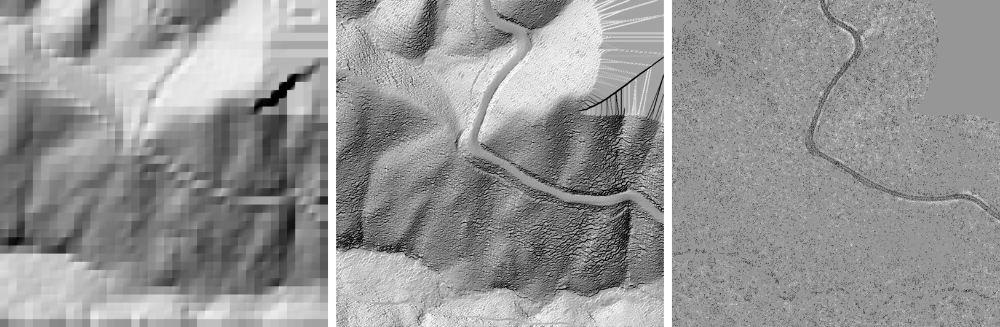

**Proposed in the game.** For each tile, a 0.5 m texture over the 40 m corridor of each road: R = lidar ground minus the 10 m terrain (metres), GB = normal, A = intensity. The terrain mesh near the car is refined to 1 m in that corridor (CPU, at tile build), and the ground shader takes its normal and its paint from the texture. One fetch per pixel. The road ribbon and its grading stay as they are (the road-engineering code owns the carriageway); the texture changes only the ground outside the ribbon. This needs the road owner's agreement before it goes in.

## What makes a picture look real to the eye

Studies that asked people "photograph or render?" agree on a short list:

- **Rough surfaces and soft shadows count most.** Rademacher et al. (EGWR 2001) changed one thing at a time in rendered scenes: soft shadows and surface roughness raised perceived realism; more objects or more lights did not. Fan et al. ("Image visual realism", IEEE TPAMI 2018) found the same cues plus colour saturation and shading smoothness, and trained a predictor on them.
- **Natural pictures have power at every size.** A photograph's amplitude spectrum falls as about 1/f (Field 1987; van der Schaaf and van Hateren 1996). A render with a flat colour at 0.5-10 m and a photo texture below 0.5 m has a hole in the middle: the eye reads it as "painted". This hole is the main fault of our grass, walls and verges.
- **Nothing real repeats.** Vision finds a repeated pattern in parallel and fast (texture segregation, Julesz). One repeat in view is enough to say "game".
- **Wear follows physics.** Dirt collects where water runs and stops (under sills, at the foot of walls), edges wear where hands, feet and tyres touch, and paint fades on the sunny side. Random grime looks wrong because the eye knows where dirt goes.
- **Depth at grazing angles.** At the driver's eye height (1.1 m) the ground is seen at 2-10 degrees. A flat texture of grass shows no blades standing up and no shade between them; real grass does.
- **Contact and occlusion.** Objects without a dark line where they meet the ground float (contact shadows, ambient occlusion).
- **Clutter.** Real streets carry wires, signs, cracks, stains, litter, drains, meters; their absence reads as "too clean".

### The realism cue checklist

Score: 0 missing, 1 crude, 2 good, 3 like a photograph. Ocean Drive is scored from the v2.0.1 screenshot (`ocean.png`); the other hero roads wait for the PC captures.

| Cue | Ocean Drive now | Cost to fix | Fix | Owner |
|---|---|---|---|---|
| Middle sizes (0.5-10 m) on grass and verges | 0 | 0.1-0.3 ms | **grass field (built below)** | this thread |
| No visible repeats on the ground | 1 | 0.05 ms | hex tiling (in the grass field; same for sand and grain next) | this thread |
| Blades and depth on near grass | 0 | 0.1-0.3 ms | parallax blade shells (grass field) | this thread |
| Wall surface: grain, patches, cracks, repairs | 1 | 0 ms | graph surface + texture by example | this thread |
| Water-driven grime on walls (sills, wall base, roof edge) | 1 | 0 ms | already in the building shader; more by graph wear facts | this thread |
| Edge wear and bevels (kerbs, corners) | 0 | 0 ms | rounded kerb edge and corner normal in the shader | this thread |
| Ground shadows from the photo vs the game's sun | 1 | 0 ms | unbaked aerial (prototype 1) | this thread |
| Contact shadows and occlusion | 1 | (lighting) | Lumen and contact shadows | picture thread |
| Road: patches, crack seal, oil drip line, worn paint | 1 | 0 ms | lidar intensity + graph surface | this thread with picture thread |
| Clutter: wires, signs, meters, drains, litter | 1 | low | roadside corridor 5.4 | knowledge-graph thread |
| Plants varied in species, size, health | 1 | low | graph species + season | this thread |
| Exposure and colour like a phone photo | 1 | 0 ms | 5.2 | picture thread |

The cheapest large gains are the middle sizes, the depth on near grass and the no-repeat ground. They are all in one shader change, the grass field.

## The grass field: real texture at every size, from almost nothing

This is the "new tech" the project owner asked for. It needs no stored textures beyond the 640 px CC0 grass photograph we already have, no new draw calls and no AI on the frame.

1. **Micro (under 0.5 m): no-repeat photograph.** Hex tiling (Mikkelsen, JCGT 2022): three lookups of the same photograph, each rotated and offset by a hash of its hex cell, blended with the contrast restored. No two metres of lawn are the same.
2. **Meso (0.3-10 m): the size that was missing.** Hashed value noise makes clumps (0.3-1 m, brighter and darker), patches of yellower and bluer grass (2-8 m), clover spots and dry patches. The dry share comes from the season and the graph (`state:dormant_tan`, `state:cured_straw`); for now `-SimCruiseGrassDry=0..1`. It only multiplies around 1, so the mean colour that the photograph and the colour grade set does not move.
3. **Near (under 22 m): blades with depth.** The pixel marches 8 thin shells from 8 cm down to the ground along the view ray. On each shell it tests one flat, tapering, leaning blade per 2 cm cell on two offset grids (St. Augustine blades are 6-10 mm wide); the first blade the ray meets decides: high is a bright tip, low is a dark base, none is shaded thatch. So blades stand up, hide each other and shade their bases, with parallax as the car moves. This is shell texturing (the fur technique) done inside one pixel, with no extra geometry. The shells start at a per-pixel random height, so they never show as steps; blades fade out where the land-cover mask is under about 0.6 (path edges) and where a pixel covers more than 1-2 cm of lawn, so they cannot shimmer. The first version thresholded value noise per shell instead; on the PC it drew stacked cones like a sawtooth carpet and spilled onto the beachwalk (picture below).

All three are arithmetic in the existing ground shader: about 3 texture fetches and roughly 150 ALU operations per grass pixel near the car, fewer far away. On a 28 W GPU that is expected at 0.1-0.3 ms when lawns fill half the screen; the PC measures it.

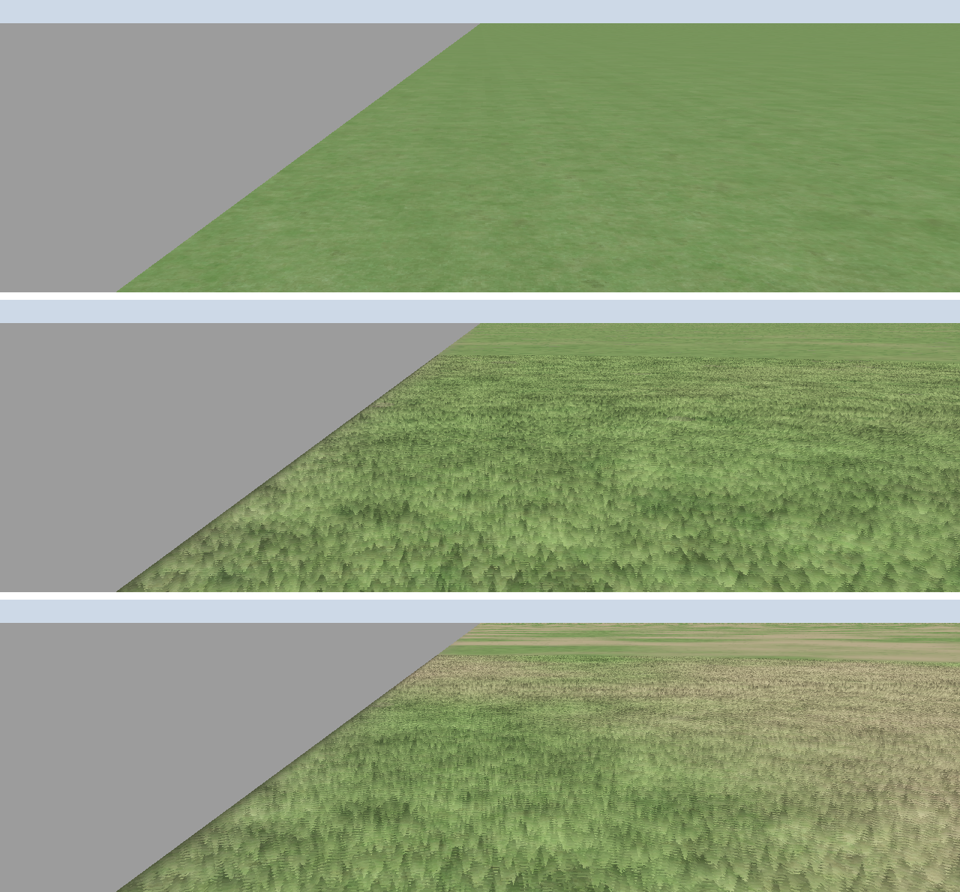

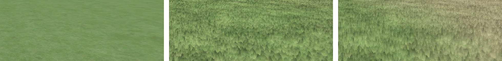

**Where AI helps.** (a) An optimiser on the CPU fits the field's few numbers (clump size, patch colours, blade height and density) per species and season to licensed photographs of real lawns, by the realism score's detail and colour parts. (b) Texture by example makes the micro photograph for a species with no CC0 scan. No network runs while driving.

**In the game.** Ground material parameters `GrassField` (on; `-SimCruiseNoGrassField` turns it off) and `GrassDry`. The materials are rebuilt with `-run=SimCruiseBuildWorldMaterials`.

## The knowledge graph chooses the surfaces (the project owner, 13 November)

The project owner asked: can the AI use a knowledge graph to make building textures, roads, grass and so on? Yes. The place knowledge graph ([../place-graph.md](../place-graph.md)) already chooses each building's recipe, details, colours and wear from facts. The plan extends the same graph from buildings to every surface.

**How it works.**

1. **Facts about each surface.** A road gets `road:<class>` and its OSM `surface`. A land patch gets `land:<cover>`. Every surface also gets the facts of its place: `region:*`, `climate:*`, `district:*`, `near:sea`, and `season:*` from today's date and the climate.
2. **Rules make surface facts.** The same rule engine (weakest `if` fact, noisy OR, negative weights suppress) turns them into `surface:*` and `state:*` facts. Examples: tropical lawn = St. Augustine turf; Southeast lawn in November = dormant tan Bermuda; Great Plains grass in autumn = cured straw; Deco wall = smooth stucco; Main Street block before 1945 = common brick; OSM `surface=concrete` = concrete slabs with 4.5 m joints.
3. **Measured facts outweigh rules.** Lidar intensity that varies in blocks gives `measured:intensity_patchy` (patched asphalt). Bright pavement in the unbaked aerial photograph gives `measured:bright_pavement` (aged asphalt). A licensed street photograph gives the wall colour (already done for walls). So the rules give a good first guess everywhere, and measurement corrects it where data exists.
4. **Each surface names a material.** `surface-rules.json` maps each `surface:*` to the shader layer it uses (Ground, Asphalt, Concrete, Building), its albedo, its detail texture, scale and amount, and a CC0 library set for later (ambientCG, Poly Haven). The shaders do not change: the graph only chooses their inputs per feature.
5. **Local AI helps off the frame, never on it.** (a) Texture by example (method 5) makes a swatch on the CPU when the graph chooses a surface with no library texture. (b) The live-data thread's open-licence photo parser adds `seen:*` facts (for example "this wall is brick"). (c) A local model on the CPU can draft new rules from open sources (Wikidata, USDA and FHWA tables); a draft rule enters the rule file only when a test against real photographs passes. A rule is a fact with a reason, so every choice can be traced.

**Prototype** (`lab/surface-graph/`, Ocean Drive tile 18180_27907, November): 75 features resolved in under a second on the CPU. 20 lawns become St. Augustine turf (confidence 0.85), 3 beach patches quartz and shell sand (0.9), 24 streets aged asphalt (0.8), 27 service lanes patched asphalt (0.7), Collins Avenue mid-life asphalt. Run it with `--month 1` for a humid-subtropical tile and the Bermuda lawns turn dormant tan. The picture shows the unbaked photograph, the graph's choice, and the choice corrected toward the measured colour.

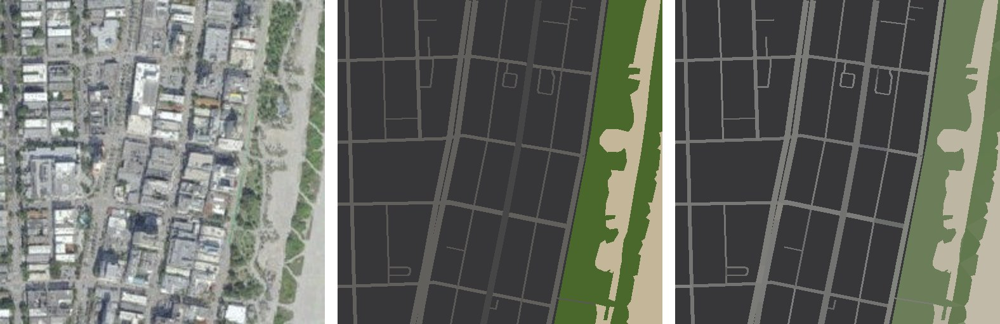

**Limits found.** The 2.4 m photograph mixes a lawn with its paths and palms, so its colour is too grey to be the grass albedo; the measured colour must come from NAIP at 0.6 m or from street photographs, and it must be converted from camera sRGB to albedo (the sand of known albedo on the same tile can set that gain). Building surfaces need the C++ hub's facts (style, era, recipe), so the prototype covers roads and land; the hub already has the engine and needs only the extra rule file.

**In the game (next step).** `SimCruisePlaceHub` loads `surface-rules.json` beside `place-graph.json`; `BakeForBuild` resolves roads and land patches on the worker thread; the tile builder writes the chosen material id and colour into vertex colour (no new draw calls), as it does for walls. This touches the knowledge-graph and world-look code, so it goes in with those owners after Wave A.

## Results in the game

Realism A/B on the PC (`scripts\realism.ps1`, ultra, traffic off, the build at commit `66e9129`):

| Aerial | REALISM line |
|---|---|
| Unbaked (default) | `REALISM lummus: 45.7 / 100  layout 31.8  tone 38.4  colour 50.3  structure 55.4  detail 67.2  sky 30.7` |
| Baked (`-SimCruiseBakedAerial`) | `REALISM lummus: 45.8 / 100  layout 32.1  tone 38.2  colour 50.0  structure 55.3  detail 67.0  sky 31.4` |

Nothing moved more than 0.7 on any part, within the run-to-run noise: from the lummus pose the near ground is the park and promenade materials, and the aerial photograph shows only in the far ground, so this score cannot see the change. The unbaked photographs stay on by default (the rule was to turn them off only if the total dropped by 1.0 or more). The change shows from above and at a distance, where the photograph is the ground (see the image in Prototype 1): in the drive capture's top-down shot at the Ocean Drive start the two frames differ by 4.2 / 255 per pixel, almost all of it the lifted shadows beside the road.

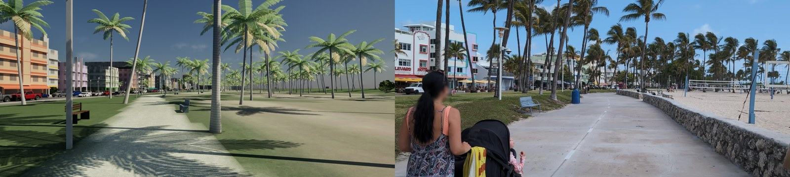

Right half of each image: Panoramax [4b6d216b](https://panoramax.xyz/#focus=pic&pic=4b6d216b-ae1c-48a8-b2ae-5d9558334f18) by MatthiasMatthias, CC BY-SA 4.0, resized.

## Grass field in the game

Measured on the PC on 13 November 2026 (`scripts\realism.ps1`, ultra, traffic off; field on is the default, `-SimCruiseNoGrassField` turns it off). The dragon and bixby poses come from the picture thread's realism poses (Tail of the Dragon, Bixby Creek Bridge) and were run with the first blade version; lummus was run again after the blades were rebuilt (below).

| Pose | Field on | Field off |
|---|---|---|
| lummus (final blades) | `REALISM lummus: 45.4 / 100  layout 31.4  tone 34.9  colour 52.3  structure 55.1  detail 66.7  sky 33.1` | `REALISM lummus: 45.5 / 100  layout 31.4  tone 34.9  colour 52.2  structure 55.6  detail 66.9  sky 32.9` |
| lummus (first blades) | `REALISM lummus: 46.2 / 100  layout 31.9  tone 38.8  colour 50.2  structure 56.6  detail 67.2  sky 31.7` | `REALISM lummus: 45.8 / 100  layout 31.8  tone 38.4  colour 50.3  structure 55.4  detail 67.3  sky 30.7` |
| dragon | `REALISM dragon: 45.9 / 100  layout 29.6  tone 18.0  colour 72.9  structure 66.5  detail 71.7  sky 10.9` | `REALISM dragon: 45.8 / 100  layout 29.6  tone 18.1  colour 72.6  structure 66.5  detail 71.7  sky 10.9` |
| bixby | `REALISM bixby: 34.9 / 100  layout 17.2  tone 20.8  colour 46.5  structure 59.0  detail 46.5  sky 11.3` | `REALISM bixby: 34.4 / 100  layout 17.2  tone 20.6  colour 45.5  structure 57.7  detail 46.2  sky 11.2` |
| bixby, July (`-SimCruiseGrassDry=0.9`) | `REALISM bixby: 34.1 / 100  layout 17.0  tone 20.3  colour 45.1  structure 55.6  detail 49.0  sky 10.8` | |

No pose moved by 1.0 or more, so the field stays on by default. The score is taken at the photographs' distances, where the field only changes the lawn's mid-size texture; the blades show only within 22 m. At Bixby the hills are the regional terrain, not the tile ground the field is written for, so the dry setting barely changes them (the next step is the same field in the landscape material).

GPU cost: RTX 2070 Super Max-Q, plugged in, 1920x1080 full screen, parked at the Ocean Drive start at 11:00 with Lummus Park on the left, traffic off, `-SimCruiseDrivePerf=high,ultra`, two runs each way, GPU ms average of the 10 s window:

| View | Field on | Field off | Difference |
|---|---|---|---|
| High, driver's seat | 48.9, 49.1 | 48.3, 47.6 | +1.0 ms (2 %) |
| High, chase | 40.4, 40.5 | 40.1, 39.2 | +0.8 ms |
| Ultra, driver's seat | 87.7, 88.0 | 86.1, 84.7 | +2.4 ms (3 %) |
| Ultra, chase | 67.0, 67.0 | 66.0, 64.5 | +1.7 ms |

`ProfileGPU` (High, driver's seat): BasePass 5.59 and 5.64 ms with the field, 4.86 and 5.43 ms without, so about +0.5 ms of the difference is the ground's base pass. This laptop's GPU ran about 3.5 times slower than in the 11 November table (High seat 13.7 ms then): it was at its power cap. At full power expect about a third of these differences.

**The blades, close up.** The first blade version (noise thresholded per shell) drew stacked cones and spilled onto the beachwalk; the version in the game now (thin leaning blades per 2 cm cell, jittered shells, gated by the land-cover mask and the pixel size) reads as fine turf with no stripes or swimming. It is subtle; the clump and patch sizes do more for the lawn than the blades.

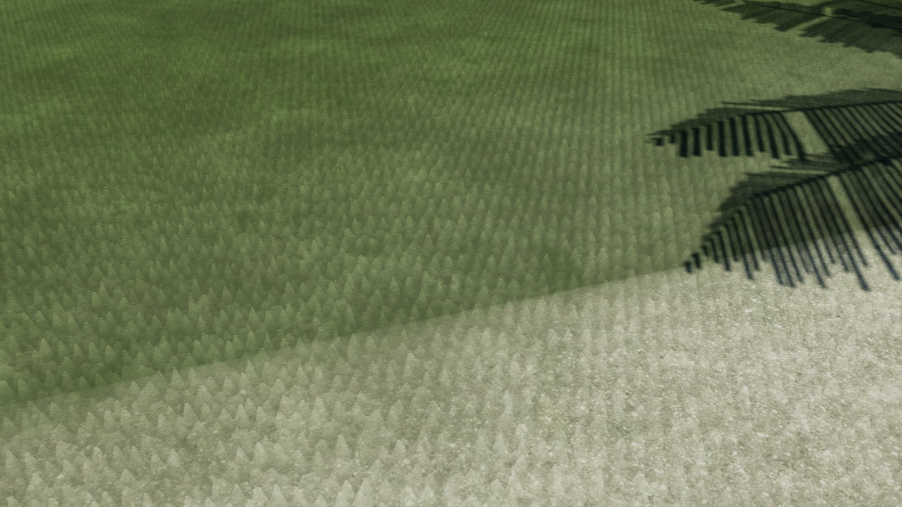

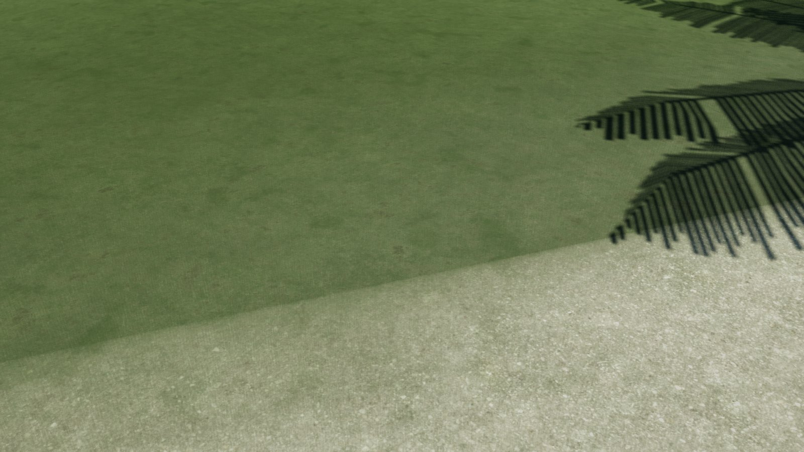

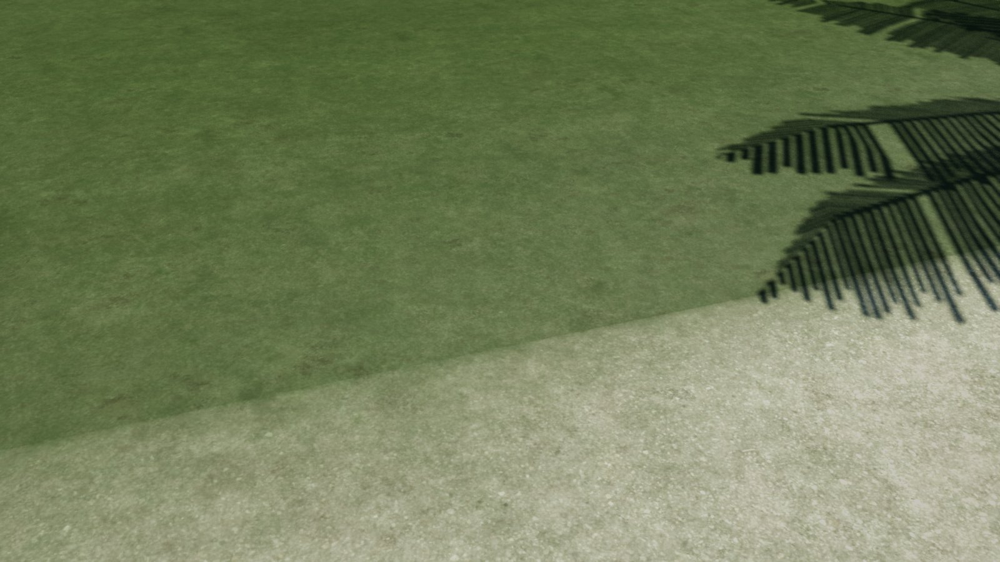

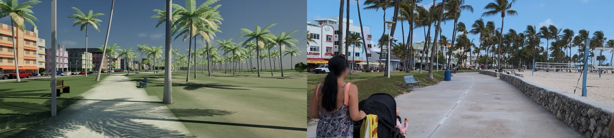

Right half of the last two images: Panoramax [4b6d216b](https://panoramax.xyz/#focus=pic&pic=4b6d216b-ae1c-48a8-b2ae-5d9558334f18) by MatthiasMatthias, CC BY-SA 4.0, resized.

## Grass field on the hillsides (13 November 2026)

The regional landscape (`M_SimCruiseLandscape`, the 45 km mesh drawn past 550 m) now has the grass field too. The ground and the landscape share one HLSL text (`USimCruiseWorldResources::GrassFieldHlsl()`, struct `FGF`: hash, value noise and the meso layer), prepended to each Custom node. On the hills the meso layer runs at 25 times a lawn's sizes: clumps about 11 m, patches of yellower or bluer grass about 125 m, and dry patches about 175 m that turn straw-gold with `GrassDry`. It is drawn only where the photograph shows plants (coloured, not bright, greener than blue), so rock, sand, sea and today's snow keep their colour. Each part fades out before a pixel is wide enough to alias it. There is no micro texture and there are no blades: past 550 m a pixel covers metres of hill. Same flags as the ground: `-SimCruiseNoGrassField`, `-SimCruiseGrassDry=0..1`.

Measured on the PC (build from `11d3c79`, ultra, traffic off):

| Pose | Field on | Field off |
|---|---|---|
| bixby | `REALISM bixby: 34.8 / 100  layout 17.2  tone 20.7  colour 46.4  structure 58.4  detail 46.6  sky 11.3` | `REALISM bixby: 34.6 / 100  layout 17.2  tone 20.8  colour 46.5  structure 57.6  detail 46.4  sky 11.3` |
| bixby, July (`-SimCruiseGrassDry=0.9`) | `REALISM bixby: 34.1 / 100  layout 16.9  tone 20.1  colour 45.4  structure 55.5  detail 48.8  sky 10.8` | |
| lummus | `REALISM lummus: 45.4 / 100  layout 31.3  tone 34.9  colour 52.3  structure 55.2  detail 66.7  sky 33.1` | 45.5 (the table above) |
| dragon | `REALISM dragon: 45.3 / 100  layout 29.6  tone 18.1  colour 68.3  structure 66.4  detail 71.2  sky 10.7` | `REALISM dragon: 45.3 / 100  layout 29.6  tone 18.1  colour 68.2  structure 66.4  detail 71.0  sky 10.7` |

No pose drops by 1.0, so the field stays on. Dragon is 0.6 lower than in the table above both with and without the field: the change came with the other commits on `main` since then, not the field. The dry setting makes the far ridges straw-coloured in patches and costs 0.7 at Bixby: the reference photograph was taken in a green July, so the score cannot judge a gold one.

GPU at the Bixby viewpoint, High, 1920x1080, plugged in (power-capped as before), two runs each way: chase view 31.2 and 30.2 ms with the field, 29.7 and 32.7 ms without; driver's seat 37.4 and 37.1 ms with, 36.9 and 37.5 ms without. The difference is inside the run-to-run spread (about 3 ms in the chase view): too small to measure.

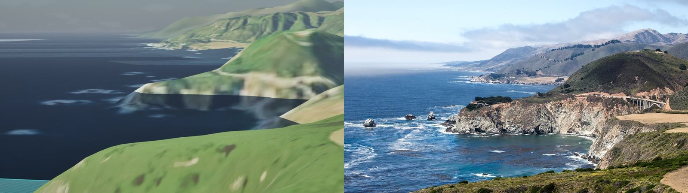

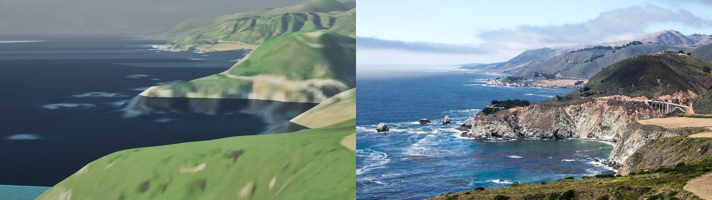

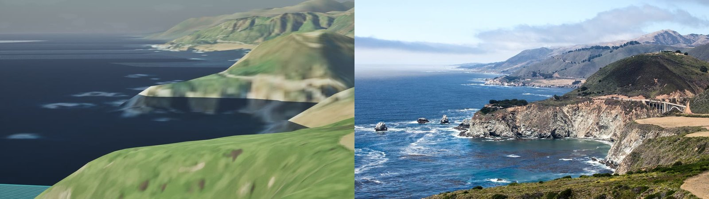

Right half of the Bixby images: Wikimedia Commons [Bixby_Creek_Bridge_juli_2016.jpg](https://commons.wikimedia.org/wiki/File:Bixby_Creek_Bridge_juli_2016.jpg), CC0, resized.

## The AI detail kit (13 November 2026)

Fine detail for the road and the ground up close, made once and offline by an open image model. Stable Diffusion XL base 1.0 (CreativeML Open RAIL++-M) made eight 1024 px top-down photographs (`lab/detail-kit/generate.py`, 30 steps, guidance 6, seeds 20261113 to 20261120): asphalt, concrete, stucco, brick, soil, sand, leaf litter and bark. `make_kit.py` turns each into an albedo ratio with mean 1. It divides the photograph by a wide blur of itself, so the slice holds only fine detail and never sets the colour. A soft clamp in log space keeps each slice inside its material's range (asphalt 0.60 to 1.50, concrete 0.75 to 1.30). The packer also makes each slice tileable, derives normals from the height, and packs a 4 x 2 atlas (`data/art/detail-kit/`, 2048 x 1024, albedo and normal). Per-slice 5th and 95th percentiles: asphalt 0.75/1.23, concrete 0.90/1.07, soil 0.76/1.26, sand 0.86/1.17, litter 0.73/1.32.

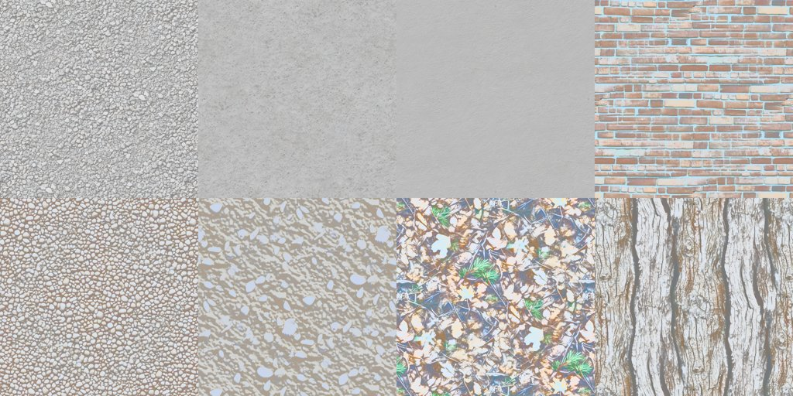

**In the game: road and ground only.** `DetailKitCode` (struct `FDK`) does hex tiling: three rotated, offset lookups so a slice never visibly repeats. Brick tiles plainly and bark is never rotated (both have a direction). The layer fades in from 0.5 m and out by 40 m, and fades out before a slice is under about 30 pixels. Its mip footprint is clamped, so it never mixes slices or shimmers. The asphalt material uses the asphalt slice (soil on the gravel edge). The ground's dominant class picks soil, pavement concrete, sand or leaf litter; lawns keep the grass field. Walls, kerbs and palm bark were tried and left out to keep the layer small: on walls the change was barely measurable (mean pixel difference 0.8 of 255 in a close facade frame). The layer is on by default; `-SimCruiseNoDetailLayer` turns it off.

Near frame on the Ocean Drive carriageway, 1.65 m eye, 30° down (left on, right off). The fine high-pass energy of the frame rises from 7.7 to 9.1 (+18 %) at the same mean brightness (111.9 vs 111.8). The aggregate reads as stones rather than blotches.

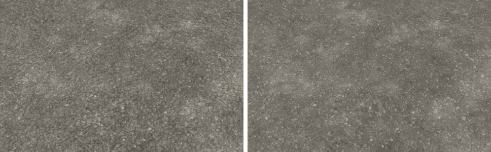

Realism (`scripts\realism.ps1`, ultra, traffic off, build `70b9236`):

| Pose | Layer on | Layer off |
|---|---|---|
| lummus | `REALISM lummus: 45.8 / 100  layout 31.5  tone 35.3  colour 52.3  structure 55.6  detail 67.9  sky 33.0` | `REALISM lummus: 45.8 / 100  layout 31.5  tone 35.3  colour 52.3  structure 55.7  detail 67.8  sky 33.0` |
| dragon | `REALISM dragon: 45.3 / 100  layout 29.6  tone 18.0  colour 68.2  structure 67.4  detail 69.7  sky 10.6` | `REALISM dragon: 45.2 / 100  layout 29.6  tone 18.0  colour 68.1  structure 67.2  detail 69.7  sky 10.6` |
| bixby | `REALISM bixby: 35.0 / 100  layout 17.2  tone 20.7  colour 46.4  structure 59.0  detail 47.0  sky 11.3` | `REALISM bixby: 35.0 / 100  layout 17.2  tone 20.7  colour 46.4  structure 59.0  detail 47.0  sky 11.3` |

GPU, the same setup as the grass field (Ocean Drive start, 11:00, High, 1920x1080 full screen, plugged in and power-capped, `-SimCruiseDrivePerf=high`, two runs each way, GPU ms average of the 10 s window):

| View | Layer on | Layer off | Difference |
|---|---|---|---|
| High, driver's seat | 48.31, 47.75 | 47.64, 48.14 | +0.14 ms |
| High, chase | 39.35, 39.29 | 39.17, 39.37 | +0.05 ms |

Both are inside the run-to-run spread. The scores cannot see the layer: the poses' photographs are taken from 10 m or more, where the layer has faded out. It is for the driver's near view of the road and the verge. No pose dropped by 1.0 or more and the cost is under 1.5 ms, so it ships on.

## Leaf mips for the Dragon's trees (13 November 2026)

The leaf PNGs are black where they are transparent, so the box-filtered mips and the bilinear lookup at the cut mixed black into every leaf edge, and the averaged alpha fattened the clusters (46 % covered at full size, 53 % by the 96 px mip). The result was dark, solid blobs with distance. `LeafMipChain` (`SimCruiseTrees.cpp`) fills the transparent texels with the mean leaf colour, averages colour by alpha and scales each mip's alpha to keep the full-size coverage at the 0.3 clip. It runs on the CPU at load; `-SimCruiseOldTreeMips` gives the old chain for an A/B.
GPU, Dragon start, Miata, High 1920x1080 full screen, two runs each: driver 30.26, 30.25 ms old vs 30.22, 30.25 ms new; chase 22.76, 23.11 ms old vs 23.21, 23.56 ms new (+0.45 ms, close to the run-to-run spread).
Realism dragon: 44.8 old, 44.9 new. In motion (preflight robot, 318 frames at 10 fps), the windscreen band's frame-to-frame change is 9.41 old vs 9.52 new and fine detail is 1.77 vs 1.83: no new shimmer or pop.
Not fixed: the crown cards keep sphere-like normals (whole crowns shade as one ball), and close crowns stay soft because the 768 px cluster texture is magnified.

## Handoff (13 November 2026)

- **Grass field on the hillsides** is on `main` (`9cc7d6f`): the ground and the regional landscape share one meso-layer HLSL helper. Measurements are in the section above.
- **AI detail kit** is on `main`, road and ground only, on by default (section above). To remake it: `lab/detail-kit/generate.py` (needs torch + diffusers and the SDXL weights; on this PC the venv is `C:\sc-cache\detailkit-venv`), then `make_kit.py --raw raw --out ../../data/art/detail-kit`. The game reads the PNGs at start, so a remake needs no material rebuild. The stucco, brick and bark slices are in the atlas but unused.
- **World work stops here.** Not done: a check of the layer in motion beyond the still frames (no shimmer was seen, but there was no video A/B), and a palm bark slice that looks like a palm (the SDXL bark is a furrowed broadleaf bark).
## Sources

- USGS 3DEP lidar point clouds in Entwine format on AWS (`usgs-lidar-public`), US public domain.
- NOAA Office for Coastal Management, Miami-Dade 2021 lidar (Entwine, `noaa-nos-coastal-lidar-pds`), public domain.
- USGS The National Map, USGSImageryOnly (the bundled aerial photographs), public domain.
- Shadow detection and removal in aerial photographs with lidar: Zhan et al., "Shadow detection and removal for high resolution city aerial photo" (ISPRS XXXV congress, comm. 3, paper 378); true orthophoto with lidar DSM (ISPRS XX congress archives).
- Efros and Freeman, "Image quilting for texture synthesis and transfer", SIGGRAPH 2001.
- Depth Anything V2 model card (Hugging Face, depth-anything/Depth-Anything-V2-Small) for the training data that blocks it.
- Gaussian splats in Unreal Engine 5: NanoGaussianSplats (Digital Production, March 2026); EVolSplat (arXiv 2503.20168).
