# Unreal client architecture

How the Unreal client is put together, one section per area. The Godot client was the behavioural and calibration reference; since 11 November 2026 it lives only at the git tag `godot-final` (`git show godot-final:game/<file>`); see the [rewrite design](superpowers/specs/2026-11-10-simcruise-unreal-rewrite-design.md) and the [migration plan](superpowers/plans/2026-11-10-simcruise-unreal-migration.md).

## Vehicle physics core

Source: `Source/SimCruise/{Public,Private}/Vehicle/`, tests in `Source/SimCruise/Private/Tests/Vehicle*`.

### The pieces

| Piece | What it is |
|---|---|
| `FSimCruiseCarDefinition`, `FSimCruiseCarDefinitionLoader` | The car file (`data/cars/<id>.json`, canonical) in C++, every field unit-labelled and validated, sources kept. An Unreal calibration overlay (`Content/Vehicle/Calibration/<id>.json`) may replace estimated fields; each overlay states its reason in `_note`, and the bench logs what it changed. |
| `FSimCruiseVehicleSim` (`SimCruiseVehicleSim.h`) | The vehicle model, independent of any engine object: a faithful port of `godot-final:game/Powertrain.gd` and `godot-final:game/CarSuspension.gd`. Ray contacts, springs with installed preload, dampers (ratio with a knee, or a shaft-speed dyno table), anti-roll bars, bump stops, camber gain and caster, Ackermann steering with toe, relaxed slip angles with load-dependent relaxation length, the saturating slip-angle curve with camber thrust, the slip-ratio tyre curve with combined slip through a friction ellipse and load sensitivity, wheel inertia solved together with the contact force, locked-wheel sliding, engine torque curve with friction, idle governor and fuel cut, clutch (or converter, or dual clutch) with launch control, automatic (with the 0.45 m/s reverse inhibitor) and manual gearboxes with stalling, torque-sensing differentials (front, rear, centre), service and parking brakes, ABS and traction control on the cars that had them, aerodynamic drag and rolling resistance, plus Godot's steering maps (assisted keys, thumbstick shaping, direct). |
| `SimCruiseDynamics::*` (`SimCruiseVehicleDynamics.h`) | The per-stage formulas the model is made of (suspension load, bar and spring rates, relaxed slip angle, friction coefficient, lateral force, one longitudinal substep, engine curve, differential split), unit-tested on their own. |
| `SimCruiseUnits` (`SimCruiseUnits.h`) | The only place SI meets Unreal: m to cm, N to kg·cm/s², N·m and kg·m² to their cm² forms, degrees, road-test units, and Godot's axes (X right, Y up, −Z forward) to Unreal's (X forward, Y right, Z up). |
| `USimCruiseVehicleMovementComponent` | Puts the model on Chaos. Configures the root body from the car (mass, centre of mass, principal inertia in Unreal axes, Godot's damping, inertia conditioning off, never sleeps) and registers a Chaos sim callback that runs the model on the physics thread before every fixed step. Holds the controls, gearbox commands and telemetry behind one lock. |
| `ASimCruiseVehicle` | The pawn: a simulating box (the car file's collision box, centred `collision_box_y` above the Godot car origin) plus the movement component, with the driving-shell interface. |
| `FSimCruiseVehicleTelemetry` | What HUD, rumble, audio and presentation read: speed, rpm, gear text, manual/reverse/stall/shift state, brake lamps, steering input and rack angle, clutch, throttle after traction control, ABS and TC activity, sound observers (Powertrain.gd's `sound_*`), stranded timer, and per wheel: contact, load, slip ratio and its peak, slip angle, grip use and combined grip use, angular speed and accumulated spin angle, suspension length, steer angle, inclination, tyre forces, surface grip, ABS pressure, contact point. |

### Where the forces are computed

Chaos ticks asynchronously at a fixed step (`Config/DefaultEngine.ini`: `bTickPhysicsAsync=True`, `AsyncFixedTimeStepSize=1/360 s`). Before every step, `FSimCruiseVehicleSimCallback::OnPreSimulate_Internal` (a `Chaos::TSimCallbackObject`) runs on the physics thread:

1. read the particle (`FRigidBodyHandle_Internal`: position, rotation, centre-of-mass velocity, angular velocity, centre of mass) and convert to SI;
2. apply pending gearbox commands and the latest controls; run a bench driver if one is installed;
3. cast the four suspension rays (`UWorld::LineTraceSingleByChannel` on `GroundTraceChannel`, the owner ignored; the same physics-thread query Epic's Chaos Vehicles make);
4. step the model over the interval, splitting it into wheel/driveline substeps no longer than `MaxWheelSubstepSeconds` (1/360 s);
5. add the summed force and its torque about the centre of mass to the particle (`AddForce`, `AddTorque`), converted to Unreal units;
6. publish telemetry.

`SimCruise.Vehicle.Chaos.ForceIntegration` proves the boundary: a known SI force and torque applied this way for 360 steps gives exactly `F·t/m` and `τ·t/I` (within float precision, 1.4e-6 of 0.55 m/s), one callback per step, every step the fixed interval. `SimCruise.Vehicle.Determinism` runs the same launch twice and compares 22 state values bit for bit (all equal). That holds for a single-threaded solver with the controls applied by a physics-thread driver (`SetPhysicsThreadDriver`), as the benches do. The bench world runs a plain `AGameModeBase` (set in its world settings before play): with the project's `SimCruiseGameMode` the test world started the drive, streamed the Ocean Drive tiles onto the pad on worker threads, and the skidpad car ran into whatever had landed at a wall-clock moment, which made `Convergence.mustang65`'s 720 Hz reference read 0.686–0.706 g. The determinism test now runs the whole CarTrack (launch, stop, restart and skidpad) twice, and every CarTrack run fails if the car stops harder than 5 g (it hit something). Controls set from the game thread are picked up by whichever physics step runs next, so with Chaos on its own threads the step on which a pedal change lands can differ by up to a game frame between runs; replays and anything that must reproduce step for step drive the car from the physics thread.

### Why 360 Hz

Godot evaluated contacts, loads and slip angles once per 60 Hz tick and integrated wheels and driveline in six 1/360 s substeps. In Unreal everything runs at 360 Hz. `SimCruise.Vehicle.Convergence.<car>` runs CarTrack at five rates:

| Rate (body / wheels) | NB 0–60 · 70–0 · skidpad | Mustang | Corvette |
|---|---|---|---|
| 60 / 360 Hz (Godot's scheme) | 7.99 s · 172.9 ft · 0.884 g | 9.01 s · 265.2 ft · 0.699 g | 3.47 s · 151.7 ft · 1.025 g |
| 120 / 360 Hz | 7.99 · 172.4 · 0.884 | 8.94 · 264.0 · 0.698 | 3.47 · 150.7 · 1.024 |
| 240 / 480 Hz | 7.98 · 172.0 · 0.884 | 8.95 · 263.7 · 0.698 | 3.46 · 150.0 · 1.023 |
| **360 / 360 Hz (shipping)** | **7.97 · 171.9 · 0.884** | **8.95 · 263.6 · 0.698** | **3.46 · 150.1 · 1.024** |
| 720 / 720 Hz | 7.97 · 171.8 · 0.884 | 8.94 · 263.4 · 0.698 | 3.46 · 149.6 · 1.021 |

(Mustang with its Unreal brake calibration; see `docs/cars.md`.) From 360 to 720 Hz no result moves by more than a fifth of its calibration band (the test's gate), so 360 Hz is converged; 240 Hz would nearly do, but 360 Hz keeps the wheel substep the cars were calibrated with and leaves margin for curbs and the Corvette's stiff springs. The vehicle's own physics-thread work measured 21–34 µs a step on the target i9-10885H (four traces included), about 8–11 ms of CPU per simulated second per car, around 1 % of one core. A whole bench (engine tick included, single-threaded) runs 15–20 times faster than real time.

Two Godot behaviours turned out to depend on the step and were fixed in the port rather than copied:

- The clutch caps its coupling at the torque that closes the slip gap in one substep. In first and second gear that cap binds below `clutch_stiffness`, so it is part of each car's calibrated launch; it is now evaluated at the calibration substep (1/360 s) instead of the actual one, which keeps launches identical at every rate (0–60 at 720 Hz moved 0.03 s before).
- Godot's 60 Hz contact step let the Corvette's left and right loads swap every tick during its traction-controlled launch (a numerical roll oscillation that cost traction); at 120 Hz and above it is gone and the car reaches 60 mph in 3.46 s instead of Godot's 3.55 s (target 2.8 s, a stated open item).

The port also found a bug in the first Unreal helper: the anti-roll bar rate returned 0 for any bar whose second moment of area is under `UE_DOUBLE_SMALL_NUMBER` (1e-8 m⁴), which is every bar under about 21 mm, including the NB's 11 mm rear bar. That shifted the roll stiffness forward and cost the NB 0.022 g on the skidpad; `SimCruise.Vehicle.Model.SuspensionPreload` now checks both bars against CarSuspension.gd's formula.

### Who owns the body

The movement component owns the root body's Chaos particle and mass properties:

- When the body's physics state is recreated (collision switched off and on, a re-register), the old particle is queued for deletion. The component listens to `OnComponentPhysicsStateChanged`: on *destroyed* it stops stepping the old particle at once, on *created* it configures the new one. Before this, the physics thread kept the old pointer and crashed on its next step (use after free); `SimCruise.Vehicle.Chaos.BodyOwnership` recreates the body mid-drive.
- Anything that makes the game thread recompute the body's mass properties (welding an attached collider into the body, rescaling it, a mass override or physical-material change) would swap in a uniform box's mass, centre and inertia. The physics step compares the particle with the car's values every step and puts them back, logs a warning the first time, and counts it in `MassPropertyRestores` (telemetry; should stay 0). The game-thread copy of the particle keeps the recomputed values until the car is set again, so read mass from the car definition, not from the body. Presentation meshes attached to the pawn should have collision off: a welded collider also changes the body's collision shape, which the restore does not undo.
- Lock order is vehicle lock, then physics scene lock: the physics step holds the vehicle lock across its four scene queries. Never call the vehicle's setters while holding a physics scene write lock.

### Interface for the driving shell

On `ASimCruiseVehicle` (and the movement component), all game-thread calls:

- `SetThrottle(0..1)`, `SetBrake(0..1)` (in automatic, below 0.45 m/s the brake pedal selects reverse and drives, as in Godot), `SetSteer(-1..1, bFromThumbstick)` (+ right; a thumbstick gets Godot's centre shaping and rates), `SetHandbrake(bool)` (rear parking brake), `SetClutch(0..1)`, `ShiftUp()`, `ShiftDown()`, `ToggleManual()`; on the component also `SetFullBrake`, `SetManualTransmission`, `RequestEngineStart`, `SetSteeringAssist` (assisted for keys and sticks, off for a real wheel), `ResetVehicle`.
- `ResetAt(GroundLocation, YawDeg)` puts the car on its wheels, stopped (Powertrain.gd `restart`).
- `GetVehicleTelemetry()` / `GetTelemetry()` return the last physics step (fields above). Manual gear refusals arrive as `LastGearMessage` ("Hold the clutch to change gear", "Stop before changing direction", "Speed is too high for that gear").
- `SetPhysicsThreadDriver(TFunction)` runs code on the physics thread before every step with the model, body and controls (benches, replays, autopilots).

Controls set on the game thread reach the physics thread on its next step; telemetry is at most one game frame old. `SimCruise.Vehicle.Interface` drives a car through this interface only, with Chaos on its own task-graph threads as in the game: launch and upshift, steering right (rack, road wheels, load transfer and yaw all to the right), braking to a stop without ever selecting reverse, manual neutral/clutch/first gear and a stall-free clutch release, the handbrake holding, and a reset.

### Not yet done

- Surface grip comes from `FSimCruiseGroundHit::SurfaceGrip` (1.0 on the bench); the world stream needs to supply Godot's per-tile wheel grip and road roughness (`RoadProfileM`, `RoadProfileRateMps` are in place).
- Contacts are rays as in Godot; a wheel-radius sphere cast for curbs and potholes, and an aligning moment for force feedback, are next.
- The ground query reads the game thread's scene-query structure from the physics thread, as Chaos Vehicles do; streamed road collision must therefore be in place before the car reaches it (the world stream's job).
- Packaging: the car files (`data/cars/`) and calibration overlays (`Content/Vehicle/Calibration/*.json`) are loose JSON, which a cooked build does not stage by default; a packaged build needs them added to `DirectoriesToAlwaysStageAsNonUFS` (or moved into assets), or the Mustang loses its overlay. `SIMCRUISE_CALIBRATION_DIR` is read in development builds only.

## Real-world streaming (`Source/SimCruise/{Public,Private}/{Atlas,World}/`)

The streaming layer turns the atlas helper's tile documents into the drivable
place around the car. The Godot client (`godot-final:game/Drive.gd`, `WorldTile.gd`,
`RoadSurface.gd`, `Kerbs.gd`, `LaneMarkings.gd`) and the helper
(`helper/road-grade.mjs`) are the behavioural reference; the design choices
and their reasons are ported, not reinvented.

### The helper contract

- `helper/atlas.mjs <command> <cache> <args...>` prints one JSON document on
  stdout (last line) and exits 0; a failure prints its message on stderr and
  exits 1. Commands used here: `tile <x> <y>` (zoom-16 tile: `h` heights on a
  `grid` (64 for bundled, 128 for live v2 data), `road_grade`, `roads`,
  `road_surface` (v2), `bridges` (v2), `pedestrian`, `buildings`, `land`,
  `pois`, `aerial_key`, `crowns`) and `aerial <x14> <y14>` (fetches the
  zoom-14 photograph `a-<x>-<y>.jpg` into the cache). The other commands
  (search, roofs, canopy, weather, ...) are reachable through the same client.
- Coordinates in every row are tile units (0..1, north-west origin, y south).
  Road rows are `[class, oneway, name, points, width m, surface?, "bridge"?]`.
- The helper owns the network, rate limits, retries, provenance and its
  96 MB cache eviction. The Unreal client never opens a connection.
- Offline start: `data/tiles/<x>_<y>.json` holds the 24 Miami Beach tiles and
  `data/tiles/aerial/a-*.jpg` their photographs; a bundled tile is always read before
  the helper is asked.

### Atlas client (`Atlas/SimCruiseAtlasClient`)

One helper process per request on its own worker thread; at most
`MaxConcurrent` (2) run, the rest queue. Each request has a timeout; timeout
and `Cancel()`/`CancelAll()` kill the process tree. Results are typed:
`None`, `NotConfigured`, `LaunchFailed`, `Timeout`, `Cancelled`, `ExitCode`
(stderr kept), `EmptyOutput`, `MalformedOutput`. Issuing work returns at once
with a future; nothing blocks the game thread. The helper is found as in the
Godot client: `SIMCRUISE_MAP_HELPER`, then `<project>/tools/atlas(.exe)`,
then beside the game binary, then Bun running `helper/atlas.mjs`. The cache
is `<user settings>/SimCruise/map-cache` (`SIMCRUISE_MAP_CACHE` overrides).

### Frame and floating origin (`World/SimCruiseGeo.h`)

Unreal X = east, Y = south, Z = up (centimetres): facing east, south is on
the right, so this is Unreal's own handedness with no mirroring. A drive has
one origin tile and one tile size (the Mercator scale at the start latitude,
`Drive.gd scale_at`); a tile's actor sits at `(tile - origin) * size`. When
the focus is more than `RebaseDistanceM` (2 km) from the origin, the origin
moves to the focus tile, every tile actor moves by whole tiles and
`ASimCruiseWorldStreamer::OnRebased` broadcasts the offset so the car,
cameras and traffic move with it.

### Tile lifetime (`FSimCruiseTileManager`, `ASimCruiseWorldStreamer`)

The 3 x 3 ring around the car's tile is wanted, best first by the Drive.gd
score (40 % distance from the car, 60 % from where it will be in 5 s); tiles
beyond the ring plus one are retired; at most 2 build at once and never two
edge neighbours together (see seam contracts). Every job carries the
generation of the place it was started for and a serial: a result for an
older place, a tile no longer wanted or a superseded job is dropped. A
failed tile waits 15 s. Tiles are read and built on worker threads (a helper
result is parsed and built on the thread pool, never in the future's
continuation, which can run on the game thread); the game thread installs one
finished tile per frame (mesh sections, collision, materials). Collision is
cooked asynchronously, so a tile is drawn a few frames before it can be hit:
`AreTilesReadyAround` only reports a tile once a trace through its centre hits
its collision, so a car placed after it lands on the road. Tiles of one
zoom-14 photograph that build together run the helper's `aerial` command
once; the others wait for that file.

### Roads (`World/SimCruiseRoadNetwork`)

1. Pieces in tile metres; ends on the tile edge are exact, and they are
   never chained to another piece there (they continue in the neighbour).
2. Chains through junctions (the straightest pair joins; road-grade.mjs).
   A small closed ring (a cul-de-sac bulb) becomes a paved pad.
3. Plan view: each mapped vertex is filleted (edge-authority's
   `chainVertices`: at most 1 m off a gentle bend, a radius the whole
   cross-section can follow on a sharp one), then a local-linear smoothing
   (sigma 4 m) removes the 0.6 m quantisation of zoom-14 vector tiles. A bend
   the fillet cannot round, or a sharp joint between pieces, is a corner:
   the ribbon ends and the next begins, each running on by its half width.
4. Profile: robust Gaussian local-linear fit of the ground under the
   centreline (sigma 16 m, one Tukey pass), 2 % crown, superelevation from
   curvature on 60/90 km/h classes (AASHTO, halved for side friction, <= 6 %).
5. Seams: a road end on a tile edge either takes the **seam contract** of the
   already built neighbour (point, direction, width and the three
   carriageway heights, blended in over 10 m) or, on the first tile, is lifted
   just clear of the shared ground across its width. The two tiles of a seam
   therefore build one cross-section, whichever came first. Bundled and
   streamed tiles come from different zoom-14 vector tiles whose lines cross
   a shared edge 0.2-0.3 m apart; without contracts the curbs stepped.
6. Junctions: ribbons are joined major first. Where a lower ribbon overlaps
   one already built, its stations are refined to 0.5 m and all five
   carriageway columns take that surface (and stay under its edge just
   outside it), fading back to its own profile over 15 m. Pinned seam ends
   are never moved by a join.
7. Beyond the paved edge: curb and gutter with a sidewalk where a mapped
   sidewalk or footway runs alongside (18 in gutter, 6 in face, sidewalk
   draining 2 % to the street), a paved edge in town, a gravel shoulder in the
   country, each with a skirt. A side stops where another carriageway crosses
   it (junction corners, driveways), found to 3 cm by bisection, with an end
   cap on the curb.
8. Markings (MUTCD Part 3 as in LaneMarkings.gd, with US default lane
   counts): double yellow centre lines on two-way major roads, broken white
   lane lines (3.05 m / 12.2 m, anchored to the world along a canonical
   direction so dashes run on across seams), white and yellow edge lines on
   arterials; none on local streets. A stripe stops where a higher road or a
   road passing through crosses it, and carries on across a T.

### Terrain, water, buildings (`World/SimCruiseTileBuilder`)

- Terrain: the tile grid upsampled to ~2.2 m (exact on the helper's
  triangles, so seam vertices equal the neighbour's). Every vertex under a
  paved footprint sits 8 cm under its lowest surface and the ground fades
  back to the elevation model over 6 m. Seam vertices always keep the shared
  ground.
- Water: open-water polygons lower the ground inside them; a water surface
  at mean sea level (NAVD88 - 0.1 m) for the sea, the low ground of the
  polygon for lakes. Pools are shaded through the land-cover mask.
- Buildings: footprints and heights from the tile (walls, flat roof, collision)
  as a massing model until the Godot client's observed facades and LiDAR
  roofs are ported. Wall colours come from one palette for every place, the
  Godot client's 12 common US exterior paints and 4 brick colours
  (`Drive.gd` `house_paints`, `bricks`), chosen per building by id.
- Ground mask (1024 px per tile): vegetation, sand, paved paths, water.

### Materials and textures (`World/SimCruiseWorldResources`)

One HLSL node per surface (ground, asphalt, concrete, paint, water, building)
built in code; `-run=SimCruiseBuildWorldMaterials` saves them under
`/Game/World/Materials` for cooked builds, and an editor build creates them
in memory when the assets are absent. Detail is world-anchored: local
position plus a per-tile anchor (`tile * size mod 64 m`), so textures run on
across seams without half-precision UV loss. Ground: the aerial photograph
with its highlights compressed toward street-level albedo, modulated by the
Godot client's detail photographs per land-cover class (`data/art/ground/grass-detail.jpg`,
`data/art/ground/mineral-ground.png`; their sources are not named in `Credits.txt`
yet). Asphalt: Poly Haven Asphalt Floor
normalised to an aged-asphalt albedo with a luminance bump. Water: six
directional waves, F0 0.02.

### Running it

- `-SimCruiseWorld` starts the bundled Miami Beach drive; `-SimCruiseStart=lat,lon`
  starts elsewhere (helper and network needed).
- `-SimCruisePreview=ocean,collins,aerial,top,seam,drop` adds a capture rig
  (sun, sky, clouds, sky light, fog when the map has none), captures to
  `Saved/Screenshots/SimCruise/` and quits; `drop` drops a 1000 kg box on
  Ocean Drive and logs where it rests.
- Gameplay code: `GetWorld()->GetSubsystem<USimCruiseWorldSubsystem>()->StartDrive(lon, lat, title)`,
  then `ASimCruiseWorldStreamer::SetFocus(carLocation, carVelocity)` each frame,
  `SurfaceHeightAt`, `FindRoadPose`, `OnRebased`.

### Tests (`SimCruise.Atlas.*`, `SimCruise.World.*`)

| Test | Proves |
|---|---|
| `Atlas.ProcessResults` | valid JSON, malformed, empty, exit code, timeout (< 5 s), missing helper, not configured |
| `Atlas.AsyncQueue` | issuing never blocks, at most 2 processes, queued and running jobs cancel promptly |
| `World.TileMath` | lon/lat <-> tile <-> world round trips at six US places, rebasing keeps positions, Drive.gd tile size |
| `World.TileParse` | bundled tile parses; malformed documents fail with the field named |
| `World.OfflineStart` | the 3 x 3 ring of the bundled start streams with the helper switched off; Ocean Drive found, its surface height agrees, and a trace at the spawn pose hits collision as soon as the ring reports ready |
| `World.SeamContinuity` | all 24 bundled tiles built as a drive builds them: terrain, road heights and road edges equal across every seam (0.0 mm), every crossing road matched |
| `World.RoadCollision` | collision under every carriageway vertex, equal to the drawn surface within 1 cm for 99.5 % |
| `World.RoadEdges` | straight roads build straight edges (< 1 mm), sharp corners turn smoothly, no back-and-forth kink over 8 deg on a public road edge (16 deg on service ways); 10 smaller kinks remain, 9 of them on public roads (Alton Road, 6th Street, Washington Avenue, Jefferson Avenue, 16th Street; worst 7.7 deg), the worst one (15.8 deg) on a service way |
| `World.StaleJobs` | older places, tiles left behind and superseded jobs are rejected; retries wait; resident tiles stay bounded |
| `World.Rebase` | in a live streamer, a car past the rebase distance moves the origin once by one whole tile; tile actors, the car, the ground height and the collision under the car move together |
| `World.BuildDeterminism` | the same tile with the same seam contracts, built twice concurrently, gives bit-identical geometry |

### What it looks like (10 November 2026, Cinematic scalability, preview rig lighting)

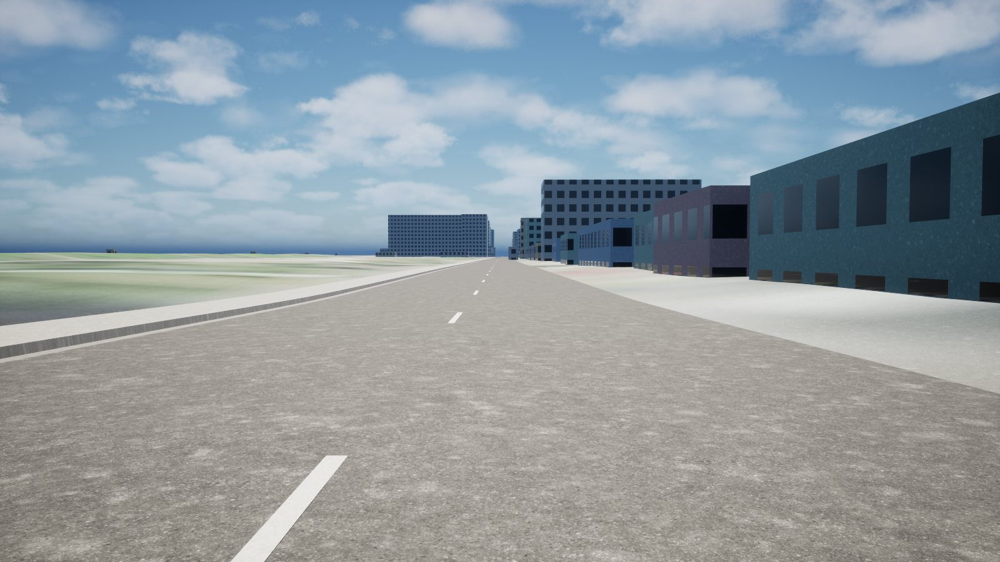
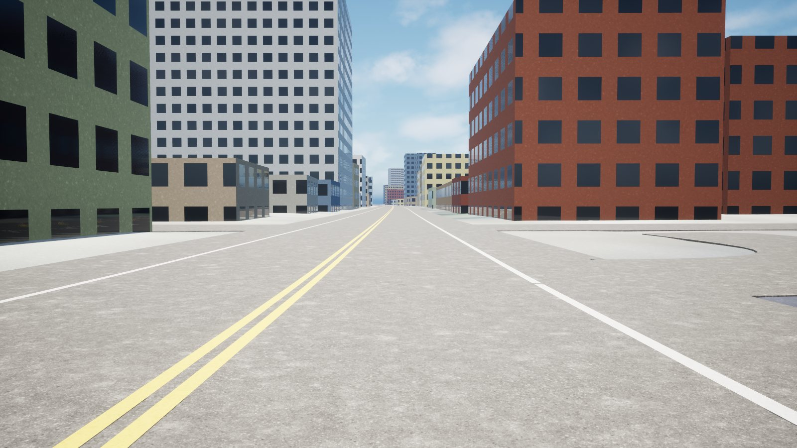
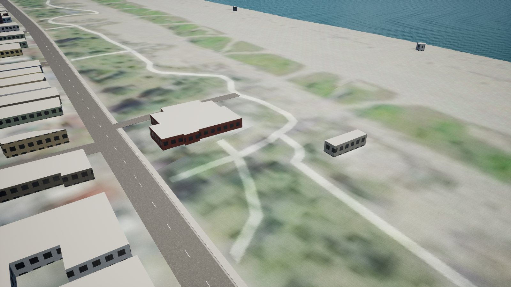
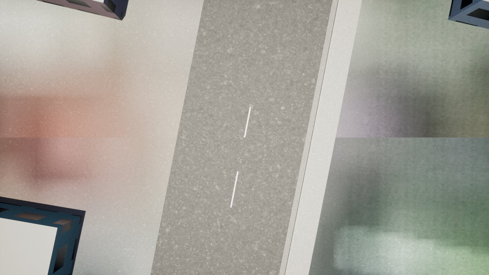

Against photographs of Ocean Drive the road surface, curbs, sidewalks and
markings read right; the place does not yet: no palms or street trees, no
parked cars, signals or street lights, massing buildings with a uniform
window grid instead of the Art Deco facades (their colours come from the
general US palette, so Collins Avenue shows red brick that South Beach does
not have), and a 2 m/px photograph as the ground. The ocean, Collins and
aerial views were recaptured on 11 November after the palette change; the
seam view is from 10 November. The seam view shows the road, curb and sidewalk running straight
across the tile edge; the line in the ground there is where two zoom-14
aerial photographs of different tone meet.

### Known gaps

- Bridges (`bridges`, v2 decks) are not built yet; bridge roads are left out.
- Live v2 tiles: `road_surface` profiles are not used directly (the ribbon fits
  the benched `h` grid the helper conditioned to the same profile).
- No trees, street furniture, signals or traffic; buildings are massing only.
- Tile builds take 1-9 s on a worker thread (junction refinement and terrain
  conditioning dominate); fine at driving speed, worth profiling.
- Packaged builds need `data/` and the helper staged.
- A seam's exact position follows build order: the tile built first keeps its
  own road ends (the two vector tiles disagree by 0.2-0.3 m) and the later one
  takes them, so the same place can differ by that much between drives.
- The sea surface is NAVD88 - 0.1 m everywhere (east-coast mean sea level);
  on the Pacific coast mean sea level is closer to NAVD88 + 1 m.
- Surfaces carry no physical materials yet: asphalt, concrete, terrain and
  buildings have the same friction for the car's tyres.
- Each collision section (terrain, asphalt, concrete, buildings) restarts the
  asynchronous cook, so a dense tile cooks up to four times on a worker thread.
## Car presentation (`Source/SimCruise/{Public,Private}/Presentation/`, `Content/Vehicles/`)

The visible car: the downloaded Sketchfab model of each car, fitted to the car's data, cut into moving parts and drawn with physically based materials. It replaces `godot-final:game/ModelRig.gd`, `CarBody.gd` and the material parts of `CarFinish.gd`. Physics never reads anything from here.

### Pipeline

1. **glTF in at runtime** (`SimCruiseGltfModel`). A small, strict glTF 2.0 reader loads `scene.gltf` + `scene.bin` (or `.glb`) with every node transform applied, in glTF's own space. Unreal's Interchange glTF importer was not used: it is an editor import that writes `.uasset`s, and the rig needs the raw triangles anyway. The glTF stays the only source of truth, so nothing binary has to be merged.
2. **Rig** (`SimCruiseCarModelRig`), a port of `ModelRig.gd` plus the `cars/rig-infra` steering-wheel search, working in the Godot vehicle frame so it can be compared line by line:
   - upright check; wheels by node name (`Front Left Wheel`, `wheel_fl` …) or by the four ground-contact patches, refined from the tyre surfaces (new) so the hub sits at the tyre's true centre and the model's real tyre radius is measured;
   - front/back from the named wheels, else `data/art/traffic/manifest.json`'s `flip` when the model has an entry there, then the rear lamps overrule it (new: a model whose red lenses sit at the front end is turned round; the NB has no manifest entry and is placed by its lamps alone);
   - uniform scale to the car's wheelbase, then (new) a lateral fit so the model's mean track equals the car's (applied for misses of 1.5–10 %);
   - static ride: hubs at `mount_height_m - static_length_m`;
   - wheel cut by **connected parts** wholly inside a tyre cylinder (a suspension arm that reaches outside stays on the body); off-axis parts inboard of the wheel's centre plane, or parts with the caliper role, become the non-spinning **upright** (calipers steer and travel but do not spin);
   - badges: by name (`badge|logo|emblem|brand|invisible|unimportant`), by profile box, and (new, general) by shape and place — a small, thin, detached part on the centreline of the nose or tail, or a small part of another material on a wheel's axle at its outer face (centre-cap logo). Lettering off the centreline (the NB's `MX-5` and `mazda` on the tail panel, the Mustang's `FORD`) needs a profile box;
   - role areas (profile boxes, new): parts wholly inside a box take another role through a copy of their author material, for models that draw several surfaces with one texture atlas (the Mustang's tail-lamp lens segments, so its brake lamps light);
   - reversing lamps (new, general): white lenses (`lamp_front`) behind the axles are reversing or plate lamps and become unlit clear glass, so they do not light with the head lamps;
   - steering wheel: by name, else by geometry (a flat closed ring of 0.24–0.48 m across in the driver's half of the cabin — the side of the car data's driver eye, so right-hand-drive cars work too — facing fore/aft), else (new) by fitting circles to arcs of a rim modelled in pieces; when only the rim was found, the spokes and hub welded to the column are cut out in the wheel's disc;
   - output in Unreal axes: X forward, Y right, Z up, centimetres, origin midway between the axles at the physics body origin. The axis change keeps glTF's counter-clockwise front faces as Unreal front faces (checked with two-sided materials, whose facing sign turns the shading normal).
3. **Meshes** (`SimCruiseCarAssets`): one transient `UStaticMesh` per part (body, 4 wheels, 4 uprights, steering wheel), glass and lenses in a separate non-Nanite mesh. Editor builds run the full mesh build with **Nanite for parts over 20 000 triangles** (the 1.1 M-triangle NB body), MikkTSpace tangents and the author's normals; the result is cached in the DDC by content hash, so later starts take seconds. Cooked games take the fast runtime build (no Nanite). Built cars are cached per process and shared between instances.
4. **Materials** (`SimCruiseCarMaterialLibrary`): three master materials generated from C++ — a two-sided clear-coat surface, its masked twin, and thin-translucent glass — each around HLSL custom nodes. Roles (`SimCruiseCarMaterialRoles`: paint, glass, chrome, wheel alloy, tyre, brake disc, caliper, grained plastic, interior plastic, cloth, leather, carpet, lamps, gauges …) are guessed from author material names and overridden per car. Surface detail is procedural in each part's own space, so it moves with the part and needs no UVs:
   - paint: a cellular field of 0.55 mm flakes tilts the **base-coat normal under a smooth clear coat** (`r.ClearCoatNormal=True`), orange peel tilts the coat; flakes fade into base roughness below a pixel;
   - pebble grain on plastics, leather grain, cloth weave, brushed metal, lathe marks and rusty edges on brake discs, rubber grain and road dust on tyres, procedural asphalt for the stage;
   - glass is thin translucent with coloured transmittance (faint green laminated glass, red/amber lenses) and Fresnel reflection; lamp lenses glow in nits (red channel: tail 300, brake 6000) in a near-pure linear red, since signal red lies outside the sRGB gamut and any green or blue tone-maps a bright lens to salmon.
   The editor builds the masters in memory on first use, so a code change is never hidden by a stale asset; `SimCruise.SaveCarMaterials` writes them under `/Game/Vehicles/Materials` for cooking.
5. **Component** (`USimCruiseCarPresentationComponent`, actor `ASimCruiseCarPresentationActor`).

### Interface for the vehicle pawn

```cpp
// Implement on the pawn or movement component:
class ISimCruiseWheelStateProvider { virtual bool GetCarVisualState(FSimCruiseCarVisualState& Out) const = 0; };

USimCruiseCarPresentationComponent* Look = CreateDefaultSubobject<USimCruiseCarPresentationComponent>(TEXT("Look"));
Look->SetupAttachment(Body);              // identity: the physics body origin, Unreal axes
Look->InitializeForCar(TEXT("nb1999"));    // blocking on a car's first build
Look->SetWheelStateProvider(this);         // polled every frame in TG_PostPhysics
```

`FSimCruiseCarVisualState` per wheel (FL, FR, RL, RR): `SteerAngleRad` (+ left), `CamberRad` (+ top outboard), `SpinAngleRad` (+ rolling forward; keep it wrapped to one turn, since a float accumulated over a long drive loses the precision a spinning wheel needs), `SuspensionTravelCm` (+ bump); plus `bBrake` and `bLamps`. The component polls the provider on the game thread in `TG_PostPhysics`: a provider fed from the physics thread must hand over a copy of the last completed step (no reads of live physics-thread state). Part components get unique names, so one actor can carry several cars and a car can be re-initialised. The steering wheel turns by the mean front steer angle times the car's overall `steering_ratio` (anticlockwise for a left turn as the driver sees it). `GetStaticHubLocation`, `GetDriverEye` and `GetSteeringWheelRestTransform` give the cockpit camera and HUD what they need. `GetHeadLampLocations` gives the vehicle its low-beam origins: per side, the centre of the head-lamp lens surfaces ahead of the front axle, keeping only the top 22 cm so bumper fog lamps that share the lens material do not pull it down (`SimCruiseCarModelRig::HeadLampCentresCm`; NB 61.8 cm over the ground at ±54 cm, Mustang 62 cm, C8 66 cm). The sign conventions are pinned by `SimCruise.Presentation.Component.Conventions`.

### Data: `Content/Vehicles/CarPresentation.json`

Per car id: `model` (glTF path), `credit`, `steering_ratio` with its source, `paint` (name, sRGB base, metallic, base roughness, flake, clear-coat roughness, orange peel, source), `roles` (author material → role), `tints` (role → colour), `badges` (brand notes, or `{note, material?, box}` in the Unreal vehicle frame, metres), `role_areas` (`{note, role, material?, box}`), optional `flip`, `fit_track`, `auto_badges`, `hide_pattern` and a `steering_wheel` override (`node`, or `centre`/`axis`/`radius`, or `none`).

### Turntable

`SimCruiseTurntableGameMode` on `/Engine/Maps/Entry` (or the `SimCruise.Turntable [ids|all] [dir]` console command in any world) lights an outdoor stage — physical sun 42° up and 215° from the nose as in the Godot taste test, sky atmosphere, volumetric clouds, real-time sky light, procedural asphalt — sets scalability 4 with Lumen GI and reflections, and photographs each car from eight angles plus the driver's seat, a wheel close-up, a steered front three-quarter, the steered cockpit and a braking rear three-quarter. Shots and `report.txt` (rig log, build time, mean frame time) go to `Saved/Screenshots/Turntable`. See `docs/unreal-building.md` for the command line.

### What it looks like (turntable, 11 November 2026)

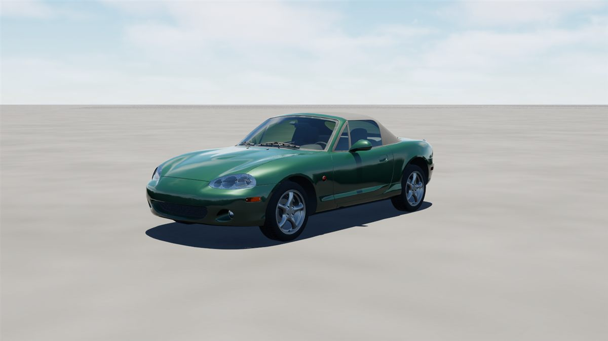
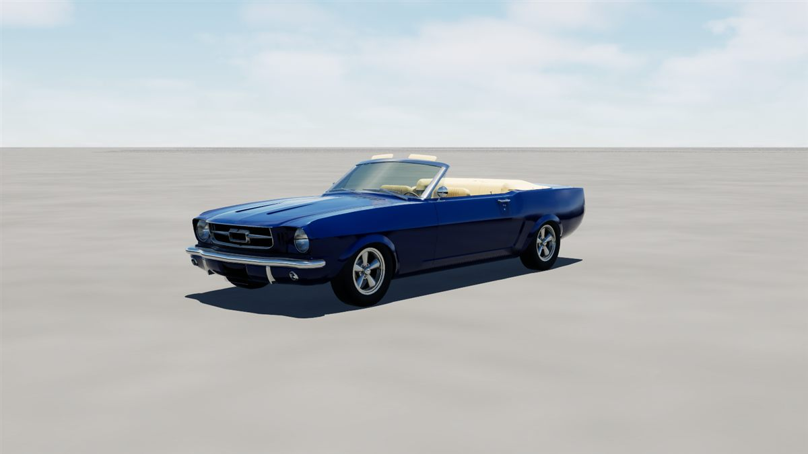
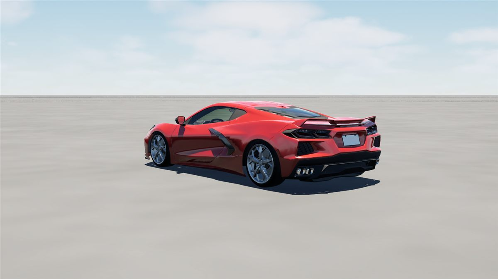
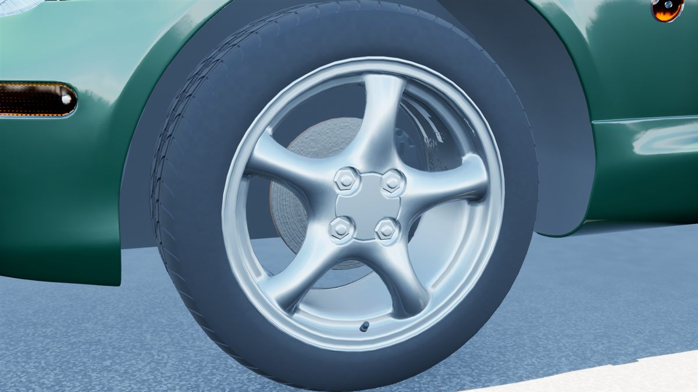
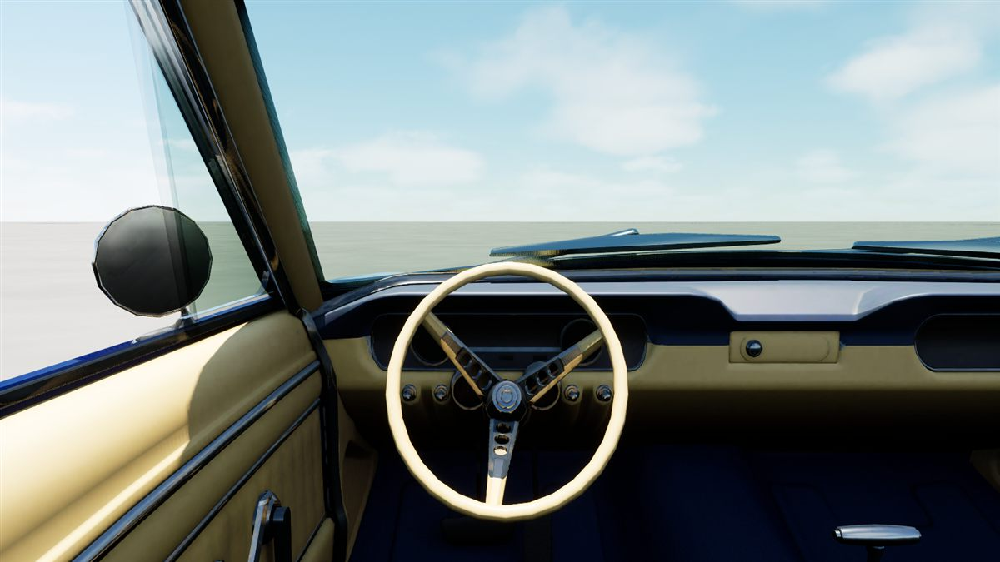

### Tests

`SimCruise.Presentation.*`: glTF loading of all three models; the rig for each car (wheelbase, hubs, track and tyre within tolerance of the car data, wheels centred on hubs, steering wheel ahead of and below the eye, rear-lamp surfaces present and behind the axles, white head-lamp lenses ahead of them, calipers on uprights for the C8, badge removal); role guessing; component conventions; building and posing the C8 in a world.

### Known gaps (review, 11 November 2026)

- Lit lamps glow evenly over the whole lens: there is no reflector or bulb structure in the glow, so the NB's brake lamps read as a flat red oval at close range.
- Shots dominated by shade (the wheel close-up, the cockpit) come out strongly blue: the shade is lit by the blue sky and Unreal has no automatic white balance. A real phone photo of the same scene would be white-balanced. Lighting and camera belong to the rendering stream.
- The C8's rear quarters show jagged reflection patches where the horizon reflects off the curved paint; the model's normals are the likely cause, and this has not been checked further.
- The Mustang's steering wheel is 0.26 m across in the model, well short of the real wheel; its tail-lamp lenses are dark when unlit in shade.
- The cooked-game path (fast mesh build, saved masters, runtime textures) has been compiled but never run.

## Light, sky and rendering

Code: `Source/SimCruise/{Public,Private}/Environment/`. Config: the rendering part of `Config/DefaultEngine.ini` and `Config/DefaultScalability.ini`. No assets: the sky is built in C++ at run time from engine components and Epic's engine content (`/Engine/EngineSky/VolumetricClouds/m_SimpleVolumetricCloud_Inst`).

### World frame

The sun and moon are placed in an east-south-up frame: **+X east, +Y south, +Z up** (north is -Y), the left-handed frame Cesium for Unreal uses for a local tangent plane. Unreal yaw 0 looks east; a compass heading *h* is yaw *h* - 90. `ASimCruiseEnvironment::NorthYawDeg` turns the map if a world stream ever puts north elsewhere. `FSimCruiseSolarPosition::ToWorldDirection` / `FromWorldDirection` convert azimuth and elevation.

### Pieces

| Class | Job |
|---|---|
| `FSimCruiseSolarPosition` | Sun from latitude, longitude and a UTC instant with the NOAA solar-calculator algorithm (Meeus), about 0.01° (the test reproduces NREL's SPA reference case to 0.03°), with NOAA's refraction. Moon from Meeus chapter 47 (largest terms, about 0.1°) with topocentric parallax and the phase of chapter 48. `SunFractionalYear` keeps the Godot client's formula (`godot-final:game/SurveyDaylight.gd` `solar_for_day`) for comparison: its Spencer declination runs about 0.45° low in late April. |
| `FSimCruiseDaylightModel` | Photometry in SI units: extraterrestrial sun 1361 W/m² × 93.9 lm/W = 127.8 klx at 1 AU; IES clear / partly cloudy / overcast daylight for the horizontal illuminance; log-linear twilight (about 3.4 lx at -6°); Allen's lunar phase law (0.32 lx full moon above the air); ISO 2720 reflected-light EV100; Koschmieder visibility (2 % contrast). |
| `FSimCruiseWeather`, `FSimCruiseWeatherConditions` | Reads the object `helper/conditions.mjs` writes (`cloud`, `visibility_m`, `wet`, `station`, …; an optional raw `wx` string splits rain from snow). A METAR "10SM" cap is not taken as measured haze. Road surface water rises with a 3-minute time constant in rain and dries with 15 minutes (proposal 18). Maps sky cover to the cloud material's coverage. |
| `ASimCruiseEnvironment` | The sky actor: sun and moon directional lights (only one casts virtual shadow maps at a time), `SkyAtmosphere`, volumetric clouds, height fog, a sky light with real-time capture and cloud occlusion, and an unbound post-process volume for the camera. `SetPlace`, `SetUtcTime` / `FollowSystemClock` (default: the real clock), `TimeScale`, `SetWeather`, `GetRoadWetness`, `GetSunDirection`, `Describe`. |
| `USimCruiseEnvironmentSubsystem` | Spawns one environment in every game world (unless the level has one), turns off any other sun, sky, cloud, fog and sky light in the level and in every streamed level or World Partition cell added later (`FWorldDelegates::LevelAddedToWorld`), applies the command line and the graphics preset, and owns the `SimCruise.*` console commands. |
| `FSimCruiseGraphics` | The Low / Medium / High / Ultra presets and the auto-pick. |
| `FSimCruisePerfSampler` | Frame, GPU (RHI timestamp queries, what `stat unit` shows), game- and render-thread times over a window; logs `SimCruisePerf:` and appends `Saved/Profiling/SimCruisePerf.csv`. |
| `ASimCruiseLightingLab` | The measurable test street and its capture / timing script (below). |

### Light in physical units

- **Sun**: 127.8 klx scaled by 1/R² (Earth-Sun distance from the ephemeris), angular diameter 0.533°, white; `SkyAtmosphere` applies the per-pixel transmittance, so low suns redden and dim by themselves. Below -1° it stops casting shadows; below -18° it is switched off.
- **Moon**: Allen's phase law × (mean distance / distance)², slightly cool (the eye's Purkinje shift; physically it is a little redder than the sun). It is the second atmosphere light (index 1), casts the shadows once the sun has set, and is off while the sun is above 10°.
- **Sky light**: real-time capture of the rendered atmosphere and clouds, lower hemisphere from the atmosphere's lit ground (`GroundAlbedo` 0.12), cloud ambient occlusion over 50 km.
- **Haze**: the atmosphere's Mie (aerosol) extinction comes from the visibility: 3.912 / V minus clean-air Rayleigh (0.0116 /km at 550 nm), single-scattering albedo 0.93, Ångström exponent 0.7, scale height 1.2 km, asymmetry 0.76. Unreal's default aerosol (0.0044 /km) is an 880 km visibility; ours defaults to 40 km (aerosol optical depth about 0.1) when nothing is observed. Below 8 km the rest of the extinction becomes a 150 m ground fog (`ExponentialHeightFog` density = σ[1/km] / 100, because Unreal stores density × 1000 per centimetre).
- **Clouds**: Epic's simple volumetric cloud material, layer 1.2–7.2 km (Florida fair-weather cumulus base), coverage from the sky cover. Its `Cloud_GlobalCoverage` is an offset, not a fraction: a sweep of lab captures put the knots at CLR -0.5, FEW (0.19) -0.25, SCT (0.44) -0.12, BKN (0.78) 0.0, OVC 0.35 (0.2 still let the sun through).
- **Camera**: histogram auto exposure in EV100 (`r.DefaultFeature.AutoExposure.ExtendDefaultLuminanceRange`), metering the middle 10–90 % of the histogram. The environment computes the reference EV100 (an 18 % grey horizontal card under this sky; 15.6 at a clear Miami noon, "sunny 16") and limits the camera to reference -3 … -0.5 EV with +0.7 compensation. The band comes from photographs: on sunny Ocean Drive, Commons EXIF shows cameras exposing 1.1 EV (December noon, f/1.8 1/2527 s ISO 50) and 1.6 EV (January afternoon, shaded street, f/3.6 1/800 s ISO 160) below the grey-card reading, never above it. Below reference EV 10 the camera compensates only 55 % of the loss (`DisplayEV100`), so a full-moon night shows about 6 EV darker than day rather than as daylight, and colour fades with the light (saturation down to a third by EV -2, rod vision). Local exposure 0.8 / 0.8 compresses the tropical contrast as a phone camera's HDR does; bloom 0.25, no lens flare, vignette 0.15, no chromatic aberration.
- **Renderer** (`DefaultEngine.ini`): Lumen global illumination and reflections on mesh distance fields (software Lumen; hardware ray tracing is off), virtual shadow maps, TSR, `SkyAtmosphere` affecting the height fog, no static lighting.

### Graphics presets

Each preset sets every Unreal scalability group to one level and the TSR screen percentage; `DefaultScalability.ini` adds the volumetric-cloud shadow and sky-occlusion budgets and gives Ultra a 100 % TSR history.

| Preset | Scalability | Screen % (TSR) | Lumen GI / reflections | Cloud shadow map / steps |
|---|---|---|---|---|
| Low | 0 | 50 | off / off (sky light + distance-field AO) | 192 / 12 |
| Medium | 1 | 58 | on / off | 256 / 16 |
| High | 2 | 67 | on / on | 384 / 24 |
| Ultra | 3 | 75 | on / on (Epic quality) | 384 / 32 |

Measured in the lighting lab on the owner's RTX 2070 Super with Max-Q Design (8 GB, driver 32.0.16.2114, on mains power, GPU power-capped at about 90 W and 1650 MHz), 1920 × 1080 fullscreen, i9-10885H, Development editor build in `-game`, 10–12 s windows:

| Scene | Low | Medium | High | Ultra |
|---|---|---|---|---|
| Clear noon, street view (FEW cloud) | 225 fps (GPU 3.2 ms) | 141 fps (6.1 ms) | 95–99 fps (9.7 ms) | **72 fps** (GPU 13.6 ms, frame p95 15.4 ms) |
| Broken cloud (BKN), 17:30 EDT, props view | 198 fps (4.7 ms) | 123 fps (7.7 ms) | 88 fps (11.0 ms) | **65 fps** (GPU 15.1 ms, frame p95 17.4 ms) |

Before the budgets, Ultra ran 52 fps (19.0 ms): `ProfileGPU` showed the cloud shadow map and cloud sky occlusion at 6.0 ms (Unreal's default 128-step march; the cost follows the map size, 4.6 ms at 768 texels) and TSR at 4.0 ms (a 200 % history at 3840 × 2160 for a 1080p output). The lab street is light (about 1 500 boxes, no foliage or cars), so streamed real places will cost more; these numbers are the lighting's own cost. Windows where another Unreal process shared the GPU (every pass, even tonemapping, took 3–10 times longer) were discarded; repeat any run that disagrees with its twin. A review re-run of the broken-cloud props view (1920 × 1080 windowed, final config) gave Ultra 63–65 fps (frame p95 17.5–18.6 ms) and High 90 fps.

**Auto-pick** (`FSimCruiseGraphics::AutoPick`, run once per process unless `-SimCruiseGraphics=` names a preset or `keep`; skipped without a renderer (`-nullrhi`, servers) and in Play-In-Editor, which shares the editor's own scalability, unless a preset is named): software and integrated adapters → Low; RTX 40/50, RTX 30 (3050: Medium), RX 7000/9000, RTX 2070/2080, RX 6000 → Ultra; RTX 2060 → High; Arc, GTX 16, RX 5000, Apple M → Medium; GTX 10 → Low. A laptop part (Max-Q, Laptop, Mobile) is one tier below its desktop name, so the owner's RTX 2070 Super Max-Q starts on **High**. Ultra needs 7 GB of VRAM, High 4.5 GB. Unknown adapters use Unreal's synthetic benchmark.

### Lighting lab

`-SimCruiseLab` builds a measurable street at the world origin from engine basic shapes: an asphalt road (albedo 0.085) running north-south with dashed lane lines and a double yellow centre line, 15 cm kerbs and concrete sidewalks (0.30), a row of pastel stucco hotels on the west side (Ocean Drive's paint chips, eyebrow ledges, dark glass), a lawn (0.045), the beach walk, sand (0.45) and sea to the east, an 18 % grey card on a stand and a horizontal one, white / 18 % / black / chrome spheres, and a car-sized box (the 1999 MX-5's 3.95 × 1.68 × 1.23 m). In the editor build (`UnrealEditor.exe -game`) the surfaces are a tiny parametric material made at run time; a cooked game falls back to `BasicShapeMaterial`.

Script (all optional; see `ASimCruiseLightingLab::StartScriptFromCommandLine`):

```text
-SimCruiseLabShots=name@2025-04-24T17:19:00Z[#console cmd|cmd],...   times to capture (~ stands for a space in commands)
-SimCruiseLabViews=street,props,facade,sky,road                     camera poses
-SimCruiseLabCapturePresets=ultra                                   presets to capture with
-SimCruiseLabPerf=low,medium,high,ultra -SimCruiseLabPerfSeconds=12 -SimCruiseLabPerfView=street
-SimCruiseLabOut=<dir> -SimCruiseLabSettle=6 -SimCruiseLabQuit
```

Each capture writes `<shot>_<view>_<preset>.png` and a JSON sidecar with the sun, the reference EV and the screen position of named probe points (grey cards, sphere tops, road, facade, car side) for pixel readback. Settling waits for shader and asset compilation first.

Console commands: `SimCruise.Env.Time <ISO UTC> [timescale] | now`, `SimCruise.Env.Place <lat> <lon> [elev m]`, `SimCruise.Env.Weather <cloud> [visibility km] [rain]`, `SimCruise.Env.Report`, `SimCruise.Env.Look <name> <value>` (look development: cloud material scalars, layer, aerosol, exposure, saturation), `SimCruise.Graphics <auto|low|medium|high|ultra>`, `SimCruise.Perf <seconds> [label]`, `SimCruise.Capture <name>`. Command line: `-SimCruiseLat= -SimCruiseLon= -SimCruiseElevation= -SimCruiseUtc= -SimCruiseTimeScale= -SimCruiseConditions=<file> -SimCruiseCloud= -SimCruiseVisibilityKm= -SimCruiseRain -SimCruiseGraphics= -SimCruiseNoEnvironment`.

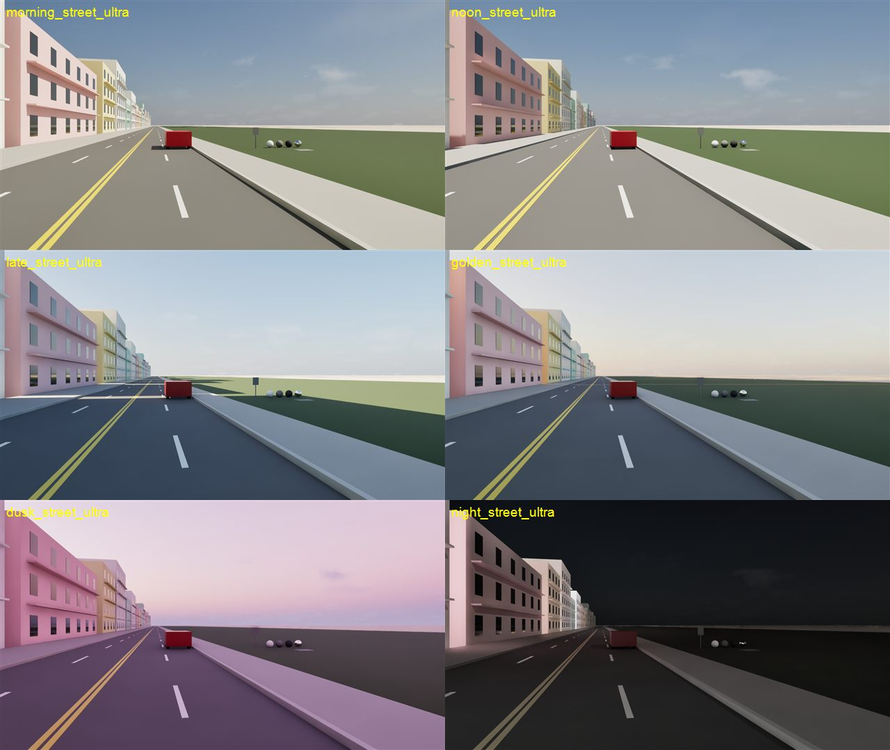

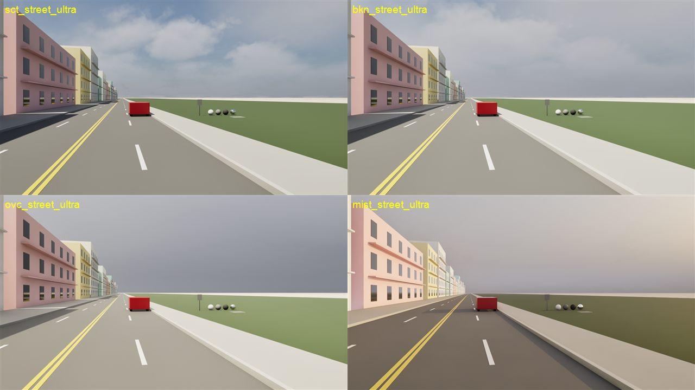

### Against photographs of Ocean Drive

Compared at matching times of day with [Miami Beach - Hotels along Ocean Drive (2023)](https://commons.wikimedia.org/wiki/File:Miami_Beach_-_Hotels_along_Ocean_Drive_(2023).jpg) (P. Hughes, CC BY 4.0; 9 December 2023, 11:49) and [South Beach Ocean Drive Strip, January 2018 - 01](https://commons.wikimedia.org/wiki/File:South_Beach_Ocean_Drive_Strip,_Miami_Beach_Florida,_January_2018_-_01.jpg) (Infrogmation of New Orleans, CC BY 2.0; 16 January 2018, 15:39). Links only; the photographs are not in the repository.

- **Sunlit ground is close, a little bright.** Sunlit asphalt reads sRGB (136, 130, 121) in the December photograph and (146–161, 142–157, 132–149) across the road in the lab's street view at noon (two separate runs), both warm-grey: 0.3–0.5 EV brighter in linear light; sunlit concrete and sand sit where the photograph's do. In the 17:30 props view the shaded lawn reads 0.31 of the sunlit lawn (display luminance; the sidewalk 0.40, its sunlit part already in the tone curve's shoulder), near the 0.18–0.32 shadow-to-sun ratio the Godot client measured from photographs.
- **The sky is paler than the photographs.** At 25° elevation away from the sun the lab sky is (126, 155, 181), the December photograph (98, 150, 213). Raising the visibility from 40 to 200 km or the saturation by 15 % moves it only part of the way; some of the gap is the phone's rendering (saturation, sky polarisation), some may be the aerosol model. Open.
- **Afternoon shade is darker and bluer than the January photograph.** Shaded asphalt reads (53, 67, 86) in the lab against (115, 115, 119) in the photograph, shaded stucco (148, 143, 160) against (177, 187, 193). The photograph's camera exposed for the shade (1.6 EV under the grey-card reading) and its street is lit by sunlit facades the lab does not have; with average metering the lab's open sky holds the exposure down. Open: a camera white balance that follows the illuminant mix, and real streets around the lab.
- **Twilight** turns the whole scene magenta at -3° (the atmosphere's twilight sky); real dusk photographs keep a bluer zenith. Open.
- Moonlit nights are dim and almost colourless, with the moon's aureole in the haze; there are no stars yet.

### Threads and lifetime

Everything here runs on the game thread: the environment ticks in `TG_PrePhysics` and only sets component properties, which Unreal hands to the render thread itself. `GetRoadWetness()` is game-thread state; a tyre model stepping on the physics thread (Chaos async physics) must copy it into its per-step inputs on the game thread rather than read the actor. The perf sampler runs on the core ticker, which outlives worlds, so the lab reaches itself from its callback through a weak pointer.

### Light that is not the sky's

`ASimCruiseEnvironment::SetArtificialIlluminanceLux(lux)` adds light that is not the sky's to the reference exposure (it joins sun, sky and moon in `FSimCruiseDaylightModel::ReferenceEV100`). The player's car sets it while its low beams are on: two lamps of 15 000 cd seen by a grey card 30 m ahead, 33 lx, so a moonless night meters at EV100 3.9 (band 3.7..6.2) instead of -11, the way a driver's eye or a dash camera adapts to the lit road. By day it changes nothing (below 0.01 EV). A change under 5 % does not re-meter. Street lighting, when the world stream places it, belongs here too.

### Tests

`SimCruise.Environment.*` (12 automation tests, headless with `-nullrhi`): `Sky.Actor` (an environment in a throwaway game world: the sun light points along the ephemeris direction at extraterrestrial lux, shadows move from sun to moon at night, the noon reference EV, a level's own sun turned off by the level-scoped takeover), `Solar.SpaReference` (NREL SPA case, zenith 50.11162°, azimuth 194.34024°, equation of time, declination), `Solar.GodotAgreement` (the taste test's Panoramax frame, the Godot formula within 0.75°, the almanac declination), `Solar.Calendar` (solstice declination, overhead sun on the tropic, equation of time in November and February, Miami solar noon, a night sun), `Solar.Refraction`, `Solar.WorldFrame`, `Moon.Meeus` (examples 47.a and 48.a, a full moon), `Daylight.Illuminance` (noon 95–125 klx and EV100 15–16, overcast, low sun, monotonic twilight, civil dusk, moonlight, the night display curve), `Daylight.Visibility`, `Weather.Conditions` (the helper's JSON, rain vs snow, the 10 SM cap, empty and invalid input), `Weather.RoadWetness` (time constants, frame-rate independence, cloud coverage knots), `Graphics.AutoPick` (tiers, laptop step-down, VRAM caps, parsing, percentiles).

### Next

Stars and a moon disc with phases; wet road materials reading `GetRoadWetness`; METAR polling through the helper at run time; a white balance that follows the light; rain and snow particles; the lab's comparisons repeated on the streamed Miami Beach tiles once the world stream draws them, at the exact Panoramax pose of the Godot taste test (4b6d216b, 2025-04-24 14:34:52 UTC, heading 7°, 70.8° horizontal field of view; the lab's `morning` shot uses that time).

## Driving shell

`Source/SimCruise/{Public,Private}/Gameplay/` — the drivable loop around whatever simulates the car: input, steering and pedal shaping, cameras, HUD and pad rumble. It never applies a force; the vehicle model and every calibration band belong to the vehicle code.

| Class | Role | Ports |
|---|---|---|
| `ISimCruiseVehicleControl` (`SimCruiseVehicleControl.h`) | The seam to the vehicle: 7 calls, SI units, body frame | Powertrain's public state |
| `USimCruiseInputConfig` | Enhanced Input actions and mapping context built in code | `Drive.gd` input map, `docs/controls.md` |
| `FSimCruiseDriverShaper` (`SimCruiseDriverShaping.h`) | Thumb, hand and foot: rack angle and pedal positions | `Powertrain.gd` steering map, plan 04 |
| `ASimCruisePlayerController` | Reads actions, shapes, commands the vehicle, rumbles the pad | `Drive.gd` `_physics_process`, `_unhandled_input` |
| `ASimCruisePlayerCameraManager`, `FSimCruiseHeadModel`, `FSimCruiseChaseFrame` | Driver, chase and scenic views | `Cockpit.gd` `head_view`, `ViewLens.gd`, `Drive.gd` cameras, plan 15 |
| `ASimCruiseHUD` | Canvas HUD, Off / Glance / Full | `Hud.gd` |
| `FSimCruiseHapticsModel` (`SimCruiseHaptics.h`) | Rumble from tyre slip, ABS and road texture | `feel/slip-haptics-audio:game/Haptics.gd` |
| `ASimCruiseGameMode` | Starts the drive on the real place, places the vehicle pawn (from config) on the start road once its tiles are built, streams around it and moves it with the floating origin (see "The drive") | `Drive.tscn`, `Drive.gd` start |
| `ASimCruiseDriveCapture` | `-SimCruiseDriveCapture`: cockpit, chase and top-down shots of the real drive | `checks/Screenshots.gd` |
| `ASimCruisePlaceholderVehicle` | Fallback single-track car when no vehicle pawn class is configured | none (not a SimCruise model) |

### The vehicle seam

A vehicle pawn implements `ISimCruiseVehicleControl` and is named in `Config/DefaultGame.ini`:

```ini
[/Script/SimCruise.SimCruiseGameMode]
VehiclePawnClass=/Script/SimCruise.SimCruiseVehicle
```

The project config names the real Chaos car, `ASimCruiseVehicle`; without the setting the game mode spawns `ASimCruisePlaceholderVehicle`. The shell's structs are `FSimCruiseDriveTelemetry` and `FSimCruiseDriveWheelTelemetry` (renamed from `FSimCruiseVehicleTelemetry`/`FSimCruiseWheelTelemetry` at integration, where they collided with the vehicle's reflected telemetry structs of the same names). Conventions: Unreal body axes (+X forward, +Y right, +Z up), SI units, yaw rate positive turning right, rack angle = mean front road-wheel angle in radians, positive right; wheels 0 FL, 1 FR, 2 RL, 3 RR (Godot `MOUNTS` order); the driver's eye in pawn-local centimetres (`SimCruiseGodotToLocalCm` converts a car file's `driver_eye`).

- `GetVehicleSetup()` — wheelbase, CG-to-front-axle, parking rack lock, assist lateral g, limit slip surplus, driver eye and sight, idle/upshift/redline rpm, gear count, published skidpad g and the braking g of the 70-0 mph distance.
- `GetVehicleTelemetry()` — body velocity and angular velocity, rpm, gear, manual/stalled/electric/service-brake flags, the rack angle applied, engine load, road roughness, and per wheel: contact, driven, ABS acting, load, slip ratio and its peak, relaxed slip angle and its 98 %-plateau angle (`SimCruiseHaptics::PlateauSlipAngleRad`), suspension travel, surface grip. Data a vehicle does not report keeps its default and simply produces no cue.
- `ApplyDriverCommand()` once per frame before physics (the controller is a tick prerequisite of the pawn while it possesses it): throttle, brake, clutch, parking brake, full service brake (Space), rack angle. In automatic, the vehicle keeps Godot's "brake, then reverse once stopped" pedal semantics.
- Threading: every call is made on the game thread. A vehicle that steps on the physics thread (Chaos async physics or substep callbacks) hands the command over itself, for example as async input, and answers `GetVehicleTelemetry()` from its last published game-thread copy, never by reading physics-thread state in place. Telemetry is read before the pawn ticks, so the shell shapes on state one frame old.
- `RequestGearChange(±1)`, `SetManualTransmission()`, `RequestEngineStart()`, `ResetVehicle(transform)`.

### Input

`USimCruiseInputConfig::Bindings()` is the single table behind the mapping context, the `SimCruise.Gameplay.Input.*` tests and this list. Analog channels are separate actions from their keys because they are shaped differently.

| Action | Keyboard | Xbox | Value |
|---|---|---|---|
| ThrottlePad / ThrottleKey | W, ↑ | RT (0.04 dead zone) | trigger linear; key ramps 3/s up, 8/s down |
| BrakePad / BrakeKey | S, ↓ | LT (0.04) | trigger linear; key ramps 2.5/s up, 8/s down |
| SteerPad / SteerKey | A/D, ←/→ (A and D cancel) | left stick X (0.12, rescaled) | see steering |
| FullBrake | Space | — | held |
| ParkingBrake | H | A | held |
| Clutch | Shift | LB | 14/s in, 2.8/s out |
| ToggleTransmission | T | B | |
| ShiftUp / ShiftDown | E / Q | RB / X | |
| StartEngine | I | right-stick click | |
| CycleCamera | C | Y | driver → scenic → chase |
| CycleHud | F2 | left-stick click | Off → Glance → Full |
| ToggleStats | F3 | — | `stat fps`, `stat unit` |
| CycleLens | F6 | — | natural 45° → true to screen → wide 67° |
| ToggleSound / ToggleLights | M / L | — | flags until audio and lamps are ported |
| ToggleAtlas / FindPlace | Tab / `/` | Menu | message until the atlas and search are ported |
| Recover | R | View | upright at rest in the right-hand lane of the nearest public road within 250 m, facing its travel; else on the ground below |

`Config/DefaultInput.ini` sets the legacy `Gamepad_LeftX` dead zone to 0 so Enhanced Input's 0.12 is the only one.

### Steering and pedals: shaping that never fakes physics

`FSimCruiseDriverShaper` decides which rack angle a thumb or a key asks for and how fast a hand can move the wheel; the car then does what its tyres do. It ports `Powertrain.gd` with the audited corrections of `docs/research/plan-2026-11-10/04-pad-steering-pedals.md`:

- **Range** (`AvailableSteeringRad`): the Ackermann angle for the assist lateral g plus the limit slip surplus, smooth-min blended into the parking lock (NB: 8.02° at 20 m/s, 36.6° parked).
- **Countersteer allowance**: toward the front axle's velocity angle β_f = atan2(v_y + r·a, v_x) the range opens to |β_f| + surplus (never past the lock) and a hand may move the rack that way at up to 40°/s. Keyed on β_f alone (no yaw-rate state machine); zero below 5 m/s and in reverse. A 15° slide at 45 mph can be met with 20° of opposite lock; steering into the slide keeps the normal cap. Plan 04's gate (keep it only if a slide that spins with the capped rack is caught with it) has **not** been met: on the placeholder car a gentle catch never needs the allowance, a snap to full opposite lock uses it and overcorrects into a spin that the capped rack avoids, and a 0.3 s parking-brake flick at 60 mph spins either way (`SimCruise.Gameplay.Loop.PlaceholderConventionsAndSlideCatch` and the capture's slide trace). The allowance is closer to a real wheel, which has no speed cap, so it stays; the gate has to be run on the real vehicle.
- **Rack state in radians**, slewed in rad/s. When the allowance closes the rack unwinds at the return rate; it never jumps.
- **Stick map** (`ThumbstickCommand`): the stick's centre goes to lane corrections, the ends reach the full range; pad rates 2.75 and 4.4 ranges/s. Releasing returns to exactly zero (no self-centring aid).
- **Keys**: a hand's rate, 2.75 locks/s parked easing to 12°/s at highway speed (a half-second tap at 60 mph gives 6°); release unwinds first at 1.6× (at least 24°/s).
- **Pedals**: triggers linear past their dead zone; keys ramp like a foot (a 0.3 s brake tap reaches 0.75, so a no-ABS car is not locked by a tap).

### Cameras

`ASimCruisePlayerCameraManager::UpdateViewTarget` builds the view from the pawn and its telemetry:

- **Driver** (default): `FSimCruiseHeadModel`, a port of `Cockpit.gd head_view`. A critically damped 9 rad/s spring moves the eye against the felt specific force (differentiated over the real frame time, so the lean is the same at 30 and 360 fps) (3 cm/g lateral, 2 cm/g longitudinal, clamped), braking dips the gaze 1.5°/g, the gaze leads up to 4° into a corner from 14 m/s (normalised by the car's own range, not the NB's 0.10 rad), suspension travel rate adds millimetre vibration, and the horizon keeps 70 % of the body roll. `simcruise.Camera.HeadMotion` (0..1) scales all but the horizon. The lens is a vertical field of view converted to Unreal's horizontal one for the window's aspect: natural 45° (72.7° across 16:9), true to screen (`simcruise.Lens.ScreenHeightCm`, `ViewDistanceCm`), wide 67°.
- **Chase**: Drive.gd's offsets (5.8 m back, 1.94 m up, 1.92 m right easing to 0.35 m) in a yaw-only heading frame swung toward the direction of travel by 0.4 β (β = atan2(v_y, |v_x|), clamped ±35°, faded in from 2 to 8 m/s, no swing in reverse, held in a spin, 0.3 s lag), so a slide reads on screen. The position lag acts on the offset from the car, so the camera no longer trails further behind as speed rises. 50° vertical. A ground trace keeps it 55 cm up (probing from only 2.5 m above the camera, the rule of Drive.gd `surface()`, so an overpass deck never lifts the camera onto it) and a wall trace pulls it in front of buildings.
- **Scenic**: 7.2 m back, 4.9 m right, 3.45 m up, same frame and lag.

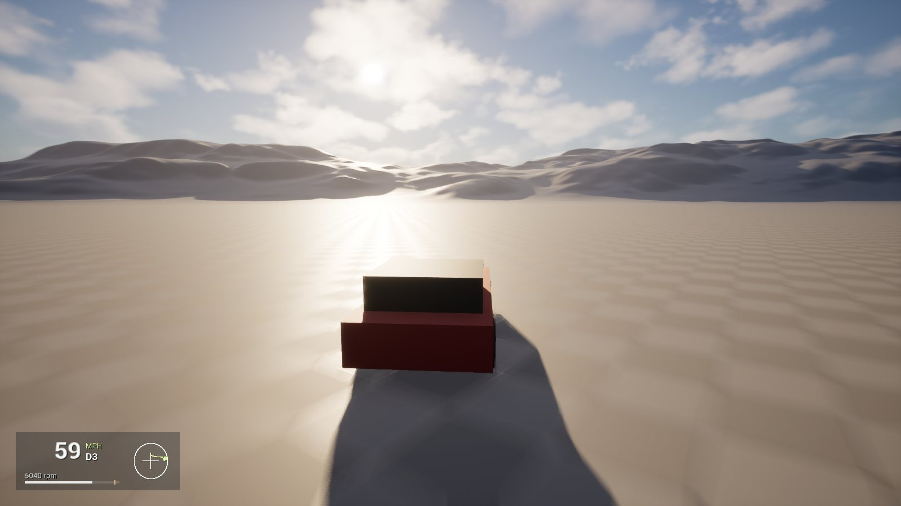

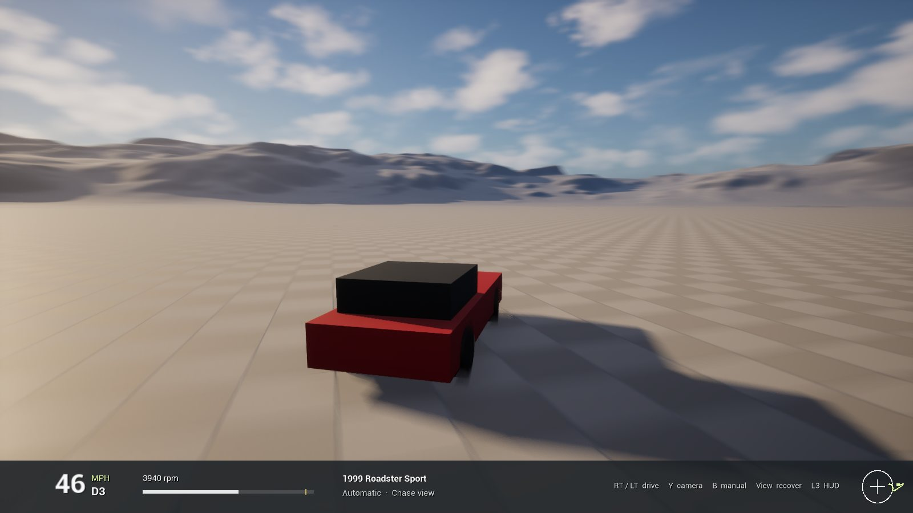

### HUD

`ASimCruiseHUD` draws on the canvas in code (engine Roboto duplicated per typeface, so no UMG asset). **Glance** (default): a translucent tag bottom left with speed, gear, rpm and shift bar, and a g-g meter whose ellipse is the car's published skidpad g sideways and its 70-0 mph braking g fore and aft, with a two-second trace; it fades to 40 % while cruising and wakes on a 3 mph change or a message. **Full**: an opaque strip with the same plus the car, gearbox, view and controller-aware hints. **Off**: prompts only. Messages show at every level.

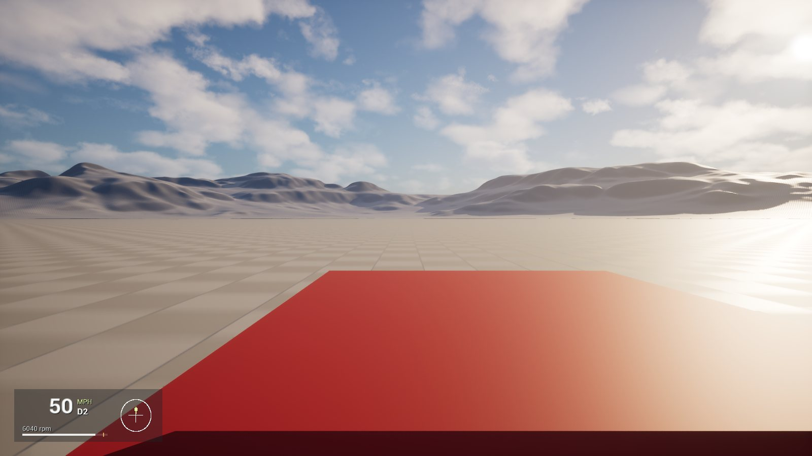

### Rumble

`FSimCruiseHapticsModel` ports the slip-haptics branch: normalised slip s = √((κ/κ*)² + (α/α*)²) per tyre, felt from s 0.75 (65 % at the plateau end 1.15, full at 2.5). The high-frequency (right) motor carries front-tyre scrub, road texture, loose surface and a faint engine buzz; the low-frequency (left) motor carries the rear tyres and driven-wheel slip, an 8 Hz ABS pulse and kerbs. New for Unreal: the impulse triggers carry the pedal's own story, right trigger = driven-wheel spin under throttle, left = a locking wheel or the ABS pulse. Unreal's channels reach the pad differently per backend, so `SimCruiseHaptics::ToChannels` maps them: XInput (the default plugin) drives the left motor from max(LeftLarge, RightLarge) and the right from max(LeftSmall, RightSmall) and has no trigger motors; GameInput maps LeftLarge, RightLarge to the body motors and the Small channels to the triggers. The controller plays each channel as a dynamic force-feedback effect and stops them when paused, unpossessed or ended. `simcruise.Rumble.Strength` (0..1) scales it. Coasting straight on a smooth road it is silent. Slip angles fade in as felt scrub between 0.5 and 2 m/s (a tyre scrubs at about v·sin α), so a car stopped sideways after a slide is quiet; wheelspin from standstill is still felt.

### Placeholder vehicle

`ASimCruisePlaceholderVehicle` exists only so the shell can be driven before the vehicle pawn lands. Spawning, reset and recover probe for the ground from 3 m above the car first (a reset under an overpass stays on the road below) and only then from high above. It is a planar single-track model (relaxed slip angles, the car file's lateral law and friction, a friction ellipse, static load transfer, the engine curve, gearbox, brakes, engine braking) riding the ground on four line traces, drawn with engine basic shapes, using `nb1999`. It is never used for calibration and makes no claim about the real car.

### Checks

- `SimCruise.Gameplay.*` automation tests (13): bindings against `docs/controls.md`, dead zones and directions, the Godot range numbers, exact centring, key rate at 60 mph, countersteer allowance and its slewed closing, pedal ramps, rumble (plateau angle 10.6° on the NB, monotonic feel, silence when coasting and when stopped, which motor for understeer, wheelspin and ABS, both backends), head model offsets, brake dip and 70 % horizon, the same lean and g-meter reading from 30 to 360 fps, chase swing = 0.4 β, HUD levels, and the closed loop of shaper and placeholder car (stick right yaws right; the allowance opens past the cap in a slide; four catch variants logged).
- `-SimCruiseShellSelfTest` (or the `SimCruiseShellSelfTest 1` console command) drives the real Enhanced Input stack in the game like Godot's `checks/PadSteer.gd` and prints `SIMCRUISE SHELL SELF-TEST PASSED|FAILED`; with quit it exits 0 on a pass and 1 on a failure.
- `-SimCruiseShellCapture` drives a scripted lap (accelerate, corner, a 0.3 s parking-brake flick at 60 mph answered by aiming the wheels along the front axle's travel, brake) and saves six screenshots to `Saved/Screenshots/`, with a 10 Hz trace of the slide in the log. On the placeholder the flick spins the car, so the last two shots show it stopping after the spin.

### Not yet verified

Rumble and trigger levels have not been felt on a physical Xbox pad; the captures prove the levels the model asks for, not how they feel. Since integration round 1 the shell drives the real vehicle on the streamed Ocean Drive (see "The drive"); its documentation pictures above are still from the placeholder on the OpenWorld template. The countersteer allowance has not passed plan 04's slide-catch gate (see above). The self-test's failure exit code follows the engine source (a forced exit with the code) and has not been triggered.

## The drive (integration)

Source: `Gameplay/SimCruiseGameMode`, `Vehicle/SimCruiseVehicle` (the seams), `Gameplay/SimCruiseDriveCapture`; tests in `Private/Tests/DriveIntegrationTests.cpp`. Integration round 1 (branch `unreal/round1`) joined the five streams: vehicle core, world, car presentation, lighting and the driving shell.

### What a launch does

`UnrealEditor.exe SimCruise.uproject -game` (no map argument) loads `/Engine/Maps/Entry`, an empty engine map, and `ASimCruiseGameMode`:

1. `InitGame` decides that this is a drive on the real place (any game world, unless `-SimCruiseNoWorld` or the lighting lab's `-SimCruiseLab`). It has to be decided there: the local player logs in (`PostLogin` → `RestartPlayer`) while the map loads, before `StartPlay`, and is held from then on.
2. `StartPlay` starts the world stream at the bundled Miami Beach start (25.78000, -80.13025; no network, no helper process) and puts the sun and moon at that latitude and longitude, at the real UTC time unless `-SimCruiseUtc=` pins it.
3. Each frame the held player sees "Building Ocean Drive, Miami Beach · n of 9 tiles". When `AreTilesReadyAround(start, 1)` is true (all nine tiles built and their collision traced, 13–16 s on the i9-10885H), the car is spawned in the right-hand lane of `StartRoad` (`FindRoadPose`, the lane centre the markings use) facing its direction of travel, 3 cm up, and settles on its springs. After `StartTimeoutSeconds` (180 s) it is placed on whatever is there.
4. From then on the game mode hands the car's position and velocity to the streamer every frame (`SetFocus`) and moves the car with the floating origin (`OnRebased`: a physics teleport that keeps the velocity, and a camera snap).

| Setting (`Config/DefaultGame.ini`, `[/Script/SimCruise.SimCruiseGameMode]`) | Default | Command line |
|---|---|---|
| `VehiclePawnClass` | `/Script/SimCruise.SimCruiseVehicle` (the Chaos car); unset gives the shell's placeholder | — |
| `StartCarId` | `nb1999` | `-SimCruiseCar=mustang65` |
| `StartRoad` | `Ocean Drive` | `-SimCruiseStartRoad=<name>` |
| — | bundled Miami Beach | `-SimCruiseStart=lat,lon` (nearest public road; needs the atlas helper) |
| — | real clock | `-SimCruiseUtc=2026-11-11T16:00:00Z` |
| — | auto-picked preset | `-SimCruiseGraphics=low`, `medium`, `high` or `ultra` |

### The seams

- **Shell → vehicle.** `ASimCruiseVehicle` implements `ISimCruiseVehicleControl`. `ApplyDriverCommand` passes the shaped pedals, clutch, parking brake and full service brake to the movement component in one locked write (`SetDriverControls`), with `bDirectRack`: the shell's shaper has already applied the steering rates, the speed cap and the countersteer allowance, so the physics step applies `RackAngleRad` as given and only stops it at the car's parking lock (the vehicle's own thumbstick shaping is bypassed, not doubled). `GetVehicleTelemetry` maps the vehicle's published copy of the last physics step (`ToDriveTelemetry`): body-frame velocity and yaw rate (new telemetry fields), rpm, gear, rack angle in radians, per-wheel contact, load, slip ratio, slip angle in radians, ABS (release under 0.95), driven wheels from the car file, suspension compression from full droop, and the tyre's 98 % plateau angle for the rumble. Gear refusals ("Hold the clutch to change gear") reach the driver's screen from the pawn's tick. `GetVehicleSetup` derives the shell's numbers from the car file (CG to front axle from the front weight share; braking g from the 70–0 mph distance; the driver's eye moved from the Godot origin to the body centre). The shell's structs were renamed `FSimCruiseDriveTelemetry` / `FSimCruiseDriveWheelTelemetry`: their old names collided with the vehicle's reflected telemetry structs.
- **Vehicle → car model.** `AttachCarModel()` builds the downloaded model on the pawn (blocking the first time; the NB's Nanite body then comes from the DDC) and attaches it `CollisionShapeCenterYM` below the body centre, where the Godot car origin is. Every part has collision off, so nothing welds into the Chaos body. The pawn is the model's `ISimCruiseWheelStateProvider` (`ToVisualState`): the model's steer is positive left where the vehicle's is positive right; camber from the wheel's inclination with the side's sign; spin wrapped to one turn; bump = static strut length minus the current one. Brake lamps follow the service brake. Head and tail lamps follow the sun (on from 1° below the horizon) or the L key.
- **Low beams.** Two spot lights leave from just ahead of the head-lamp lenses (`GetHeadLampLocations`): 15 000 cd peak each (a late-1990s halogen H4 reflector), aimed 1.5° down, a bright core of 8° and an edge of 32° half angle, 3200 K, shadowed, out to the 1 lx distance (122 m). While they are lit the player's car tells the environment about its light (`SetArtificialIlluminanceLux`, see "Light that is not the sky's"), so the camera adapts to the lit road instead of staying open for starlight.
- **World → vehicle.** The car is placed only when the tiles under it have collision (`IsCollisionReady`), on `FindRoadPose`'s lane. Recover (R / View) uses `FindRoadPose` with no name: the nearest public road's right-hand lane within 250 m (service ways excluded), facing its travel, else upright on the ground below.
- **Environment and other worlds.** The turntable destroys the real-sky environment (it has its own studio sun); the world preview adds its own sun only with `-SimCruiseNoEnvironment`.
- **Rendering settings found at integration** (`Config/DefaultEngine.ini`, `[SystemSettings]`): `r.EyeAdaptation.CachedLightingPreExposure=7.5`, because the real sun meters EV100 13.6–15 and clipped Lumen's cached lighting and the sky capture with the engine's default of 4 (safe to EV 12; an on-screen warning said so); 7.5 covers EV -4.5 to 15.5. `r.Shadow.Virtual.AllowScreenOverflowMessages=0` hides the virtual shadow map's "non-Nanite marking job queue overflow" banner, which the large runtime tile meshes raise on wide views; the cost behind it is still there.
- **Build.** Unity builds are off for the module: each stream keeps file-local helpers (`Tau`, `Smooth01`, test flags) in anonymous namespaces that collide when files are pasted together.

### Captures

`-SimCruiseDriveCapture` (`ASimCruiseDriveCapture`): once the car is on the road, the tiles around it are ready and no shaders are compiling, it waits 8 s for the springs, exposure, TSR, Lumen and the shadow pages to settle, then saves `drive-cockpit`, `drive-chase` and `drive-top` (straight down from 35 m, nose up) of the parked car, drives off at 45 % throttle through the real input stack (the right-trigger axis), saves `drive-cockpit-moving` and `drive-chase-moving` with the HUD at a glance, brakes to a stop and quits. Output: `Saved/Screenshots/SimCruise/Drive/` (`-SimCruiseDriveCaptureOut=DIR`); one `SHOT` log line per picture with speed, gear, rpm, wheels on the ground and the sky. `-SimCruiseKeepOpen` leaves the game running.

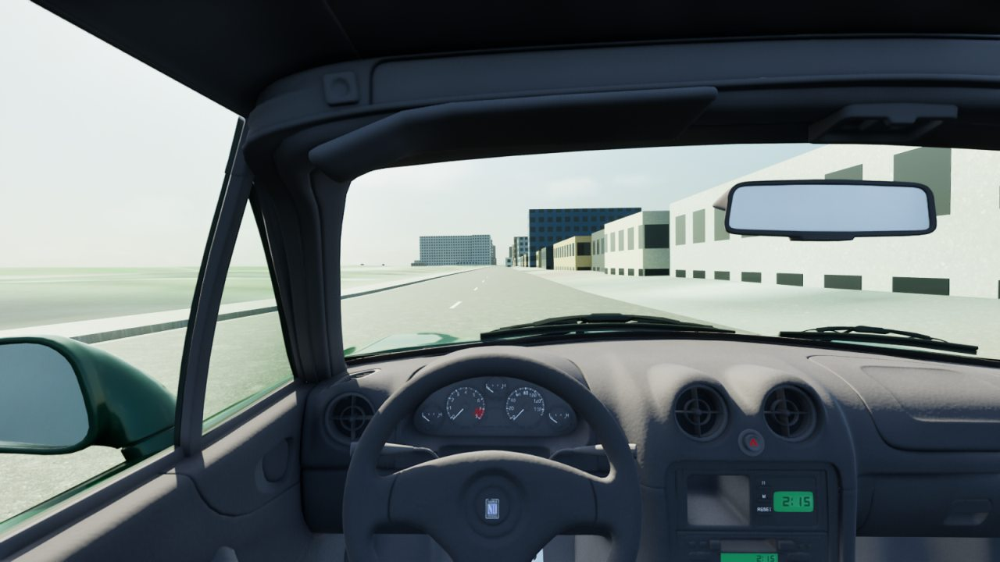
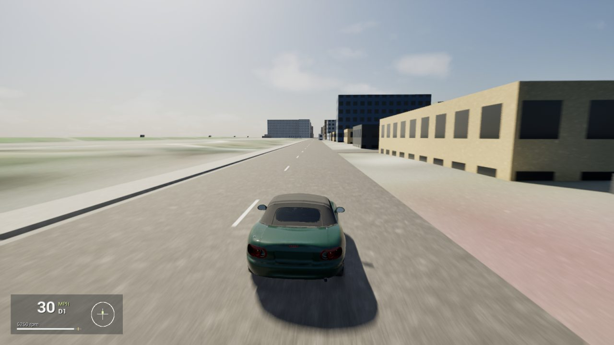
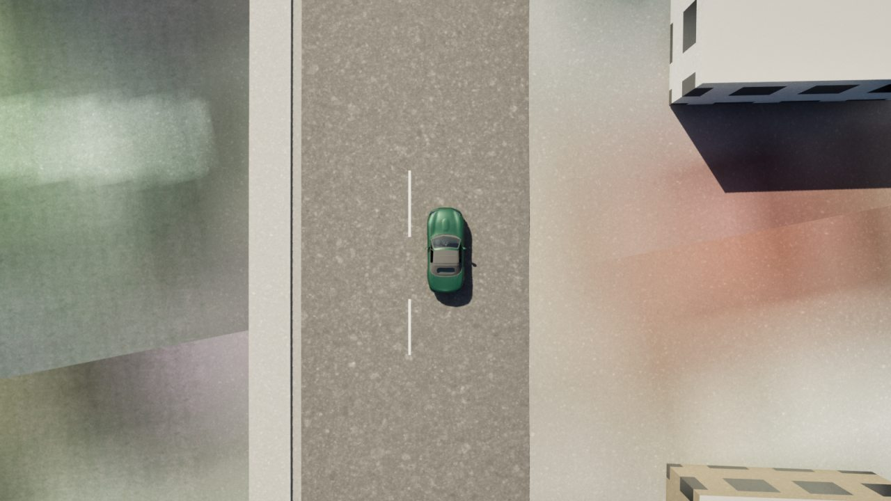
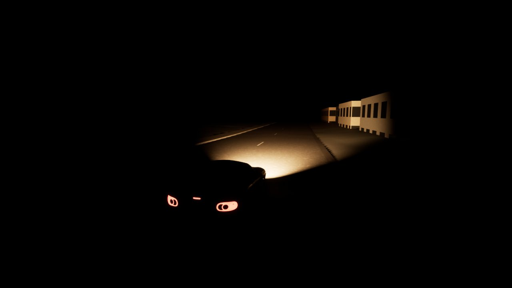

### Tests (`SimCruise.Drive.*`)

| Test | What it checks |
|---|---|
| `Mapping` | Vehicle telemetry to shell telemetry and to the model pose: signs (a right turn is negative model steer, lean to the right is negative camber on the left wheel), spin wrapped, bump, brake lamps, gear, radians, ABS per wheel, driven wheels, travel from droop, plateau angle |
| `ShellControl` | The real car through `ISimCruiseVehicleControl` with threaded physics: eye inside the cabin on the left, four tyres down, throttle drives it (16.4 m/s after 4 s), the rack takes the shaped angle exactly and yaws right, the rack stops at the lock, brake lamps, recover pose and height |
| `OceanDrive` | The bundled start ring streams with collision (9.5–13 s), Ocean Drive is found, the car rests on the streamed road at ride height (body centre 49.0 cm over the road against 46.0 static) and drives 16 m along the lane in 5 s at 40 % throttle with 0.05 m of drift and four wheels down |
| `LowBeams` | Night EV100 -11.1 rises to 3.9 with the lamps, noon unchanged; two beams ahead of the front hubs, one each side, aimed forward and 1.5° down, in candela; off by day, on with the switch, on at night by the sun |

The shell's `-SimCruiseShellSelfTest` now runs on the real car on Ocean Drive (it waits for the car to be placed) and passes.

### What it looks like (11 November 2026, Ultra, 1600 × 900)

Compared with photographs of Ocean Drive (South Beach, the Lummus Park side) and of 1999 NB roadsters. Most unreal first:

1. **The buildings are boxes.** Ocean Drive is a row of 1930s Art Deco hotels: pastel stucco, eyebrow ledges, vertical fins, porches with tables and umbrellas, neon names. Here they are flat extruded footprints in a generic paint and brick palette with black square windows, no roof detail and no ground floors. This alone makes the place unrecognisable.
2. **No palms, no people, no parked cars, no traffic.** Lummus Park's coconut palms line the whole east side, the west kerb is parked solid and the sidewalks are full. The street is empty and treeless.
3. **The park and beach are a blurred aerial photograph.** The 2 m/px image is draped flat: grey-green smears with no grass, sand, low walls or paths, and its tone changes at photo boundaries.
4. **Haze and sky.** The late-morning sky is milky white towards the horizon and the scene is washed out; Miami in November photographs as a deep blue sky with cumulus and hard, high-contrast light. Buildings 500 m away already fade into haze.
5. **Night is too empty.** Under the low beams the road and the facades they reach are lit, but there are no street lights, lit windows or neon, so Ocean Drive at night (one of the brightest streets in Florida) is a black void around one beam. The beam is a round cone with no low-beam cut-off, so it lights facades above the horizon, and it has no structure.
6. **Road surface.** The asphalt is too pale and its aggregate too coarse and contrasty (terrazzo-like white specks); real Ocean Drive asphalt is darker, patched, with tyre polish in the wheel paths. Only a dashed centre line: no edge lines, parking bays or crosswalks. The sidewalks are near-white with pink blotches from the aerial.
7. **The cockpit.** The NB interior has the right shapes, but its plastics read as one flat blue-grey (shade lit by a blue sky, no white balance); the mirrors were flat pale blue (they now reflect the road, see Mirrors); the radio always reads 2:15.
8. **The car itself is closest to real.** Paint, wheels, glass, soft top and shadow read well in the turntable and chase views. Against a 1999 NB1: the model is an NB2 facelift (projector head lamps, different bumper) with a Nardi wheel; the lit lamps are flat glowing shapes; the tyres have no sidewall lettering; there are no number plates.
9. **Motion.** At 45 % throttle the automatic holds first gear to 6250 rpm at 30 mph (the ported Godot gearbox changes up at 6700 rpm whatever the throttle; a driver or a real automatic changes up near 3000 rpm at part throttle), so a gentle pull-away screams.

### Round 2: world detail (11 November 2026)

Items 1-6 and 9 of the list above were worked on; the captures are `docs/images/unreal/round2-*` (before: `round2-before-*`). Compared again with Panoramax 4b6d216b (Lummus Park and the Ocean Drive frontage, CC BY-SA 4.0).

- **Buildings** (`World/SimCruiseTileDetail`, `BuildBuildings`). Footprints in the Miami Beach Architectural District (`StyleForPlace`: about 25.763-25.800 N, 80.146-80.125 W) get an Art Deco recipe up to 26 m: the restored pastel stucco palette with white or contrasting trim, a 0.9 m parapet, three speed-line bands under it on the street front, cantilevered eyebrows over every upper storey (on the front, and all round on half the hotels), a raised porch 2.2 m deep under the upper floors with columns, terrazzo floor and a glazed back wall (when both corners are convex and the building is deep enough), canvas awnings over the other shopfronts, a stepped tower over the entrance of the longest street front with neon up its edges, and neon along the parapet on half of them. Taller footprints in the district are white condominium towers with a balcony slab and glass rail every storey. A facade is "front" when a public (non-service) carriageway lies within 11 m of it. Elsewhere the generic palette stays. All of it is light geometry (a facade is a handful of quads); the material draws the rest from the surface kind in UV1 (`SimCruiseSurfaceKind`) and (metres along, metres up) in UV0: windows on a 3.1 m storey grid with frames, mullions, reveal shadow and blinds; shopfront glass in the street front's ground storey; stucco grain, rain streaks and splash grime; roof membrane; neon tubes; lamp lenses; palm bark rings.
- **Palms** (`BuildPalms`). Where coconut palms grow outdoors (`IsCoconutPalmRegion`: South Florida's coasts and the Keys, Hawaii), lawns and parks get one about every 10.5 m (42 % of a jittered grid), never on a path, within 2.5 m of a carriageway, in water or in a building: a 7-16 m curving, leaning trunk with a swollen bole (6 sides, 10 rings) and 16 drooping fronds whose leaflets hang in a V. The fronds are cards cut by the masked, two-sided foliage material (`M_SimCruiseFoliage`, two-sided foliage shading). About 500 triangles a palm. Since the first optimisation pass the palms are six shared static meshes (`USimCruiseWorldResources::PalmMeshes`, built once at start with a full build, so they get distance fields and their shaded sides take Lumen's sky light instead of reading black) placed per tile as instances (variant, yaw, scale); a capsule round the bole is their collision. That took about 107 000 triangles out of each Miami tile's mesh and collision. Their cost on the GPU (about 0.7 ms at High in the driver's seat) is the masked leaflets' overdraw, not shadow caching. `simcruise.World.Palms 0` builds tiles without them, for measuring.
- **Street lights** (`BuildStreetLights`, `ASimCruiseWorldStreamer::UpdateNightLighting`). Poles every 33 m behind every built-up edge of public streets, staggered side to side and anchored to the world so the rhythm crosses tile seams: 5.2 m light-grey posts with small lanterns in the district (as in the reference frame), 8.5 m davit-arm LED heads elsewhere. At night the 24 lamp heads nearest the car each get a real spot light (1800 cd straight down, 3000 K, no shadows); the lenses, lit windows (about a third of the rooms, warm and uneven), shop interiors (most lit, brighter toward the ceiling) and neon follow the sun through each tile's `Lights` parameter: off above 2 degrees of sun elevation, full below -4.
- **Markings** (`SimCruiseLanes::Parking`, the tile builder's markings). Built-up streets with room keep a 2.4 m parking lane on each edge (two-way from 10.8 m; one-way from 7.8 m, or one side from 5.4 m), with a solid line and stall ticks every 6.7 m; the travel lanes and the car's start lane sit between them. Junction approaches in town get continental crosswalks (0.6 m bars and gaps, 3 m deep, 1 m back from the crossing road). Ocean Drive now reads as one southbound lane between two parking lanes.
- **Asphalt** darker (tint 0.085) and less speckled (the aggregate photograph at 45 % instead of 85 %). **Park and beach**: where the land cover says lawn or sand, St. Augustine turf and Miami Beach's pale shell sand lead and the 10 m/px photograph only shades them.
- **Sky and camera.** Exposure compensation +0.2 (was +0.7), local exposure highlight contrast 0.55 and shadow contrast 0.95 (were 0.8 / 0.8), aerosol scale height 0.7 km (was 1.2): the sky overhead is the deep blue of the reference and shadows are hard; the horizon toward the sun is still paler than the photograph.
- **Low beams** (`Presentation/SimCruiseLowBeamPattern`). Each head-lamp spot light carries a light function: a sharp cut-off 0.57 degrees below the horizon on the oncoming side rising at 15 degrees on the curb side, the hot spot just under it and to the curb side, a dimmer foreground and 1.5 % spill. Unreal 5.8 renders a spot light's light function into the light-function atlas in light space, so the pattern is written in the projective UV it gives (u up, v across) and the cone's tangent; world position is not available there. `round2-lowbeam-*-x6` compare the beam (six times as bright, `simcruise.Lamps.BeamScale 6`) with and without the pattern: without it the palms and fronts above the horizon are lit, with it they are not. Beyond 25 m a lamp 65 cm up lights the asphalt at a grazing angle (illuminance falls with distance cubed), so on a lit street the beam reads as a short pool, as it does in reality.

Still unreal after round 2, worst first: the buildings are still extruded footprints with every hotel the same recipe (no individual names, no vertical fins or porthole windows, no roof-top signs, no corner wraps), and their ground floors have no cafe tables or umbrellas; there are no people, parked cars or traffic; the palms' shaded sides read nearly black against the light (the runtime meshes have no distance fields for Lumen's sky occlusion) and the crowns are lighter and more see-through than real ones; the night sky is black where Miami Beach's sky glows orange-grey; lit windows sparkle with reflection noise; the cockpit items (7) are untouched.

### Tiles draw as static meshes (11 November 2026)

A tile's procedural mesh went through Unreal's dynamic draw path, which virtual shadow maps cannot cache: it was rasterised into the shadow pages every frame. Now the tile build's worker thread also fills a static mesh's render data (`SimCruiseTileBuilder::MakeRenderData`: positions, tangents, two UV sets, colours, one section per layer, GPU-only buffers), and the game thread only wraps it in a `UStaticMesh` and uploads it (installs stay 30-90 ms). The procedural mesh keeps the collision and is hidden. High in the driver's seat went from 70 to 76 fps, the chase view from 85 to 91. Tried first and dropped: Unreal's own mesh build (`BuildFromMeshDescriptions`), which in editor builds would also have given each tile a mesh distance field for Lumen, but held the game thread 0.6-1.3 s per tile, a visible hitch whenever a tile streams in. So reflections of the street (mirrors, shop glass) still show only the sky.

### Sky glow (11 November 2026)

The night sky over Miami Beach was black. `ASimCruiseEnvironment::SetSkyGlowLuminance` takes the glow at the horizon in cd/m2; the world streamer sets it from the street lights in its ring (300 or more lamps, as in the nine Ocean Drive tiles: 0.06 cd/m2, the bright end of measured big-city horizons; open country: none). It is drawn after civil twilight as a thin height-fog layer (0.02/km extinction, 1 km scale height) whose in-scattering is the glow's warm colour: it lights the sky toward the horizon and adds about 1 % to anything 500 m away. Volumetric fog now runs only when there is real mist, so the glow costs nothing. On screen it is subtle, as the eye sees it: the horizon turns a dark warm grey and the Lummus Park palms stand out against it as silhouettes.

### The dashboard clock (11 November 2026)

The NB's clock showed the "2:15" painted in its display texture. A car profile can now name a `clock`: the author material, the digits' box in the texture, a point of plain LCD background and whether the mesh shows the texture upside down (the NB's does: the texture says 5:12, and a seven-segment 5 upside down is a 2). `SimCruiseCarClock` replaces that material with one that clears the box and draws the local time in seven segments, 12-hour and right-aligned like the real clock, updated each minute from the environment's clock and place: US zones by their approximate boundaries, US daylight saving time except in Hawaii and Arizona (`SimCruise.Presentation.CarClock`). The material is flagged for Nanite: the display is a section of a Nanite cabin part, and without the flag the whole cabin part fell back to its coarse proxy. The radio's own display (another texture) still reads 2:15. The NB's cluster numerals and ticks and the console labels (author material `white`) now take the gauge role, a 25-nit backlight that daylight in the cabin drowns and night shows (`docs/images/unreal/round2-night-cockpit-gauges.jpg`); the needles are still unlit.

### Engine sound (11 November 2026)

`FSimCruiseInlineFourSynth` is `godot-final:game/InlineFourSound.gd` ported sample for sample (the same tables, smoothing, limiter, pops and random sequence): a pure DSP class, testable without a device, at 22.05 kHz mono. `USimCruiseEngineSoundComponent` is a `USynthComponent` around it: the vehicle hands it the physics' engine speed, combustion, shaft load, pedal and stall state each frame (`SetEngineState`, under a lock) and the audio render thread pulls buffers. It is not spatialised; the pickup is the Godot filter choice, the cabin in the driver's seat and the exterior otherwise. Its volume is 0.25 (the Godot Engine bus at -6 dB and its trim at -6 dB). It plays for the driven car while sound is on (M), not for electric cars, and not without an audio device (headless runs). Nothing flows back into the physics. `SimCruise.Audio.InlineFour`: the fundamental is rpm / 30 with no half orders, the outside is brighter than the cabin, full load is louder than idle, a stall is silent within half a second, the limiter cuts and fires, and the idle cabin's orders 1-10 are 0.9 dB (median) from the Godot voice's and 4.5 dB from the recorded interior of an idling NB (Freesound 523351). `FSimCruiseRoadNoiseSynth` is `RoadNoise.gd` (with the feel/slip-haptics-audio tyre layer and the audio/no-wind level) ported: the road layer (tyre hiss, gravel crunch, rumble, and per-tyre scrub, squeal and skid from the normalised slip of `SimCruiseHaptics`) under a tanh limit of 0.90, the wind under 0.85, mixed at the Godot bus gains (road -8 dB, wind -30 dB) in `USimCruiseRoadNoiseComponent` (stereo, 22.05 kHz). The vehicle feeds it the ground speed, mean surface grip, wheels on the ground, a roughness from the high-passed suspension travel rate, and each tyre's slip, load over the reference corner load and contact-patch sliding speed (ground speed times the combined slip). The Godot Cabin bus's 2.4 kHz low-pass is a biquad in both components, on in the driver's seat. Worst case at the output: engine 0.236 + road 0.358 + wind 0.027, under 1, so nothing clips. `SimCruise.Audio.RoadNoise` ports `checks/RoadNoiseCheck.gd`: asphalt 30 m/s -16.6 dBFS before the bus (Godot: about -16), tyres at s 1.1 / 1.5 / 2.0 -17.3 / -14.7 / -13.2 dBFS (Godot: -17 / -15 / -13), the squeal's spectral peak at 925 Hz, nothing from the tyres on gravel, the road unchanged while no tyre slips, the cabin 15 dB down at 5 kHz.

### Mirrors (11 November 2026)

The mirrors cannot come from Lumen: the street tiles have no mesh distance fields, so glass reflects only the sky. Instead, from the driver's seat (not in the chase or scenic views, where the mirrors are a few pixels), one `USceneCaptureComponent2D` at the driver's eye looks straight back with a 100° lens into a 768 x 320 HDR target, every third frame (`simcruise.Mirrors.Interval`), the car itself hidden. The mirror material (`SimCruiseCarMirror`, emissive, 85 % reflectance) reflects each pixel's view ray off its glass and looks that direction up in the capture, so the three glasses share it; parallax between the head and the mirrors is small next to the street metres behind.

The glass is not the model's own surface: the rig finds each mirror glass's centre (`SimCruiseCarModelRig::MirrorCentresCm`: left door, rear-view within 30 cm of the centreline, right door), and each is set the way a driver sets it, from the eye: the rear-view so the line to it reflects straight back (1 % down), the driver's door mirror 12° outward, the passenger's 18° outward and convex with a 1.3 m radius (US practice). A pixel belongs to the nearest centre. With the model's own normals the rear-view showed sky, because the authored mirror is aimed for a different seat.

Cost at High: a capture with everything on was 4.7 ms (global distance field 0.75, volumetric clouds and their shadow map 0.9, virtual shadow maps 0.66). The capture turns off clouds (the mirror's sky is the atmosphere alone), distance-field AO and shadows, ambient occlusion, contact shadows, volumetric fog, bloom, motion blur and anti-aliasing, and Lumen: 3.3 ms, of which the global distance field (something still asks for it) is 0.74. Every third frame that is 76 to 72 fps in the seat. Show flags have to go in as `SetShowFlagSettings`: registering the capture rebuilds `ShowFlags` from them.

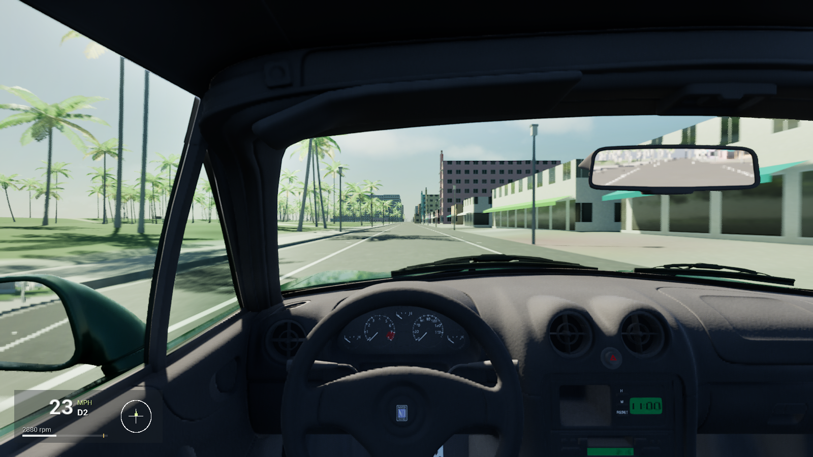

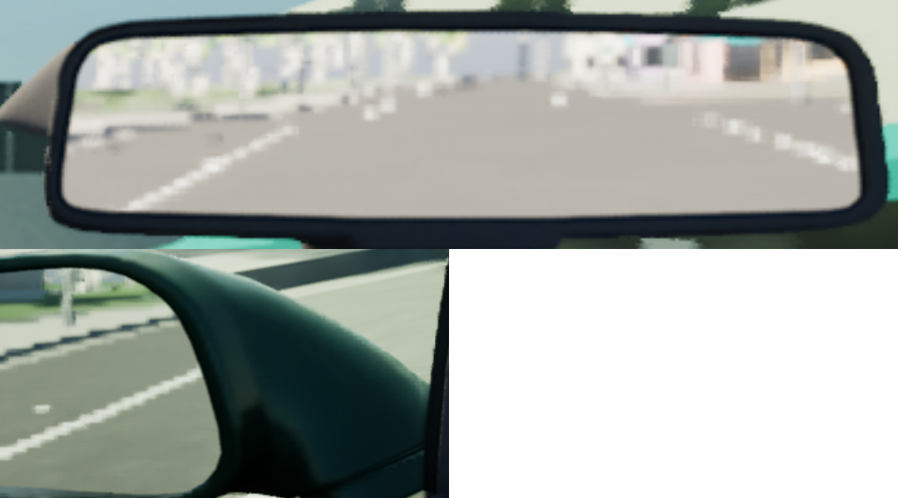

### Moving traffic (11 November 2026)

`ASimCruiseTraffic` (spawned by the streamer in drawn runs) keeps `simcruise.Traffic.Cars` (20) `ASimCruiseTrafficCar`s within 260 m of the player's car: each is a car body from the parked-car pool and colours, moved kinematically (a blocking box the player can hit) and posing its wheels through `ISimCruiseWheelStateProvider` (roll from distance, steer from the yaw rate by a bicycle model, brake lamps, lamps at night). A car's path is a tile's road ribbon driven in a direction: its pose is the ribbon's centre line offset by `SimCruiseTrafficModel::LaneOffsetM`, the rightmost travel lane the markings draw (`SimCruiseLanes::RightLaneCentreM`, inside any parking lane on the driver's right; on a two-way street mirrored per direction), at the carriageway's height. A ribbon follows its street through junctions, so a car decides at each junction along it (`SimCruiseTrafficModel::NextDecisionS`: the centre of the next run of stations another carriageway cuts, `FSimCruiseRibbonSide::Cut`) and at its end: 45 m before, it picks among straight on (weight 3) and the public ribbons whose carriageway is within reach of that point on this or a neighbouring tile (`GatherSegments`), either direction the one-way rules allow, no U-turns, a turn weight 1; there it moves onto the new ribbon and eases the position and heading jump out over about 0.7 s, so a turn reads as a curve. Junctions have no signals in the bundled data (the tiles' `street_objects.signals` are empty; the Godot client fetched them live), so they run as US junctions without signals do: an approach stops when the crossing road ranks higher (a stop sign on the minor road) or ranks the same and neither is a major road (an all-way stop); the stop line, the crossing road's half width plus 2.5 m before the junction, is a stopped car 2 m past it to the IDM, so the front bumper stops on the line; stopped, the car waits at least 1.2 s and until no moving car is within 10 m of the junction, nothing that will not stop is due within 5 s, and no car waiting at the junction stopped before it. The tile builder draws the same rule (`SimCruiseLanes::ApproachStops`): where another public carriageway starts to cross a ribbon's centre line, an approach that stops gets an 18 in white stop bar across its travel lanes (two-way: the driver's half, inside the parking lane) `SimCruiseLanes::StopLineSetbackM` (5.25 m: the crosswalk's 1 m setback and 10 ft, then 4 ft, MUTCD 3B.16) before the crossing carriageway, and an R1-1 stop sign (`SimCruiseTileDetail::AddStopSign`: 30 in octagon, 0.75 in white border, STOP in 10 in block strokes, bottom 7 ft above the curb, 2 in galvanised square post) on the driver's right behind the curb; the traffic's stop line is the same distance from the crossing carriageway's edge. About 280 signs stand on the four Miami Beach tiles round the start (logged per tile). Every car also brakes for any car (not one waiting at its line) or the player within 3 m of its path in the next 2.5 s (8-25 m). A drive capture logs the counts every 5 s; on Ocean Drive: `20 cars, 19 moving, 0 waiting at stops, 1 standing elsewhere ... 15 ribbon changes, 11 stops passed` after 25 s. Speed: the class's usual US limit times 0.9-1.1, capped into a turn so the car brakes at 1.5 m/s^2 to 7 m/s (30 degrees) .. 4.5 m/s (90 degrees); the Intelligent Driver Model (a 1.4, b 2.0 m/s^2, s0 2 m, T 1.4 s) behind the nearest car or the player within 1.9 m of its lane line and 80 m ahead. Cars spawn on a random public ribbon 60-260 m away and out of the camera's view (anywhere from 25 m in the first 3 s), never within 15 m of another, and leave beyond 320 m or when their tile unloads. A drive capture logs every 5 s, for example `20 cars, 20 moving, mean 12.7 m/s, 4 ribbon changes`. `SimCruise.World.Traffic` checks the model: free acceleration, settling at the leader's speed 17.6 m behind at 10 m/s, stopping short of a stopped car, mirrored lanes on a two-way street, one centred lane on a narrow one-way street with parking, the limits. Not yet: signals (no data bundled), lane changes, oncoming cars yielding at left turns.

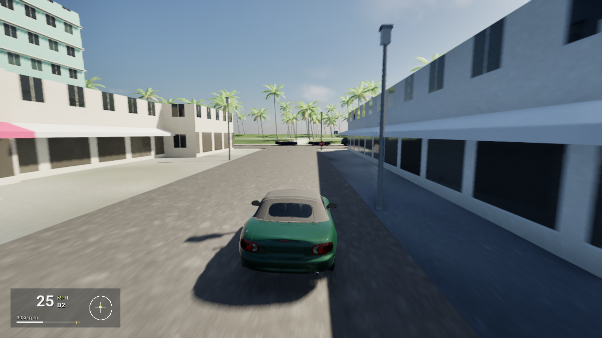

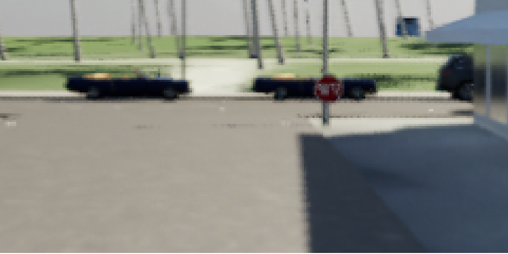

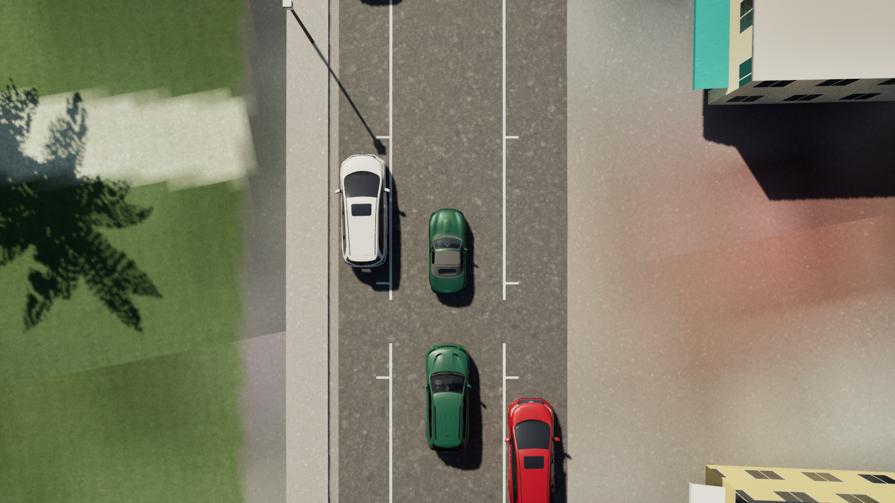

### Parked cars (11 November 2026)

The tile builder walks each parking lane between the painted stall ticks (one 6.7 m stall per pair, on the same world-anchored phase as the ticks) and keeps a little over half of the stalls (58 %, a hash of the stall's world position, so a stall is always taken or always free), none within 12 m of a crossing road (MUTCD: no parking within 20 ft of a crosswalk). A car stands 25-40 cm off the curb, facing the traffic on its side (on a one-way street, its direction), turned up to 1.5° off true. The tile places them three a frame across the tiles (`PlaceParkedCars`) as `ASimCruiseCarPresentationActor`s attached to the tile (so they ride the floating origin), each with a box round its body for collision; about 800 stand on the four Miami Beach tiles round the start.

Which car: the bundled models that have a fitted presentation: the NB, the Mustang and the C8 about 12 % each, and four of the traffic models, which have no driving data and are fitted to the dimensions in their profile's `parked` block (the maker's wheelbase, track and tyre size): Tesla Model 3 16 %, Jeep Grand Cherokee 16 %, Ford F-150 Raptor 16 % (fitted as the SuperCab: the model's length is 1.658 wheelbases, the SuperCab's 1.647 and the SuperCrew's 1.599) and Honda Odyssey 18 % (its lamps, front and back, are one textured material, drawn as authored). `SimCruise.Presentation.Rig.ParkedCars` checks that each fits within 4 % of its published length. The Accord (one texture atlas, glass included), the CR-V (several colour variants' paints) and the Tahoe (unnamed materials) are left for later. Colours: repainted in about the shares US cars come in (white 25 %, black 20 %, grey 18 %, silver 11 %, blue 9 %, red 9 %, a few green, orange and yellow); the Mustang's colour lives in its texture atlas and stays. A parked car draws less: no tick, nothing beyond 150 m, no part in Lumen's scene, and from 25 m its glass and lenses swap to an opaque copy (dark glossy glass, lenses in their colour) that itself stops at 80 m.

Cost: in single profiled frames the parked cars add about 0.5 ms (Lumen card captures). Measured on 11 November while the laptop's GPU was held to 28 W (driver: software power cap), everything ran about 2.6 times slower than in the table below, so the cost is given relatively: no difference with the mirrors off or capturing every frame, and 10 % with the mirror capture every third frame, which is still to be explained at full power.

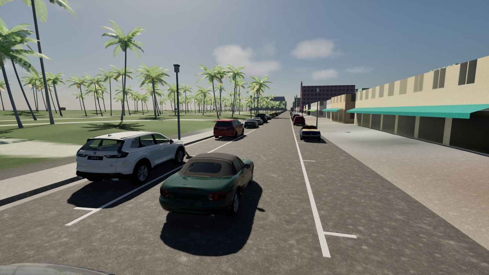

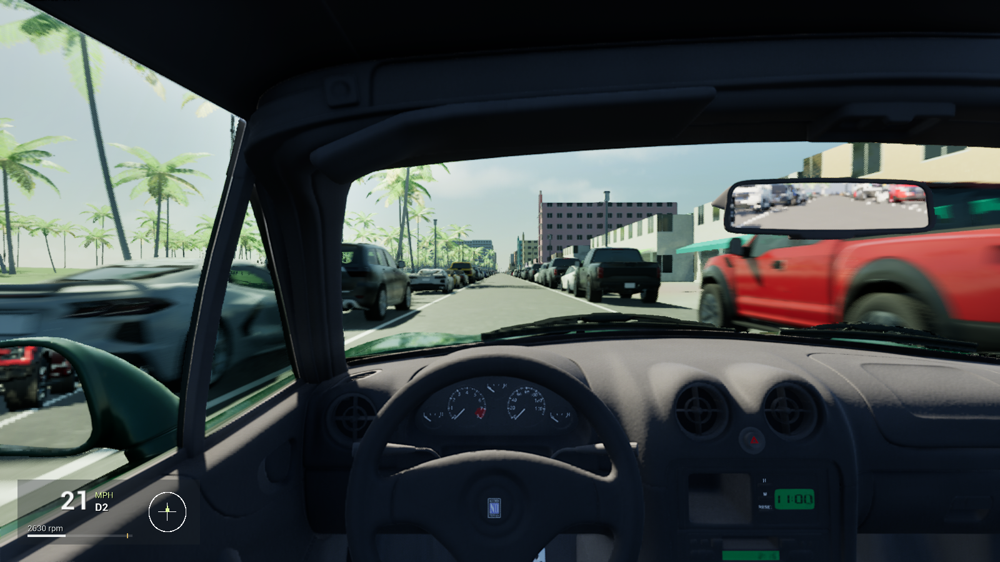

### Frame time on the drive (11 November 2026)

RTX 2070 Super Max-Q, 1920x1080 full screen, parked at the Ocean Drive start at 11:00, `-SimCruiseDrivePerf`:

| Preset | Driver's seat | Chase view |
|---|---|---|
| Medium (58 %) | 94 fps, GPU 10.2 ms | 107 fps, GPU 8.9 ms |
| High (67 %, the default here) | 70 fps, GPU 13.7 ms (p99 frame 17.7 ms) | 85 fps, GPU 11.3 ms |
| Ultra (75 %) | 45 fps, GPU 21.5 ms | 59 fps, GPU 16.5 ms |

Round 2's world first measured 62 fps at High in the seat. `ProfileGPU` put 2.1 ms of its 15 ms in the volumetric cloud shadow map (at 384 texels and 24 steps, for a 12 % cumulus sky); High now marches a 192-texel map in 12 steps over 20 km (100 m texels, the same as before over 50 km): 0.56 ms, with no visible difference. The rest of the High frame: Lumen diffuse GI 1.9 ms, virtual shadow maps 2.1 ms (1.0 ms of it the non-Nanite tile meshes), TSR 1.7 ms, volumetric clouds 0.85 ms, base pass 0.5 ms.

### Known gaps

- The start is the rightmost lane's centre of Ocean Drive, which the bundled OpenStreetMap data draws one-way southbound.
- Only the bundled start has been captured; `-SimCruiseStart=` needs the helper.
- The drive's frame time at Ultra has not been measured (only the lighting lab's).
- Plan 04's slide-catch gate for the countersteer allowance still has to be run on the real car.
