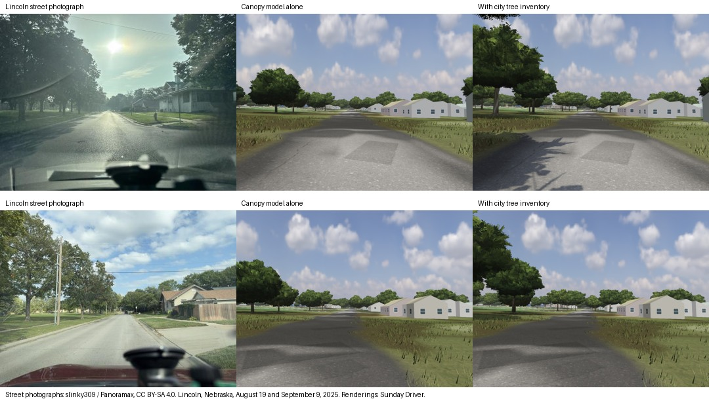

# Lincoln street tree holdout

> Former name: this study was written when SimCruise was called "Sunday Driver"; the app, paths and commands it mentions under that name are now SimCruise.

Each row shows a public street photograph, the previous canopy model, and the same scene using municipal trunk coordinates, diameters and available species. The two photographs come from separate drives by slinky309. The comparison sheet is licensed under [CC BY-SA 4.0](https://creativecommons.org/licenses/by-sa/4.0/).

| Photograph | Reference camera | Field of view and pitch |
| --- | --- | --- |
| [August 19, 2025](https://panoramax.xyz/#focus=pic&pic=8889f6fa-34ff-4959-adb9-7d162c46b68c) | 40.808013889, −96.675002778, heading 91° | 74° horizontal, 3° above level |
| [September 9, 2025](https://panoramax.xyz/#focus=pic&pic=e018d3fd-228a-4026-90f4-661ca53b6729) | 40.807991667, −96.674930556, heading 90° | Assumed 74° horizontal, 4° above level |

Both game cameras were 1.65 m above the modeled road. For September the recorded compass heading of 130° disagreed with both the visible street and the GPS positions immediately before and after the image. Those points spanned 25.5 m due east, which supplied the comparison heading. Pitch was estimated from the road horizon. The September photograph was withheld when developing the stem matching algorithm.

Each game pair was rendered within one paused scene after canopy, building and imagery loads. The right-hand image used municipal stem positions. For the middle image all affected tiles reverted to their original canopy peaks, dropping stems sized from peers. Materials, camera, light, shadows and map inputs were held fixed. The trunks and shade along the left curb moved closer to both photographs. Houses and trees outside inventory coverage still differ visibly. The September left crown still sits somewhat too low. Municipal records do not describe the private trees that fill much of the right-hand sky in August.

For the September photograph the mean absolute difference in left-curb canopy boundary height fell from **26.0 to 14.7 percentage points of frame height**. The images were resized to 400 × 300. Ten columns sampled x = 3.5%, 7.5%, …, 39.5%. The upper canopy edge was the first five consecutive rows in which at least three of five pixels satisfied G ≥ R−3, G > B+4, R < 142, G < 152 and B < 142, searching the upper 60% of the frame. The August windshield glare turns much of the real canopy gray, so this color test does not reliably identify its edge. This metric covers one strip of vegetation in one unobstructed photo.

## Data and reproduction

The Lincoln tile (15168,24617 at zoom 16) held 306 eligible survey stems and 337 original canopy peaks at the November 7, 2026 check. The helper uniquely matched 75 and sized another 39. Camera-ready geometry passed all 114 municipal stems in that tile. Each added stem required at least five same-tile peers with a comparable measured trunk diameter and crown class. The median peer height and width are local estimates. Trunk diameter feeds the near-player collision geometry. The visible mesh represents a general tree form. The optional city lookup made one cold request and no requests on the second run. No edit or download timestamp is substituted for the date the tree was measured.

Cambridge City Hall (19823,24236) yielded 331 eligible stems, 43 uniquely matched canopy peaks, and 88 stems sized from peers. The nearby tile 19818,24238 returned no city stems. The helper makes no city requests outside the two municipal source extents. Each municipal tile response is capped at 650 rows and 448 KiB. It skips incomplete responses, gates transient failures for an hour and caches valid responses for 30 days under the game's existing size-bounded cache.

From the source root, the pure matching and cache tests run with `bun lab/check_civic_trees.mjs`. For a live lookup, install dependencies with `bun install --frozen-lockfile`, then run twice with the same cache directory:

    bun helper/atlas.mjs canopy /tmp/sunday-driver-canopy 15168 24617
    bun helper/atlas.mjs canopy /tmp/sunday-driver-canopy 19823 24236

The extra city records contain contemporary public inventory ID, measured diameter at breast height (inches converted to meters), species labels when available and the original modeled peak. Most private-yard trees have no municipal record. Changes in individual trees between the imagery, height model and inventory dates remain possible. Canopy heights use WRI and Meta's [Version 2 canopy-height model](https://registry.opendata.aws/dataforgood-fb-forestsv2/).

- © City of Lincoln / Lancaster County Geospatial Services, Lincoln Parks and Recreation. Its open-data policy grants reuse and redistribution subject to city copyright. The forestry plan documents the survey and its diameter measurements in inches. [Official tree layer](https://gis.lincoln.ne.gov/public/rest/services/Parks/Trees/MapServer/0) · [Council resolution A-89931](https://www.arcgis.com/sharing/rest/content/items/df312b42047343ecada9a67ca17c2970/data) · [Urban forestry report](https://www.lincoln.ne.gov/files/sharedassets/public/v/3/parks-amp-rec/community-forest/eabrandrplan.pdf)
- City of Cambridge GIS and Cambridge Public Works. Its regularly updated tree layer supplies recorded planting sites, current tree state, stem count and diameter in inches. [Data dictionary and PDDL 1.0 license](https://www.cambridgema.gov/gis/gisdatadictionary/environmental/environmental_streettrees) · [Hosted feature layer](https://services1.arcgis.com/WnzC35krSYGuYov4/arcgis/rest/services/Trees/FeatureServer/0)
- The published 63-city archive covers additional cities and has no Lincoln file. This release streams the two current municipal layers. [McCoy et al., 2022](https://datadryad.org/dataset/doi:10.5061/dryad.2jm63xsrf)
