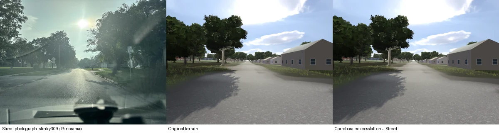

# Ground-surveyed road crown and camber

On a subsequent tile visit the renderer can use the measured side slopes of pavement. It requires two distinct ground-survey strips, a uniquely matched mapped road, and road and traffic-control geometry around the candidate. Three US tiles currently include that mapped safety register. The normal driving test exercised Lincoln, Nebraska, Lewisburg, West Virginia, and Anchorage, Alaska. Their public flights were collected in 2015–2017. The evidence describes the pavement at collection time.

| Low-speed normal Miata drive | Distance | Four tire contacts | Worst tire ray vs visible mesh |
| --- | ---: | ---: | ---: |
| J Street, Lincoln | 41 m | 629 / 629 physics frames | 0.072 mm |
| South Court Street, Lewisburg | 77 m | 1,126 / 1,126 | 0.090 mm |
| North Jefferson Street, Lewisburg | 47 m | 671 / 671 | 0.091 mm |
| K Street, Anchorage | 47 m | 708 / 708 | 0.046 mm |

The current terrain held the lane within 3.89 cm across these runs. K Street's prior low-detail ground climbed 57% at its entry. The transverse correction correctly abstained on that source. The normal 3DEP 1/3 arc-second terrain and road conditioning pass the longitudinal gate there. The general road and terrain fallback still applies on unsupported roads. [Machine-readable measurements](receipt.json)

**Independent accuracy.** Separate USGS octree nodes selected by geographic overlap and obtained only for the lab supplied ground returns from the second aircraft strip. No returns in those nodes participated in slope fitting or run acceptance. Only portions with multiple independent returns on both sides were scored. The comparison removes the estimated longitudinal gradient and the median vertical registration offset within each six-metre interval. Mean absolute transverse error on J Street fell from 6.11 to 2.43 cm across 47 held returns. On North Jefferson it fell from 8.00 to 1.40 cm across 656, and on K Street it fell from 2.59 to 2.31 cm across 51. South Court has a contact test but insufficient bilateral evidence in the independent node. The Lincoln comparison below was captured for the earlier triangulation prototype at the held camera. A road crown changes relatively few pixels. The numerical comparison above evaluates the final actual Godot triangles.



The August 19, 2025 photograph is by slinky309. The comparison uses resized photographic and render panels. The reference positions the camera at 40.808016667, −96.675327778, heading 91°, horizontal field of view 74°. [Original Panoramax photograph](https://panoramax.xyz/#focus=pic&pic=202ef7e6-ea03-4311-a626-b9f3b8405a52) · [CC BY-SA 4.0](https://creativecommons.org/licenses/by-sa/4.0/)

**Streaming cost.** The ordinary district roof worker uses its existing bounded OSM/building tile and USGS 3DEP node downloads. It retains return number, number of returns and source ID alongside the unchanged xyz/class arrays. Classes remain 1, 2 and 6. Only class 2, unwithheld, with a nonzero source ID, participates in road fitting. No new public request is made for a road profile. All three test districts produced their sidecars entirely from retained ordinary sources. Replaying an unexpired older roof result preserves every roof. If raw nodes were pruned, the next normal roof refresh can try again. A replay with every Nebraska LAZ removed made zero requests and preserved the same eight roof profiles.

Godot reads eligible sidecars once when building a tile, on the existing worker. The candidate has no effect on already attached ground. Each tile has at most 16 district files and one readiness marker, limited by the existing global cache eviction. External preparation inputs belong to the operator. Runtime fitting caps retained ground returns, locally supported intervals, verified runs and fine triangles. On this Mac the final running game’s helper and Godot were tested in an isolated cache. Building the road refinement itself took 21–156 ms on the tile worker across six measured source/bank combinations. The extra mesh cost ranged from 1,484 to 16,408 triangles. Every output had zero open interior edges, zero inverted triangles and the identical physical face count. [Mesh checks and cache upgrade](receipt.json)

**Source and exclusions.** The offline register checks the OSM North America highway geometry and its separate crossing/traffic-control point layer. It rejects nonunique road identities, bridge/tunnel or nonzero layers, mapped crosswalks/signals, intersections, parallel ways, sharp bends and tile edges. Two small source queries for each of the three included registers transferred 17–36 KB per tile. A vector-tile fingerprint, independently checked road-geometry signature and one-year register lifetime prevent unverified rematches. OSM gaps remain possible. Both measured side slopes must agree across strips within 1.5 percentage points, with separate bilateral support, height, longitudinal and residual tests. At least three adjacent six-metre stations must pass. Actual terrain is checked across both lanes for 15 m on approach and departure. Absolute longitudinal grade over 16%, disagreement with measured grade over 7.5 points, or excessive relative height change prevent adoption. Tapered run ends, road margins and a conforming mesh preserve contact near transitions. No fee, key or third-party street-photo service is required by this path. [Road control negatives](negative-controls.json) · [USGS 3D Elevation Program](https://www.usgs.gov/3d-elevation-program) · [USGS public lidar files](https://registry.opendata.aws/usgs-lidar/) · [OSM North America highways](https://services6.arcgis.com/Do88DoK2xjTUCXd1/ArcGIS/rest/services/OSM_NA_Highways/FeatureServer/0) · [OSM mapped traffic points](https://services6.arcgis.com/Do88DoK2xjTUCXd1/ArcGIS/rest/services/OSM_NA_POIs/FeatureServer/0) · [OSM attribution and ODbL](https://www.openstreetmap.org/copyright)

## Reproduce or prepare another district

From the source root, with Bun's project dependencies and the normal source helper installed, run the commands below. The first request for an uncached district downloads the normal map and roof sources. Later ordinary drives reuse that cache. The generic offline register preparation uses Python with Shapely. The optional independent cloud validation uses NumPy and laspy with LAZ support.

```sh
bun lab/road-crossfall/fit-check.mjs
mkdir -p "$CACHE"
bun helper/atlas.mjs tile "$CACHE" 5479 18579 > Anchorage-tile.json
bun helper/atlas.mjs roofs "$CACHE" 5479 18579 1 2 44.84 > Anchorage-roofs.json
godot --headless --path game --script res://checks/CrossfallMeshCheck.gd -- Anchorage-tile.json "$CACHE" 1 --mesh-out Anchorage-mesh.bin
godot --headless --path game --fixed-fps 60 --audio-driver Dummy -- \
  --crossfall-drive "$PWD/lab/road-crossfall/Anchorage-route.json" "$PWD/drive-receipt.json" \
  --crossfall-cache "$CACHE" --require-crossfall
```

The route-input gate uses the actual game helper, map tile, steering, throttle, suspension and Jolt contacts. It measures every physics tick and every fourth frame's four physical wheel rays. The release flag requires the exact expected way, continuous four-wheel contact, the finish line, maximum 0.6 mm ray discrepancy and maximum 15 cm lateral lane error. For a packaged macOS build substitute the app's game executable for Godot and omit `--path game`. Use an absolute writable scratch cache for QA.

To prepare a new region, pass its actual base tile JSON and cached z14 vector binary to `python lab/road-crossfall/prepare.py BASE.json PARENT_MVT "$CACHE/road-controls-X-Y.json"`. PARENT_MVT is the original z14 vector containing that z16 tile. Preparation fails on partial provider returns. Mapped controls alone produce no geometry. The normal roof worker must independently find ground from two strips and subsequent road reconstruction must accept the transitions. To test another independent node, run `python lab/road-crossfall/held.py BASE.json DISTRICT_SECTIONS.json GODOT_MESH.bin TRAINING_ROOF_RESULT.json HELD.laz`. Preserve the source work-unit and node key in its filename as shown in the receipt. The tool refuses training node keys.
