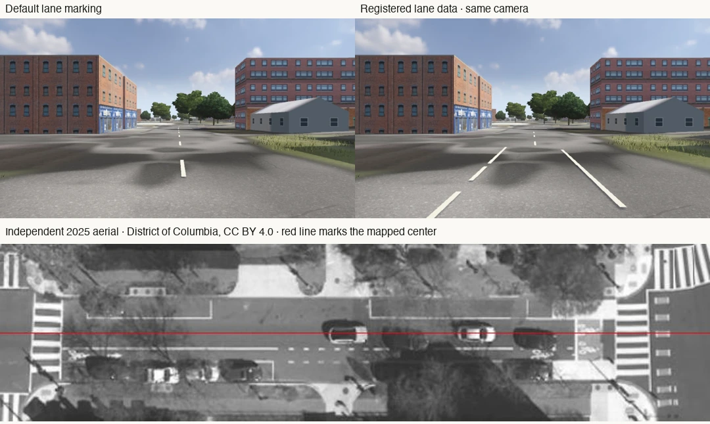
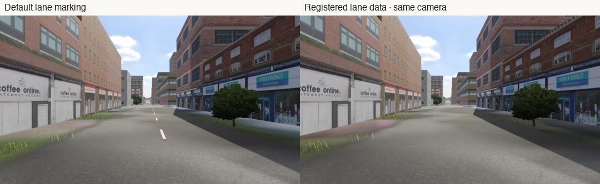

# Lane markings from mapped lanes and local surveys

> Former name: this study was written when SimCruise was called "Sunday Driver"; the app, paths and commands it mentions under that name are now SimCruise.

On a mapped one-way arterial with a single motor lane, the previous renderer drew a white divider between two implied motor lanes. The road-layout helper now checks explicit OpenStreetMap lane counts against the visible game road. Other refinements, such as painted parking boundaries, need separate observations.

The Q Street NW example covers 11.5 m of the 1100 block in Washington, DC. DDOT records one travel lane, two parking lanes and one bicycle lane across 32 ft. The mapped street agrees on parallel parking and places the cycle lane on the right. Surveyed curb spacing is 9.95 m against DDOT's 9.75 m. DC's 2021 and 2023 curb layers repeat the same coordinates here. They supply one geometry source. Separately flown orthophotos in 2023 and March 2025 support four white marks, starting at measured lateral offsets of −1.70 m and +1.70 m from the mapped road. Each strip ends where the two photographs stop agreeing. The loaded geometry has one left-side clear parking envelope, 9.5 × 2.02 m. The right-side bicycle boundary is insufficiently supported to emit a second envelope. The data describes potential space only. A placement consumer also needs its own occupancy and physical-clearance verification.

Southwest Harvey Milk Street in Portland is a separate offsite check. The regular helper read an explicit one-way, one-lane OSM way. Its geometry matches 60 m of one ordinary rendered game segment. No location-specific paint, surfacing or parking trace is bundled for Portland. Class-based paint remains on nearby unverified segments. The same registration test admitted 20 spans totaling about 756 m in the Washington tile and seven totaling about 198 m in the Portland tile.

## Runtime

The first visit can use an inferred divider until the source is available. The existing auxiliary worker can request a 2 × 2 district around the player or their next tile. This stage takes one grouped, unauthenticated HTTPS request, capped at 240,000 bytes, 280 ways and 3.2 seconds of transfer. Destination loading and physics continue independently. The shared disk cache reuses valid raw data for 28 days, suppresses duplicate in-flight requests per cache key, respects provider cooldowns, and retries missing or incomplete coverage after six hours. The worker registers the result to the active tile, then swaps its pavement mask and painted meshes together. In Portland this removed 114 inferred-paint vertices on the first visit. The same terrain material and colliders remained under the car through all 163 settled physics ticks. Neighbor tiles reuse the cached district. “Checked” can have zero matches. Missing, expired, incomplete or over-budget observations remain unknown. Each installation has its own cache.

The matcher requires an explicit single motor lane, one-way geometry, matching street name, near-parallel tangents and unique registration within 1.55 m. It steps past intersections and parallel streets, source-way ends and tile edges by 10 m. The geometry and width of the current base roads must match the recorded fingerprint. It clips the SVG and the raised stripe mesh, and uses the normal height function to draw observed paint over road banks and crossfall. It adds no collision objects and does not change the driving surface. Many streets lack direct paint evidence. A single-lane road may still have parking, a bike lane, a bus lane, or other edge paint.

## Checks

* Run `bun lab/road-layout/source-check.mjs` from the source root. The offline test covers an empty area, unknown lanes, two lanes, grade separation, intersections, a parallel impostor, conflicting overlapping ways, incomplete district reads, cache reuse and failure cooldown.
* To fetch or warm the source, run `tools/atlas road-layout /path/to/cache 10434 23439`. Run `tools/atlas tile /path/to/cache 10434 23439` to inspect actual registered spans. These apply to Portland OSM way 892193385 when the current source tile still matches. Washington uses 18745 25067. Names and upstream geometry can change.
* The independent source reproduction uses Python, NumPy, SciPy, Shapely, pyproj and Pillow. Run `python lab/road-layout/qstreet/reproduce.py /tmp/sunday-driver-qstreet`. It retrieves five geographically bounded source slices, checks the recorded edition by SHA-256, and rebuilds the same bundled markings and envelope. The source queries and byte counts are in [sources.json](qstreet/sources.json). The archived street names and source way positions are derived from the [OSM map snapshot](https://www.openstreetmap.org/way/696198842). The result processor rejects misregistered curb geometry shifted 2.5 m, an orthophoto shifted 3 m, and a conflicting second motor lane. [Control receipts](controls.json)
* Reproduce the normal eye-height camera with `--reference 38.911140041 -77.027931778 89.95 76 /tmp/dc.jpg 0 0 --reference-epoch 1743094800`. Portland uses `45.522540373 -122.682972984 111.54112`. Add `--without-road-layout` for the earlier lane behavior. At the normal Washington camera, bright centerline pixels with strong local contrast fell from 411 to 0. Of 79 projected samples on the four physically observed marks, 66 showed more than 35 levels of local contrast, up from zero. In Portland, 227 strong centerline pixels fell to zero. Its off/on captures had slightly different background streaming states. The exact projected road scopes and the four-tire driving test independently check the geometry. [Normal scene receipts](normal-scene-receipt.json)
* The ordinary Miata made a 45 m pass on Portland's USGS 3DEP ground. Four tires remained in contact for all 657 samples, peak lateral tracking error was 1.52 cm, and the largest tire-ray versus height error was below 0.005 mm. Run the game's `--crossfall-drive` diagnostic with [portland-route.json](portland-route.json) and a writable output filename.

## Sources and limits

Road tags and map geometry are © OpenStreetMap contributors, ODbL 1.0. Lane counts describe motor lanes. Parking and shoulder markings cannot be located from that number alone. The bounded live highway query uses Esri's OpenStreetMap North America replica. [OSM lane tagging](https://wiki.openstreetmap.org/wiki/Key:lanes) · [OSM parking tagging](https://wiki.openstreetmap.org/wiki/Street_parking) · [OSM license](https://www.openstreetmap.org/copyright) · [Live highway layer](https://services6.arcgis.com/Do88DoK2xjTUCXd1/ArcGIS/rest/services/OSM_NA_Highways/FeatureServer/0)

DDOT roadway block 4735282 and DC OCTO street-curb geometry describe Washington's physical cross section. The comparison sheet crops, rotates and annotates the District's March 27, 2025 aerial photograph. Open Data DC publishes the orthophoto under CC BY 4.0. The 2023 photograph supplies a separate acquisition. The game does not download these municipal products for every player. [DDOT inventory](https://maps2.dcgis.dc.gov/dcgis/rest/services/DCGIS_DATA/Transportation_WebMercator/MapServer/163) · [2023 curbs](https://maps2.dcgis.dc.gov/dcgis/rest/services/DCGIS_DATA/Planimetrics_2023/MapServer/3) · [2023 orthophoto](https://opendata.dc.gov/datasets/aerial-photography-orthophoto-2023/about) · [2025 orthophoto and license](https://opendata.dc.gov/datasets/aerial-photography-orthophoto-2025/about) · [CC BY 4.0](https://creativecommons.org/licenses/by/4.0/)

National aerial images at the game's ordinary texture scale sampled about 1.86 m per pixel in this test. They did not resolve the 13 cm stripe, so they contribute ground appearance only. Overture transportation permits width rules, but a bounded test of the October 2026 I Street area found no usable lane or width observation. HPMS roadway summaries are a different scale from registerable physical stripes. [Overture transportation schema](https://docs.overturemaps.org/schema/reference/transportation/segment/) · [FHWA HPMS](https://www.fhwa.dot.gov/policyinformation/hpms/fieldmanual/hpms_field_manual_dec2016.pdf)
